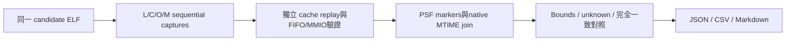
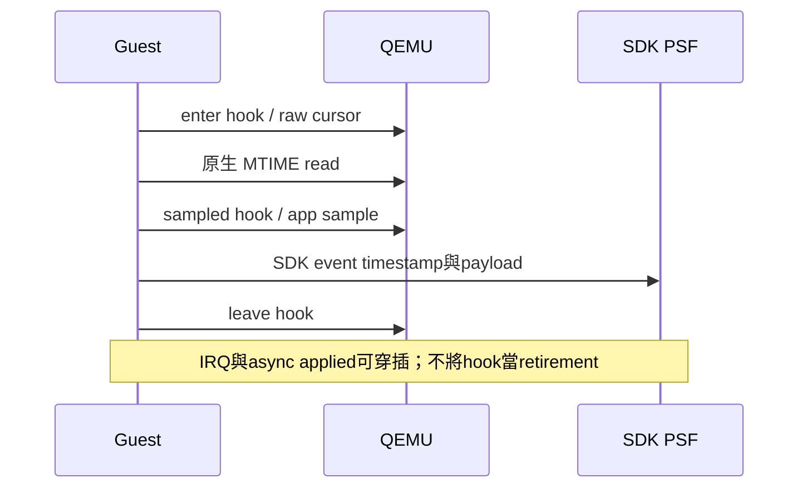

# C2b clock-anchor pilot 報告

狀態：**complete**；有效 runs：16／16。
解析度評估：unrated。此處為相對模擬模型，時間區間不代表逐事件 timestamp 或產品 SDK CPU loading。

| Run | Config | Injection | Rows | Model cycles | Unknown rows | Unknown % | Alignment | 證據 |
|---|---|---:|---:|---:|---:|---:|---|---|
| baseline-L-i1-r1 | L | 1 | 431823 | 1109492 | 431823 | 100.000000 | unavailable | [capture](../baseline-L-i1-r1/capture.json) |
| baseline-C-i1-r1 | C | 1 | 431823 | 1109492 | 431823 | 100.000000 | unavailable | [capture](../baseline-C-i1-r1/capture.json) |
| baseline-O-i1-r1 | O | 1 | 431823 | 1109492 | 311 | 0.072020 | verified-bounds | [capture](../baseline-O-i1-r1/capture.json) |
| baseline-M-i1-r1 | M | 1 | 430358 | 1102753 | 430358 | 100.000000 | unavailable | [capture](../baseline-M-i1-r1/capture.json) |
| baseline-L-i0-r1 | L | 0 | 425539 | 1084928 | 425539 | 100.000000 | unavailable | [capture](../baseline-L-i0-r1/capture.json) |
| baseline-C-i0-r1 | C | 0 | 425539 | 1084928 | 425539 | 100.000000 | unavailable | [capture](../baseline-C-i0-r1/capture.json) |
| baseline-O-i0-r1 | O | 0 | 425539 | 1084928 | 311 | 0.073084 | verified-bounds | [capture](../baseline-O-i0-r1/capture.json) |
| baseline-M-i0-r1 | M | 0 | 424074 | 1077613 | 424074 | 100.000000 | unavailable | [capture](../baseline-M-i0-r1/capture.json) |
| pbuf-L-i1-r1 | L | 1 | 426805 | 1100219 | 426805 | 100.000000 | unavailable | [capture](../pbuf-L-i1-r1/capture.json) |
| pbuf-C-i1-r1 | C | 1 | 426805 | 1100219 | 426805 | 100.000000 | unavailable | [capture](../pbuf-C-i1-r1/capture.json) |
| pbuf-O-i1-r1 | O | 1 | 426805 | 1100219 | 311 | 0.072867 | verified-bounds | [capture](../pbuf-O-i1-r1/capture.json) |
| pbuf-M-i1-r1 | M | 1 | 425340 | 1093170 | 425340 | 100.000000 | unavailable | [capture](../pbuf-M-i1-r1/capture.json) |
| pbuf-L-i0-r1 | L | 0 | 420521 | 1075543 | 420521 | 100.000000 | unavailable | [capture](../pbuf-L-i0-r1/capture.json) |
| pbuf-C-i0-r1 | C | 0 | 420521 | 1075543 | 420521 | 100.000000 | unavailable | [capture](../pbuf-C-i0-r1/capture.json) |
| pbuf-O-i0-r1 | O | 0 | 420521 | 1075543 | 311 | 0.073956 | verified-bounds | [capture](../pbuf-O-i0-r1/capture.json) |
| pbuf-M-i0-r1 | M | 0 | 419056 | 1067856 | 419056 | 100.000000 | unavailable | [capture](../pbuf-M-i0-r1/capture.json) |

## 對照結果

| Candidate | Injection | 類型 | 結果 | 差異 |
|---|---:|---|---|---|
| baseline | 1 | transparency | True |  |
| baseline | 1 | transparency | True |  |
| baseline | 1 | marker-effect | True |  |
| baseline | 0 | transparency | True |  |
| baseline | 0 | transparency | True |  |
| baseline | 0 | marker-effect | True |  |
| pbuf | 1 | transparency | True |  |
| pbuf | 1 | transparency | True |  |
| pbuf | 1 | marker-effect | True |  |
| pbuf | 0 | transparency | True |  |
| pbuf | 0 | transparency | True |  |
| pbuf | 0 | marker-effect | True |  |

## Marker 效應：O 減 M，以 M 為分母

| Candidate | Injection | Model cycles 差 | Model % | Guest ns 差 | Guest % | PSF bytes 差 |
|---|---:|---:|---:|---:|---:|---:|
| baseline | 1 | 6739 | 0.611107 | 14500 | 0.568115 | 160 |
| baseline | 0 | 7315 | 0.678815 | 1100 | 0.321449 | 160 |
| pbuf | 1 | 7049 | 0.644822 | 15200 | 0.601004 | 160 |
| pbuf | 0 | 7687 | 0.719854 | 1000 | 0.295596 | 160 |

## Bounds 分布

| 項目 | 最小 | 中位數 | 最大 |
|---|---:|---:|---:|
| sdk_quantum_ns | 100 | 100 | 100 |
| hook_bracket_rows | 269 | 269 | 269 |
| candidate_cursor_span | 0 | 0 | 0 |
| sample_to_sdk_ticks | 0 | 4.5 | 13 |

## Code size：整個 build 的差值

| Candidate | .text 新／舊／差值 bytes | .rodata 差值 | .bss 差值 |
|---|---|---:|---:|
| baseline | 39782 / 39014 / 768 | 148 | 0 |
| pbuf | 39782 / 39014 / 768 | 148 | 0 |

## 判讀與限制

L/C與C/O逐項核對完整packet順序／bytes、oracle、資源、raw成本、PSF原bytes與guest計時；任何差異都不正規化。
O/M差值以M為分母，分母0為null；負差值保留。host wall與child CPU僅列本次原始值，不推算穩定overhead百分比。
anchors.csv列原PSF offset、sample、量化bounds、候選數與context；prefix／suffix及缺證據維持unknown，不插值。
context是raw rows的歸屬，不是CPU時間百分比。marker bracket可含IRQ／其他task，exclusive CPU成本維持unavailable。
request沒有安全clock，因此不提供request→applied ns latency。queue欄位僅表示cursor距離。
code-size保存size -A、sections、symbols、反組譯與map。新舊ELF差值包括helper／init／layout；O/M共用ELF，不能用它量SDK編譯開關大小。
本輪每組只有一份配對，未驗證重複穩定性、實機PMU、產品SDK開銷、UART或Dashboard。

比較與原始host讀值見summary.json及comparisons.csv；所有檔案SHA見inventory.json。
