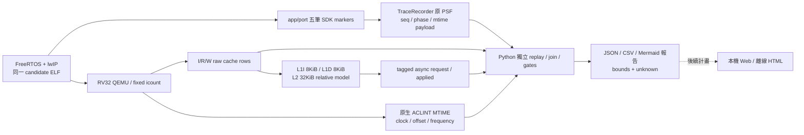
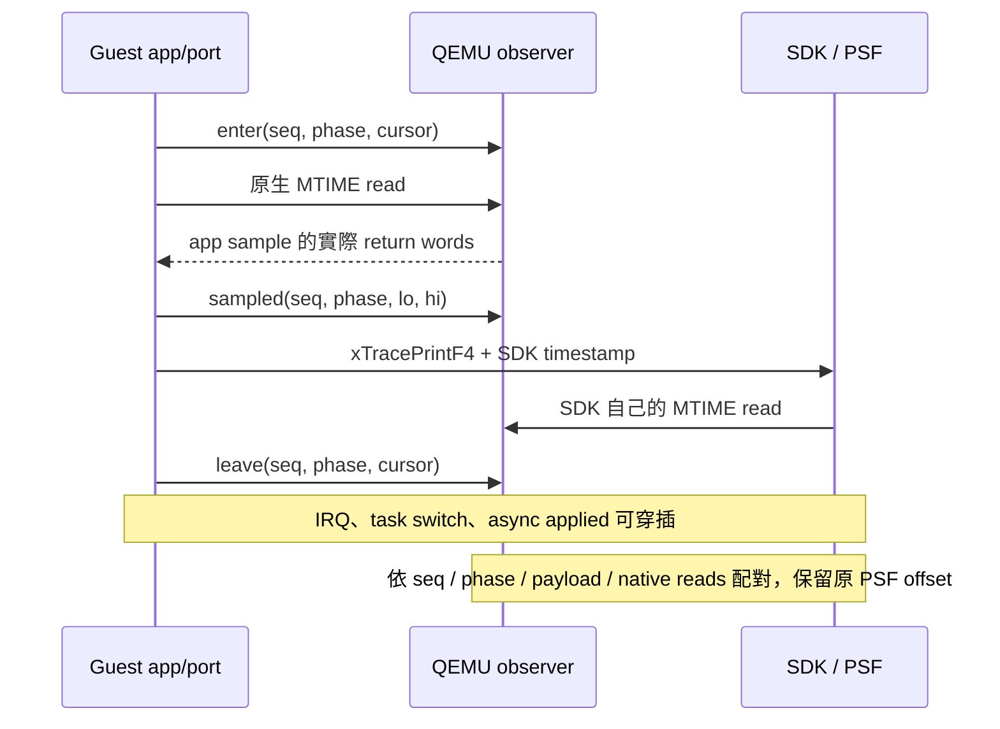
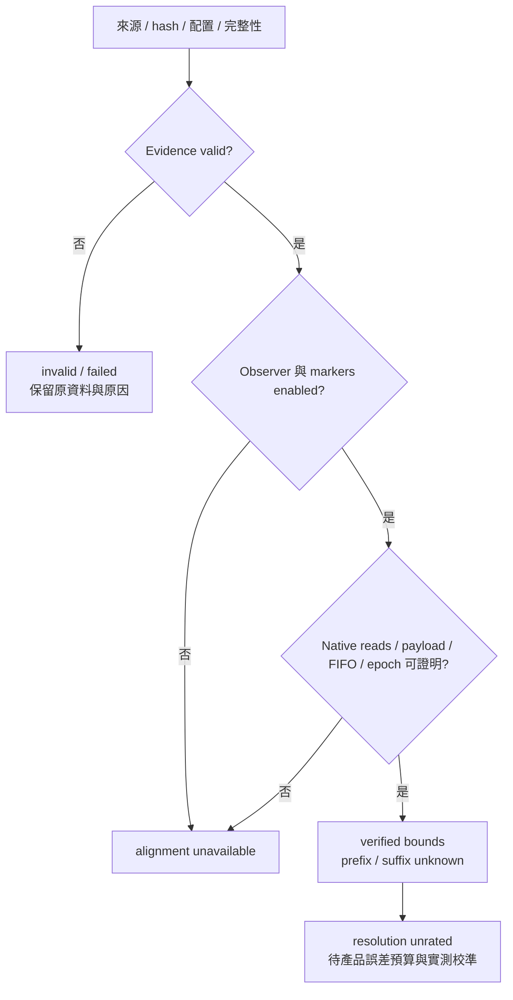

# C2b：PSF 與 cache 事件的有界時間對齊

更新：2026-11-03。**正式 16／16 runs 有效，四組對照通過，20 組 anchors 建立 verified bounds；完整封裝已實際還原。** 本頁說明本輪新增能力；[原研究報告與目錄](../README.md)保留 SDK、UART、CPU usage、cache 最佳化與 Dashboard 的歷次研究。Git 發布狀態見[驗收入口](../artifacts/verification/clock-anchor/acceptance-20261103/README.md)。

先讀本頁的結果與限制，再看[自動產生的逐 run 報告](../artifacts/verification/clock-anchor/acceptance-20261103/preview/analysis/report.md)、[完整 JSON](../artifacts/verification/clock-anchor/acceptance-20261103/preview/analysis/summary.json)、[anchor CSV](../artifacts/verification/clock-anchor/acceptance-20261103/preview/analysis/anchors.csv)與[比較 CSV](../artifacts/verification/clock-anchor/acceptance-20261103/preview/analysis/comparisons.csv)。CSV 保留帶正負號的數值，文字欄防範 spreadsheet formula；可用試算表檢查。

## 1. 解決什麼問題

過去 PSF task／IRQ 事件與 cache raw stream 分別有自己的順序與計時來源。將事件索引乘上模型成本，無法證明它與 PSF timestamp 同時發生。C2b 增加五筆 SDK user events、QEMU 原生 MTIME 觀測與非同步成本 request／applied ledger，再用 Python 獨立驗證。

本輪能證明「哪些 raw rows 位於兩個已驗證 anchors 之間」及其保守時間區間。每一列的精確執行 timestamp、instruction retirement、產品硬體時間精度仍未量到。缺少證據的資料維持 unknown，解析度評估為 **unrated**。



## 2. 實驗範圍與對照

環境為 macOS 15.7.7 arm64、Python 3.13.2、固定研究版 QEMU 9.2、RV32、single-vCPU、single-thread TCG、`-icount shift=0,align=off,sleep=off`。每指令基準 1 ns；模型每 memory cycle 2 ns。Cache 固定 L1I 8 KiB、L1D 8 KiB、L2 32 KiB、64 B line、4-way LRU、WT／WA，設定來源為 [sysram-10-small.json](../cases/timing/sysram-10-small.json)。這些是可比較的模型參數。

工作負載為 [A02](../cases/tcp/workload-matrix-v1.json)：64-byte request，segments `[13,0,51]`，兩輪 TCP；baseline 與 pbuf 各建一份新 ELF，所有開關都重用該 candidate 的 ELF。

| 配置 | QEMU／collector | SDK markers | clock observer | 目的 |
|---|---|---:|---:|---|
| L | 舊 relative binary／原 collector | on | off | 舊行為基準 |
| C | 新 binary／tagged 成本路徑 | on | off | L→C 檢查 patch 透明性 |
| O | 與 C 相同 binary／collector／ELF | on | on | C→O 檢查 observer 透明性 |
| M | 與 O 相同 binary／collector／ELF | off | on | O−M 量 marker body 及連帶效應 |

`2 candidates × 2 injection modes × 4 configurations = 16 runs`，每組 repeat=1。先完成 baseline／injection1 的四次 smoke，獨立重驗成功後只補十二次，沒有覆寫原四次。Injection0 仍計算 cache model cycles，但不把這些成本加到 guest virtual time；icount 的每指令基準仍存在。

L/C 及 C/O 的封包順序／bytes、oracle、資源、raw rows／成本、PSF bytes、context 與 guest 計時逐項完全一致。四組全通過，沒有以 tolerance 或正規化消除差異。每 run 都完成 25 packets、11,680 response bytes，應用 gate 通過；完整 raw 共 **6,812,892 rows**。

## 3. 怎麼與 FreeRTOS／SDK 結合

本輪修改 app／port，**FreeRTOS kernel 與 TraceRecorder SDK source 沒有修改**。原有 RTOS recorder hooks 延續既有設定；新增 marker 是應用層事件，不能取代 task-switch／IRQ hooks。

實作在 [clock_anchor.c](../firmware/port/clock_anchor.c)及[header](../firmware/port/clock_anchor.h)：

1. 初始化用 `xTraceStringRegister()` 註冊 channel `C2B` 與格式 `C2Bv1|%u|%u|%u|%u`。
2. 只在選定五個 phase 呼叫 `poc_clock_anchor(phase)`；用 semihosting command line 選 mode0／1。
3. mode1 依序執行 enter hook、`poc_mtime()`、sampled hook、`xTracePrintF4(channel, format, seq, phase, lo, hi)`、leave hook。
4. mode0 保留共同 guard／呼叫位置，但不取樣、不發這五筆 user events。

API 定義：[trcString.h](../references/baseline/percepio/TraceRecorder/include/trcString.h)、[trcPrint.h](../references/baseline/percepio/TraceRecorder/include/trcPrint.h)。既有 FreeRTOS 整合與 PSF parser 見[SDK 能力研究](research/c2b-sdk-anchor-capabilities.md)。搬到公司平台前仍要比對實際 FreeRTOS／SDK 版本、hardware port、timer 與既有 hooks；此 POC 並未驗證公司 source。



## 4. 觀測代價：本輪實測

O 減 M，百分比分母為 M；每列只是一組配對。

| Candidate | Injection | Model cycles 差 | Model % | Guest elapsed ns 差 | Guest % | PSF bytes 差 |
|---|---:|---:|---:|---:|---:|---:|
| baseline | 1 | 6,739 | 0.611107% | 14,500 | 0.568115% | 160 |
| baseline | 0 | 7,315 | 0.678815% | 1,100 | 0.321449% | 160 |
| pbuf | 1 | 7,049 | 0.644822% | 15,200 | 0.601004% | 160 |
| pbuf | 0 | 7,687 | 0.719854% | 1,000 | 0.295596% | 160 |

這是五個 helper／SDK event bodies、cache 與排程連帶效應的模型窗口差值；初始化發生在測量窗口之外。Hook bracket 可能包含其他 context，因此 **exclusive SDK CPU cost unavailable**。Context 的 raw-row 比例也不能直接當 task CPU time%。Host wall／child CPU 原始值保存於 JSON；單次配對不推算穩定 host overhead%。尚未做三次重複與變異分析。

每筆 marker 32 bytes：8-byte event header 加 6 個 32-bit words；五筆共 **160 bytes/run**。以未來 marker rate `r events/s` 估算，只有這類事件的 payload 下限為 `32 × r B/s`；全 trace 還包含 task／IRQ／queue 等事件與傳輸封裝。本輪使用本機檔案／semihosting，沒有 UART 吞吐或雲端速率量測。

| Whole-build size | baseline | pbuf | 解釋 |
|---|---:|---:|---|
| 新 `.text` | 39,782 B | 39,782 B | 歷史 reference 為 39,014 B |
| `.text` 差 | +768 B | +768 B | 含 helper／init／layout 差異 |
| `.rodata` 差 | +148 B | +148 B | 非 SDK 單獨編譯開關 |
| `.bss` 差 | 0 B | 0 B | 未量 stack／peak RAM，不能宣稱零 RAM overhead |

O/M 使用同 ELF，因此無法推導 compile-out SDK size。原始 `size -A`、sections、symbols、反組譯與 map 都在 [code-size](../artifacts/verification/clock-anchor/acceptance-20261103/preview/analysis/code-size/)。

## 5. Bounds、unknown 與精度

四份 O capture 各五筆 anchors，全部配對成功。

| O run | Raw rows | 可夾在 anchors 間的 rows | Unknown rows |
|---|---:|---:|---:|
| baseline injection1 | 431,823 | 431,512 | 311 |
| baseline injection0 | 425,539 | 425,228 | 311 |
| pbuf injection1 | 426,805 | 426,494 | 311 |
| pbuf injection0 | 420,521 | 420,210 | 311 |

| 20 anchors 統計 | min | median | max |
|---|---:|---:|---:|
| Native SDK quantum | 100 ns | 100 ns | 100 ns |
| Enter→leave bracket | 269 rows | 269 rows | 269 rows |
| 相符 SDK read 的 cursor span | 0 | 0 | 0 |
| App sample→SDK counter 差 | 0 ticks | 4.5 ticks | 13 ticks |

10 MHz timer 量化區間為半開區間，100 ns 是 counter quantum。它與 bracket 寬度、整體誤差、產品可接受精度不同；**不能宣稱 100 ns 對齊精度**。Prefix／suffix 留為 unknown，不插值補造時間。L/C observer-off、M markers-off 均依配置回報 alignment unavailable，並非假造 anchors。

Request clock 固定 `null`，只有安全 async applied callback 可觀察其 clock；沒有 request→applied ns latency。Raw cursor 反映已輸出的 rows 數，不代表退休指令數。App sample、SDK timestamp、native MMIO sample、PSF timestamp 仍分開保存。Counter wrap、非零 offset、重複 timestamp、缺 marker、序號 gap、EOF 缺實際 hook instruction、異動檔案與不合法 epoch 都有明確驗證路徑。



## 6. 驗證與失敗修正

| Gate | 結果／證據 |
|---|---|
| 完整 Python suite | 403 執行、398 passed、5 opt-in skipped；49.270 s |
| 明確啟用 guest／QEMU runtime | 5／5 passed、0 skipped；130.692 s |
| Review fix targeted | 46／46 passed；2.562 s |
| 全庫 Ruff check | passed |
| 本輪 Python format | passed |
| 全庫 format | **failed：10 個 baseline 舊檔**，與 `9c3c9aef` byte-identical；清單見[format debt](../artifacts/verification/clock-anchor/acceptance-20261103/verification/baseline-format-debt.json) |
| UI／Node／browser | 本輪未執行，沒有 UI 程式變更；既有截圖不冒稱新增畫面 |

測試與 runtime logs 見[verification](../artifacts/verification/clock-anchor/acceptance-20261103/verification/)。Fresh Astra/high whole-change review 找到兩項 Important，兩者都先看見 RED 再修到 GREEN，之後重跑完整 suite 與真 runtime；沒有 deferred minor。Reviewer 做 source review 與 42 個 pure unit checks，執行者另負責實際 QEMU／封裝驗收，不混稱 reviewer runtime。

| 發現 | 修正與來源 |
|---|---|
| QEMU 同 plugin 同事件註冊兩次 vcpu_init，後者取代 context init | runtime assertion 先 RED；改成單一 dispatcher 依序 context→clock。舊結果 timing bounds 可用但 context 為 unknown_cause，留作歷史，不列正式 IRQ 歸屬驗收。修正 `3cdb7794` |
| 最後 leave hook 的 cursor 等於 EOF 時，未要求真 instruction 存在 | EOF pending marker rows 必須清空；反例 RED→GREEN，`3e8a5fe2` |
| Restore 期間 manifest 替換，可能拿新 hash 當舊內容 receipt | 有界讀一次初始 bytes／SHA，結尾重驗同 SHA；替換反例 RED→GREEN，`3e8a5fe2` |

Formal capture source：`3cdb7794778bf608da6e86d189175c3cefb638b1`。獨立 revalidation／analysis／package source：`3e8a5fe27e1fbf922d7701b496b25ae021d84b3a`。後續文件／發布 commit 不冒稱原 capture source。[決策與代價](../artifacts/verification/clock-anchor/acceptance-20261103/decisions.md)保留每項 Ruling。

## 7. 資料放哪裡、怎麼還原

驗收入口：[acceptance-20261103](../artifacts/verification/clock-anchor/acceptance-20261103/README.md)。

| 路徑 | 用途 |
|---|---|
| `preview/analysis/` | 完整自動分析報告、JSON／CSV、code-size 證據 |
| `preview/<run>/` | PSF、packets、oracle、ELF／map、capture metadata；供閱讀的 projection |
| `preview-index.json` | 明列 preview 省略的 41 個 streams／歷史大檔及 SHA；不是完整 validator input |
| `restore/` | 完整原始資料、sources、工具與中間檔的 per-file gzip parts；每 part ≤64 MiB |
| `verification/` | 測試、review、實際還原、內層 source、移動後重新 hash 與發布收據 |

完整包含 **1,514 regular files，720,494,937 原始 bytes**；1,516 parts。Outer restore 已實際逐檔驗內容 SHA／mode。Manifest SHA 為 `9a55b8323647027839f3a10258c4cfa48013263a768b6f9a48419e53da7f1d75`。Manifest 的 creation status 刻意保留 `packaged-not-restore-verified`；驗收結果以獨立 [restore-check.json](../artifacts/verification/clock-anchor/acceptance-20261103/restore/restore-check.json)判定，避免改寫已驗證 manifest。

在完整 POC clone、Python 環境可用時，從 POC root 執行。`NEW_OUTPUT` 必須不存在，不能指向既有工作目錄：

```sh
PYTHONPATH=src .venv/bin/python - <<'PY'
from pathlib import Path
from tools.tcp.package_clock_anchor import verify_restore
print(verify_restore(
    Path('artifacts/verification/clock-anchor/acceptance-20261103/restore'),
    Path('artifacts/local/NEW_OUTPUT'),
))
PY
```

還原工具只需 Python stdlib，沒有增加第三方 requirements。一般測試／分析仍沿用既有 [pyproject.toml](../pyproject.toml)與 [runtime lock](../requirements-runtime.lock)。Restore 先驗分卷／完整 gzip SHA，以單一暫存 spool 加 64 KiB chunks 解壓；RAM 有界，但空間需原始 bytes 加最大單一 gzip。錯 part、缺 part、path traversal、symlink outer member、unsupported codec 或既有 output 都拒絕。

完整資料在 `NEW_OUTPUT/runset/`；另有 `host-tools/`、`compiled-tools/`、`sources/` 等輸入閉包，實際成員以 manifest 為準。完整 patched QEMU source 與 license、selected project source、kernel／SDK／lwIP、patch／overlays、兩個 QEMU binaries、ELF／map、locks、build logs、修正前 evidence 全保存。

內層 source tar 在 outer restore 只視為 opaque bytes。另一次獨立、安全目錄解包檢查已驗證 QEMU **75,847 entries = 75,782 regular files + 65 symlinks**，selected project **1,528 entries**；比對內容／mode／symlink target，[nested source receipt](../artifacts/verification/clock-anchor/acceptance-20261103/verification/task8-nested-source-restore.json)與 helper 保存完整過程。這一步未重新編譯。

## 8. 重跑方式與內網邊界

以下命令以原本機已安裝工具為前提，新的 output 名稱需自行唯一化；曾有 source 改變時不能 resume 舊 runset。

```sh
# 已有 accepted QEMU build；新建候選 ELF／collectors。
PYTHONPATH=src .venv/bin/python tools/tcp/prepare_clock_anchor_tools.py \
  --qemu-build-manifest .tools/c2b-clock-20261102-r3/build-manifest.json \
  --legacy-qemu .tools/qemu-time-control/qemu-system-riscv32-relative \
  --output runs/local/NEW_TOOLS

PYTHONPATH=src .venv/bin/python tools/tcp/run_clock_anchor_pilot.py \
  --tools runs/local/NEW_TOOLS/tools.json --output runs/local/NEW_RUNSET --stage smoke
# 只有 smoke gate 成立後，以下 full 才會補其餘 12 次。
PYTHONPATH=src .venv/bin/python tools/tcp/run_clock_anchor_pilot.py \
  --tools runs/local/NEW_TOOLS/tools.json --output runs/local/NEW_RUNSET --stage full

PYTHONPATH=src .venv/bin/python tools/tcp/analyze_clock_anchor_pilot.py \
  --runset runs/local/NEW_RUNSET --output runs/local/NEW_RUNSET/analysis
PYTHONPATH=src .venv/bin/python tools/tcp/package_clock_anchor.py \
  --runset runs/local/NEW_RUNSET --output artifacts/local/NEW_PACKAGE \
  --restore-check artifacts/local/NEW_RESTORE

C2B_REQUIRE_QEMU=1 C2B_RUNTIME_CONFIG=runs/local/NEW_TOOLS/runtime-tests.json \
  PYTHONPATH=src .venv/bin/python -m unittest \
  tests.integration.test_clock_anchor_guest tests.integration.test_clock_anchor_runtime -v
```

完整 QEMU rebuild 入口是 [build-clock-anchor-probe.sh](../tools/qemu/build-clock-anchor-probe.sh)，介面 `NEW_DEST [SOURCE_ARCHIVE] [JOBS]`，jobs 只支援 1／2、預設 2；來源 tarball、dependencies 與 accepted build manifest 必須先核對。不要把前述命令解讀為全新公司主機可直接 build 的保證。

**已驗證的是同 host 資料／source byte 還原。** GCC host distribution、GLib／system libraries、完整 Python／Meson／Ninja offline wheels 沒有打包；cross-host build／runtime 未執行，依使用者決定不新增此驗收目標。Source snapshot 只含選定 project inputs，並非完整 Git／web／history clone。Legacy collector exporter 依賴原 Git ancestry，因此需保留完整 repo history。

原 capture／tools metadata 保留當時 absolute paths，Mac legacy binary 有固定 SHA；搬到其他 root 或 OS 時，需重綁路徑、準備 host dependencies、重建並產生新的來源基準，不能改舊 receipts 讓它通過。這些是後續內網重現工作，不能把本包說成任意平台的 turnkey offline environment。

## 9. 本輪以外的 TODO

| 主題 | 現況／下一個可驗收目的 |
|---|---|
| 本機 Web 與離線 HTML 接上 clock bounds | 尚未實作；先以本輪真資料設計 unknown、兩時間軸與篩選，不畫假精確時間 |
| UI 驗證 | 未來 curl integration、agent-browser E2E、多截圖與說明；Chrome 一次一個、finally close；沿用 640 MiB／25 s／5 s 門檻 |
| Task CPU usage | 既有 PSF task-switch 統計與本輪 raw-row 歸屬不同；需正確扣除 IRQ／idle、處理 gap／wrap、窗口分母並做案例驗證 |
| 觀測 overhead／UART／雲端 | 模擬 marker 成本已有單配對；產品 SDK on/off CPU／code-size／IRQ latency、UART sustainable bandwidth、buffer／loss／backpressure 仍需公司平台實測 |
| Cache 使用效率與 coding 最佳化 | 既有 lwIP 比較可用；unused bytes、line utilization、conflict／capacity、layout 因果、NIC／DMA／coherency、PMU 校準尚未由本輪證明 |
| 穩定性 | 每組至少三次重複、變異與不同 workload／working set 的擴大驗收尚未做 |
| 知識庫同步 | 原單篇已發佈；最新 C2a／C2b 與本輪結果待增補，repo 文件先作唯一最新依據 |
| 原始碼對照／內網 | 待公司 source、timer／cache／FreeRTOS／SDK 配置對照；host dependencies 與搬移路徑另處理 |
| 既有品質債務 | 十個 baseline 全庫 format 問題明列；沒有改寫歷史模型來源 |

本輪新增 clock anchors 的測試／封裝／報告完成，不表示先前研究的每一個主題都已結清。[設計規格](design/c2b-clock-anchor-pilot-v1.md)、[八項實作計畫](plans/20-c2b-clock-anchor-implementation.md)與[總 checklist](plans/19-c2b-clock-anchor-pilot.md)保留可追溯邊界。
