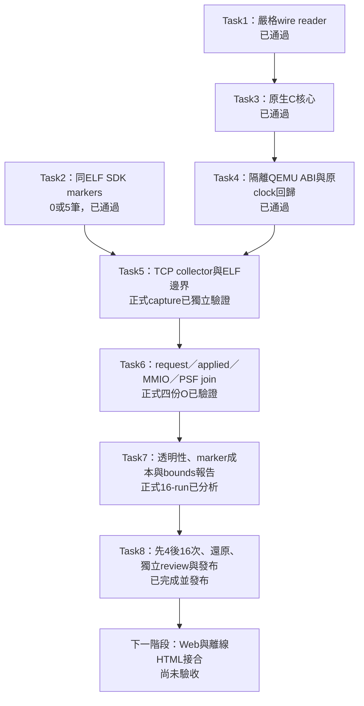

# C2b 實作進度與證據

更新：2026-11-03。**正式16／16、20組anchors、獨立review修正、report及完整包／內層source還原均已通過。Task8完成；[發布收據](../artifacts/verification/clock-anchor/acceptance-20261103/verification/publication.json)核對POC5b311de1／root d1410b5b。** [完整研究／操作報告](clock-anchor-pilot.md)與[驗收入口](../artifacts/verification/clock-anchor/acceptance-20261103/README.md)為最新依據。

清理備份已重試發布，遠端POC核對為e0679501；[Task7收據](../artifacts/verification/clock-anchor/task7-20261103/README.md)保存重試receipt。先前暫停、失敗及清理記錄維持歷史原文，不能當成目前仍暫停。

## 已完成什麼

| 任務 | 實際結果 | 可複查證據 |
|---|---|---|
| 1 Wire／clock math | JSONL／CSV 串流、canonical 整數、clock bounds primitive、手工 PSF；11 個新測試通過 | [Task1](../artifacts/verification/clock-anchor/task1-20261102/README.md) |
| 2 Guest helper | 同一 ELF 的 mode0／1，oracle 與真 PSF 分別為0／5筆 markers；四種錯誤參數拒絕 | [Task2](../artifacts/verification/clock-anchor/task2-20261102/README.md) |
| 3 Native core | 真 C FIFO、生命週期、end後applied、sink失敗、marker與MMIO；6個methods、27個拒絕案例 | [Task3](../artifacts/verification/clock-anchor/task3-20261102/README.md) |
| 4 QEMU adapter | 第三個隔離build完成；10個ABI情境、6份新舊clock回歸driver通過 | [Task4](../artifacts/verification/clock-anchor/task4-20261103/README.md) |
| 5 TCP collector／capture | 兩個候選 ELF、新舊 plugins、12 個測試；Task5先取得O capture；Task8正式16-run已獨立驗證 | [Task5](../artifacts/verification/clock-anchor/task5-20261103/README.md) |
| 6 因果 validator／join | 獨立 replay／FIFO／MMIO／PSF 核對；5 組 bounds、431,512 covered／311 unknown rows | [Task6](../artifacts/verification/clock-anchor/task6-20261103/README.md) |
| 7 對照與報告 | 18個相關測試；先驗smoke gate、JSON／CSV／Mermaid、真code-size比較 | [Task7](../artifacts/verification/clock-anchor/task7-20261103/README.md) |
| 8 正式驗收 | 16／16、20 anchors、完整還原1514檔、QEMU source75847與專案1528項核對；已發布 | [Task8](../artifacts/verification/clock-anchor/acceptance-20261103/README.md) |

修正後完整 Python 回歸 **403個：398 passed、5 opt-in skipped，49.270 s**；明確啟用 guest／QEMU runtime **5／5、0 skip，130.692 s**。發布收尾再驗403個：398 passed、5 skipped、53.657s；[task-done log](../artifacts/verification/clock-anchor/acceptance-20261103/verification/task-8-tests.log)。Review fix targeted **46／46**。全庫 Ruff check 與本輪 Python format 通過；全庫 format 仍有10個 baseline 舊檔未通過，byte-identical，不能列全綠。

## 已遇到的問題

| 問題 | 原因與處理 | 保存位置 |
|---|---|---|
| 第一次完整suite有3個整合測試拒跑 | 來源尚未commit；沒有放寬guard，提交後339個測試通過 | Task1的dirty／clean logs |
| 第一個QEMU build編譯失敗 | 新加的全域include path讓QEMU ctype.h蓋過系統標頭；改用明確的header路徑，雙重編譯測試通過 | Task4 failed-compile與header-scope RED／GREEN |
| 第二個build的manifest失敗 | 套件版本1.13.2與CLI的Kitware suffix混用；兩者分開保存並測試 | Task4 metadata recovery |
| 第一個ABI positive probe掛住 | probe缺MMIO成功callback，觸發錯誤後又持鎖exit；sample證實cleanup再次等鎖 | Task4失敗ABI與sample |
| 錯誤退出deadlock修正 | 錯誤路徑先解鎖，再退出；新missing-mmio測試能拒絕且不timeout | Task4 accepted ABI |
| vcpu_init callback被取代 | 同plugin同事件後註冊覆蓋前者；新runtime assertion先RED，改單一dispatcher後context／clock都初始化 | Task8 RED／GREEN；3cdb7794 |
| EOF hook缺真instruction | 獨立review發現；加pending marker／EOF guard，反例RED→GREEN | final review logs；3e8a5fe2 |
| 還原期間manifest替換 | 固定初始bytes／SHA，結尾核對同一份manifest；替換反例RED→GREEN | final review logs；3e8a5fe2 |

保留原失敗、修正前patch、成功及中間檔。沒有覆寫舊relative binary、FreeRTOS kernel、SDK原始碼、baseline或既有C2a captures。

## 能證明與不能證明的事

- Guest probe證明既有SDK可發出這五筆marker及同ELF開關。正式四份O已取得20組verified bounds；沒有逐row精確timestamp。
- 新QEMU能載入POC ABI，正確拒絕錯ABI／handle／SMP／icount／unsafe context；原nano／burst／edges語意通過。新tagged成本已由Task6在development O獨立驗證；正式四組L/C/O/M對照均通過。
- C核心與Python reader已互通；正式16-run已獨立重驗；所有O有界mapping成立，L/C/M依配置unavailable。
- 模型保持L1I8KiB／L1D8KiB／L232KiB、64B line、4-way LRU、WT／WA；每instruction 1ns、每memory cycle 2ns。這些是比較模型，沒有轉成產品CPU loading、cache penalty或實機UART吞吐。
- request clock仍為null；不將event index、model cost或100ns量化換成精確PSF時間，解析度評估維持unrated。

## 接下來

本輪正式pilot與完整還原已通過；Git已發布，以[驗收入口](../artifacts/verification/clock-anchor/acceptance-20261103/README.md)的receipt為準。完整source／binary／鎖與原資料分卷均保存；同host byte還原通過，不代表host dependencies閉包或跨機runtime驗收。跨機目標驗證仍依使用者決定暫緩。

Web／offline視覺接合另接在pilot之後；保留curl integration、agent-browser E2E、單一Chrome session及finally close政策。實機PMU、SDK CPU／code-size／IRQ latency、UART吞吐、cache unused-byte／layout因果分析及最新知識庫增補仍列後續，未因本輪而結清。

本次清理備份首次上傳在600秒後逾時，之後重試已成功發布。完整狀態與重試接手點見[清理收據](../artifacts/verification/storage/cleanup-paused-20261103/README.md)。開發已依continue恢復。
