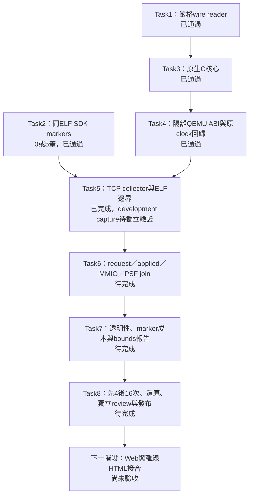

# C2b 實作進度與證據

更新：2026-11-03。**Tasks 1–5 完成；Tasks 6–8 繼續。正式 16-run 尚未執行，PSF／cache 時間對齊仍未驗證。** 執行方式沿用 Native，最後保留獨立整體 review。

## 已完成什麼

| 任務 | 實際結果 | 可複查證據 |
|---|---|---|
| 1 Wire／clock math | JSONL／CSV 串流、canonical 整數、clock bounds primitive、手工 PSF；11 個新測試通過 | [Task1](../artifacts/verification/clock-anchor/task1-20261102/README.md) |
| 2 Guest helper | 同一 ELF 的 mode0／1，oracle 與真 PSF 分別為0／5筆 markers；四種錯誤參數拒絕 | [Task2](../artifacts/verification/clock-anchor/task2-20261102/README.md) |
| 3 Native core | 真 C FIFO、生命週期、end後applied、sink失敗、marker與MMIO；6個methods、27個拒絕案例 | [Task3](../artifacts/verification/clock-anchor/task3-20261102/README.md) |
| 4 QEMU adapter | 第三個隔離build完成；10個ABI情境、6份新舊clock回歸driver通過 | [Task4](../artifacts/verification/clock-anchor/task4-20261103/README.md) |
| 5 TCP collector／capture | 兩個候選 ELF、新舊 plugins、12 個測試；實際 O capture 正常退出，尚待因果驗證 | [Task5](../artifacts/verification/clock-anchor/task5-20261103/README.md) |

最新完整 Python 回歸執行 **364 個：362 通過、2 個 opt-in runtime skip**；另明確啟用 guest runtime 的 2 個測試通過，無 skip。Task5 的 12 個新增測試通過。ABI CLI另以1個unittest method執行10個subcases，不能將兩種計數混用。全庫 `ruff check .` 通過，本輪7個Python檔的format通過；全庫format仍有10個baseline舊檔未通過，原檔未因本輪而改寫。

## 已遇到的問題

| 問題 | 原因與處理 | 保存位置 |
|---|---|---|
| 第一次完整suite有3個整合測試拒跑 | 來源尚未commit；沒有放寬guard，提交後339個測試通過 | Task1的dirty／clean logs |
| 第一個QEMU build編譯失敗 | 新加的全域include path讓QEMU ctype.h蓋過系統標頭；改用明確的header路徑，雙重編譯測試通過 | Task4 failed-compile與header-scope RED／GREEN |
| 第二個build的manifest失敗 | 套件版本1.13.2與CLI的Kitware suffix混用；兩者分開保存並測試 | Task4 metadata recovery |
| 第一個ABI positive probe掛住 | probe缺MMIO成功callback，觸發錯誤後又持鎖exit；sample證實cleanup再次等鎖 | Task4失敗ABI與sample |
| 錯誤退出deadlock修正 | 錯誤路徑先解鎖，再退出；新missing-mmio測試能拒絕且不timeout | Task4 accepted ABI |

保留原失敗、修正前patch、成功及中間檔。沒有覆寫舊relative binary、FreeRTOS kernel、SDK原始碼、baseline或既有C2a captures。

## 能證明與不能證明的事

- Guest probe證明既有SDK可發出這五筆marker及同ELF開關。Task5 的 TCP capture 已收集五組 hooks；尚不能證明TCP／IRQ流程的五個phase均已正確對齊。
- 新QEMU能載入POC ABI，正確拒絕錯ABI／handle／SMP／icount／unsafe context；原nano／burst／edges語意通過。新tagged成本的真guest request／applied關係仍待collector驗證。
- C核心與Python reader已互通；這不等於完整因果validator或PSF mapping完成。
- 模型保持L1I8KiB／L1D8KiB／L232KiB、64B line、4-way LRU、WT／WA；每instruction 1ns、每memory cycle 2ns。這些是比較模型，沒有轉成產品CPU loading、cache penalty或實機UART吞吐。
- request clock仍為null；不將event index、model cost或100ns量化換成精確PSF時間，解析度評估維持unrated。

## 接下來

依[實作計畫](plans/20-c2b-clock-anchor-implementation.md)完成Tasks6–8：A02 baseline／pbuf、每candidate同一ELF、L／C／O／M、先4次smoke再補12次。只有對照與完整性成立，才發布verified bounds；不足時交付inconclusive與unknown。

Task8還需完整QEMU source／binary／依賴鎖與可還原分卷，實際還原並核對hash；目前各Task收據不代表整包內網還原完成。跨機目標驗證仍依使用者決定暫緩。

Web／offline視覺接合另接在pilot之後；保留curl integration、agent-browser E2E、單一Chrome session及finally close政策。實機PMU、SDK CPU／code-size／IRQ latency、UART吞吐、cache unused-byte／layout因果分析及最新知識庫增補仍列後續，未因本輪而結清。
