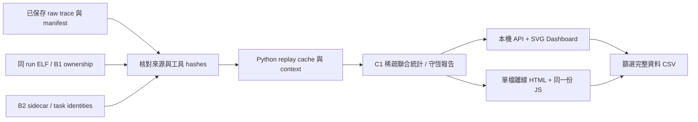

# C1：成本與熱點 Dashboard 設計

日期：2026-10-09。狀態：**2026-10-13 使用者以 continue 接續，已進入實作計畫；尚未實作。**

## 目的與既定要求

用同一個 workload 的 baseline／candidate，找出成本高的函式與指令位置，解釋最佳化後成本增加或減少在哪裡。支援本機 Python Web 與無 Python、無網路的單檔 HTML；可篩選、排序、hover、調整表格欄寬、匯出 CSV。沿用 SVG 圖表、ECharts／Tabulator，不加入 CDN 或新套件。

固定 L1I 8 KiB、L1D 8 KiB、L2 32 KiB；模型設定從保存的來源載入並核對。這是相同模型的相對比較，不能表示產品 CPU loading 或板上效能。C2 的時間對齊與區間 zoom 不在本輪。

## 現有證據與缺口

| 現有檔案 | 可直接利用 | 需要補足 |
|---|---|---|
| `artifacts/verification/cost-attribution/b1/*/report.json` | 16 個 candidate 的 role／function／PC 總成本 | context 均為 unknown；沒有逐函式 3C misses |
| `artifacts/verification/cost-attribution/context/*/*/full-report.json.gz` | A02／A08 baseline／pbuf，各 control／injection、3 repeats；context 與 role 矩陣 | function／PC 為各自總計，沒有 context × function／PC 聯合分布 |
| B1 evidence／ranges、各 run 的 ELF／map | PC ownership、來源、aliases 與可追溯 hashes | source line 要用該 ELF 的 addr2line 取得，不由 symbol 名稱猜測 |
| `src/psf_lab/timing_dashboard.py`、`web/src/timing*.js` | hash 驗證、SVG 圖與表格互動模式 | 新 C1 schema／頁面，保留 A 頁與既有輸出 |

**不能把兩張邊際統計表相乘，推導 Task × function。**必須在同一次 replay 中先按事件取得 context 與 PC ownership，再彙總。

## 方案比較

| 方案 | 優點 | 代價／限制 |
|---|---|---|
| **建議：Python 預先 replay，兩種 UI 共用產物** | 單一分析邏輯；離線無 Python；來源與守恆可驗證 | 先產生完整報告；大報告需控制封裝範圍 |
| Python API 即時 replay | 可按查詢重算 | 查詢延遲、Web／離線雙套分析邏輯 |
| 瀏覽器直接解析 raw trace | 可直接拖入 raw | 需移植 cache／context 模型；記憶體與一致性風險高 |

## 資料流程



輸出與中間資料寫入新 `artifacts/verification/hotspot/`；不得覆寫 A／B captures、completion 或 frozen HTML。重播既有資料，不重新執行 QEMU 或修改 guest、FreeRTOS、PSF。

## 資料契約

- schema 建議為 `hotspot-report-v1`。run identity 包含 workload、variant、mode、repeat、capture family、ELF hash、raw hash、context quality。
- 稀疏事實表粒度：`run × context × role × function_id × PC`；每列保存 self instructions、memory cycles、五個 cost components，以及 L1I／L1D／L2 accesses／misses／compulsory／conflict／capacity。
- 使用現有 cache model 重播產生 3C 分類；每次查詢屬於執行該存取的 PC。L2 accesses 使用模型的 L2 查詢次數，不能直接拿 CPU load/store 數作分母。
- 不含 inclusive call-tree cost；沒有 caller 證據時不把 libc 成本移交呼叫者。
- function_id 在同 run 以來源 object、symbol range 與 aliases 唯一識別。跨 binary 不以 PC 或絕對建置目錄配對。
- baseline／candidate 函式配對：正規化 repo-relative source 或 archive/member，加 symbol identity；只有唯一匹配才計算函式 delta。歧義與 unmatched 各列顯示，不能當零成本。
- PC drill-down 僅在各自 binary 內定位，不顯示假造的跨 binary PC delta。
- source line 顯示 addr2line 原始證據與 ELF hash；缺 DWARF 時為 unavailable。不要將本機不同版本的 source 顯示為當時編譯原文。
- mode 明確標記 control shadow cost／injection modeled cost。不同 mode、workload、模型設定不可配對。
- B1 與 B2 為不同 capture family，不混合成一批重複樣本。預設 injection、repeat 1，其他 repeats 可切換；不加總 repeats 為一次 workload。
- 16 個 B1 candidate 都有熱點；只有 4 個 B2 candidate 有 exact context。其餘維持 unknown，不能透過 UI 隱藏這個限制。
- `unresolved` 與 `unknown` 是可見資料列，參與所有總和。來源不完整時錯誤應可見，不能回空陣列冒充零成本。

## 指標與分母

| 指標 | 定義 |
|---|---|
| Self instructions | 該 PC 的 instruction 事件數；不含 callee |
| Memory cycles | 五個 cache／RAM cost components 總和 |
| Accounted model ns | instructions × 1 ns + memory cycles × 2 ns；control 顯示 shadow 標籤 |
| Run share | 選定 metric / 該 run 完整 metric，篩選與 top-N 不改分母 |
| Filtered share | 選定 metric / 篩選後完整 metric，另欄顯示；不以 top-N 當分母 |
| Miss rate | 同層 misses / accesses；零 accesses 為 null |
| Delta | candidate − baseline；正值代表成本增加；百分比以 baseline 為分母，零分母為 null |

完整 run、context、role、function、PC 各層加總必須守恆。3C 三項加總等於對應層 misses。baseline 不因 candidate 篩選而消失；單側函式缺失不產生 misleading percentage。

## 畫面草圖

```text
成本與熱點                    [Web / 離線] [來源與模型]
[Workload] [baseline/candidate] [capture family] [mode] [repeat]
[Context] [Role] [Function 搜尋] [Metric] [Cache level] [Top N]
完整 run 成本 | 篩選成本 | 未解析占比 | exact/unknown
┌─────────────────────┬────────────────────────┐
│ 函式成本排名 SVG     │ baseline 差異 SVG      │
│ Top N + Other        │ 增加與減少分開呈現      │
├─────────────────────┼────────────────────────┤
│ 五個成本分量 SVG     │ 3C misses SVG           │
└─────────────────────┴────────────────────────┘
[完整篩選表格：排序 / 欄寬 / CSV]
點選函式 → PC 表格 → source line 與原始證據
```

Top-N 僅裁剪圖表；標記顯示筆數、完整筆數與 Other 成本。CSV 匯出全部篩選資料並保留表格排序；帶 run identity、mode、metric units、分母、unknown 狀態及 manifest hash。文字欄位防 CSV formula injection；HTML 不執行來源檔名中的 markup。

## Web／離線邊界與容量

新增獨立 hotspot 頁，保留既有 timing 頁。Web 從固定 catalog 選取已驗證報告，API 不接受任意檔案路徑。離線匯出以一個 workload 的 baseline／candidate 配對為單位，包含該組可用 modes／repeats／context family，所有 JS／CSS／JSON 內嵌，不依賴 fetch、CDN 或 Python。

設計不預填未量測的容量或速度承諾。實作前先產生 A02 pilot，量測 JSON／HTML bytes、列數、載入與篩選時間；完整資料不得靜默截斷。保留環境與量測收據，若不可用先調整封裝設計，不刪資料假裝加速。

## 預計修改邊界

- 新增 Python `hotspot_report.py`：重播聯合統計與來源驗證；`hotspot_dashboard.py`：catalog 與 UI schema。
- 新增 `tools/tcp/analyze_hotspots.py`、`tools/tcp/export_hotspot_html.py`；重用現有 model、context validator 與 ownership，避免另寫演算法。
- 新增 `web/hotspot.html`、`web/src/hotspot.js`／`hotspot-view.js`／`hotspot.css`；修改 `web/build.mjs` 與 `src/psf_lab/server.py` 接線。
- 新增 Python unit／integration、Node view tests、curl／agent-browser 驗收工具；README、操作文件、截圖與 completion 保存於 POC。

以上是設計邊界；具體 API signatures、測試程式與逐步 commits 在設計確認後寫入 `docs/plans/13-hotspot-dashboard.md`。

## 驗收案例與風險

1. 手算 trace：I／R／W、跨 cache line、hit／各類 miss、IRQ 前後；驗證聯合統計與全域守恆。
2. 篩選兩個 context：同一 function 的成本不得從全域比例推估；unknown 必須保留。
3. 缺 ELF／hash 不符／漏 sidecar boundary／錯配 workload 或 mode：拒絕分析或配對，明確指出原因。
4. 同名 symbol、別名、不同 binary layout：不得合併錯誤 owner；unmatched 不當零。
5. Top-N、空篩選、零分母、負 delta：分母與數值定義不變，CSV 與畫面一致。
6. Python unittest、Ruff、Node tests；curl 驗 API／assets／錯誤回應；agent-browser 驗兩種部署、hover、排序、欄寬、filter、CSV 與手機版面。
7. 離線驗收先停止 Python Server、封鎖 HTTP／HTTPS；保存無網路資源、無瀏覽器錯誤證據與截圖。
8. 全回歸前 clean commit；保留完整 replay 中間資料、raw 引用、來源／工具 hashes。完成後獨立 code review、更新 README／checklist、push 並核對遠端 SHA。

## 明確不在 C1 內

C2 時間軸、PSF timestamp 與 cache 事件對齊、互動時間區間、硬體 PMU、cache residency 未使用空間、函式拆分／變數拆分因果實驗、SDK on/off CPU overhead、跨機驗證。函式大不等於 cache 效率差；本頁提供定位線索，不自動產生最佳化結論。

## 自我核對

- 已沿用使用者要求的 A → B → C 與 Web／離線雙部署。
- 已找出 B 報告缺少聯合統計與 3C 細分，沒有假設現有資料可直接支援 context filter。
- 已區分 self cost、CPU usage、modeled time、miss rate 與比例的分母。
- 已定義未知、配對失敗、來源不符、容量與歷史資料保留的處理方式。
- 設計已進入計畫階段；這份文件不代表功能完成。
