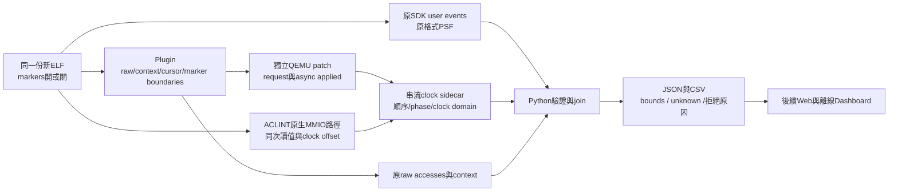
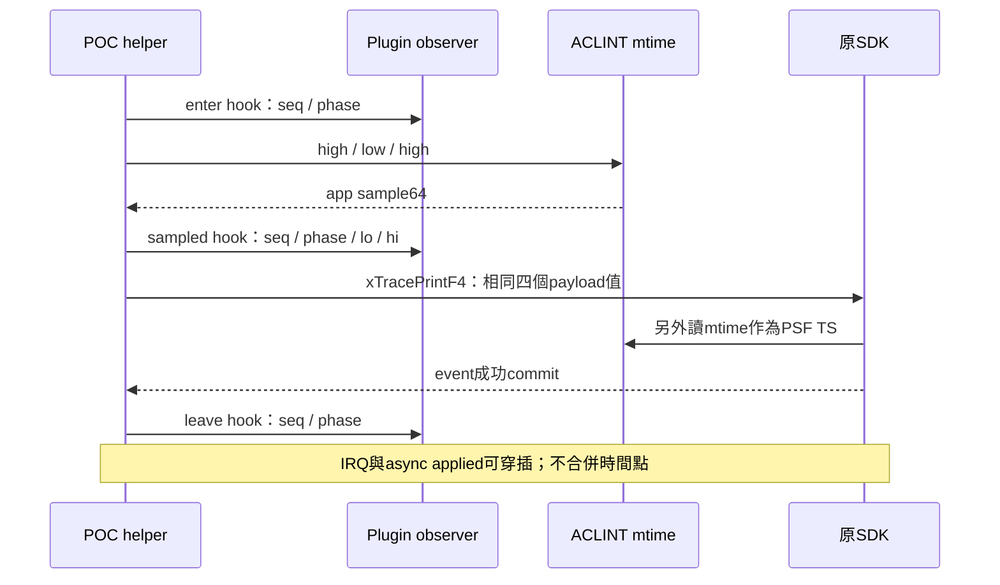

# C2b v1：SDK marker 與 QEMU clock-anchor pilot 設計規格

日期：2026-10-25。**使用者已選A，並以後續`continue`確認本書面規格，已進入[逐項實作計畫](../plans/20-c2b-clock-anchor-implementation.md)審閱階段。** 可修改POC app／port加少量SDK markers，FreeRTOS kernel與SDK原始碼保持原樣；目前沒有新增build、capture或runtime驗收。

## 1. 目的、交付與目前邊界

讓同一次 RISC-V／FreeRTOS TCP 執行產生可互相核對的 raw accesses、context、成本 request／applied、guest clock sample 與 PSF。先回答「哪些觀測能可靠對上時間區間，哪些仍未知」，支援後續用相同模型比較軟體最佳化。

這一輪交付最小 pilot、Python 驗證器、JSON／CSV 分析、Markdown 圖文報告與完整還原資料。Web 與單檔離線 HTML 接在 pilot 證據之後，沒有在這份規格中提前實作。既有 A／B／C1／C2a 的 captures、40-run chunks、8份HTML與失敗紀錄都保留。

| 已決定的需求 | 本規格採用的處理 |
|---|---|
| A：app／port 加 markers | 使用既有 `xTracePrintF4`；不修改 kernel、SDK或其事件格式 |
| 先規劃、不可猜時間 | request clock 缺安全來源時為 `null`；使用實際 sample、offset與phase |
| 相對 cache 最佳化 | L1I 8 KiB／L1D 8 KiB／L2 32 KiB、64-byte line、4-way LRU、write-through／write-allocate；原 profile 不變 |
| 模擬環境 | 固定 QEMU9.2、RV32、single-vCPU、single-thread TCG、fixed icount shift0；每 memory cycle 2 ns，原 instruction 模型1 ns |
| 可還原與可複查 | 新 output、新 patch／binary、source／ELF／profile hash、原始輸出、失敗及JSON收據一起保存 |
| Dashboard 的後續驗證 | 保留 Web／offline、curl integration、agent-browser E2E、逐一開啟與finally close政策 |

後文的marker數、16-run矩陣與介面已隨本規格確認；這是設計基準，沒有宣稱已執行或量測。實機PMU／SDK CPU loading／UART吞吐、cache unused-byte分析、知識庫增補與跨機暫緩狀態另列後續。

## 2. 來源前提與不能使用的捷徑

[QEMU能力表](../research/c2b-qemu-clock-capabilities.md)及[SDK能力表](../research/c2b-sdk-anchor-capabilities.md)已證明來源前提：API4沒有public clock getter；普通instruction callback直接讀virtual clock有`Bad icount read`風險；TB counter預扣不能當retirement time；既有`context_after_instruction()`仍在guest指令執行前。

本 POC recorder 是application-defined `mtime` low32、10 MHz。ACLINT關係為 `mtime64 = (floor(virtual_ns / 100) + time_delta) mod 2^64`；capture的`time_delta`不可先假定為0。`xTracePrintF4`會另外取自己的PSF timestamp，因此app payload sample與SDK timestamp必須分開保存。

## 3. 架構與模組責任

| 模組 | 責任 | 不負責的事項 |
|---|---|---|
| POC app／port helper | marker註冊、64-bit sample、明確的入口／取樣完成／離開hook、同ELF開關 | 不改SDK timestamp或kernel trace hooks |
| Plugin observer | 保留raw rows，回報已寫出row數cursor；在少量已知hook讀一般argument registers | 不從instruction callback讀virtual clock或time CSR |
| QEMU observer hub | 記錄request、applied、ACLINT讀取、epoch與檔案生命週期 | 不將async queue改為同步stall，不合併成本requests |
| Python validator | 來源身分、順序、counter、payload與clock關係、bounds與品質判定 | 不插值、不修補原trace、不由model cost創造timestamp |

新介面限POC，與upstream API4分開命名及版本化。新binary從原固定tarball加既有0001～0003與新patch重建，放新`.tools/`目錄，保留原relative binary。

## 4. Guest markers：少量、可識別、可量成本

### 4.1 五個位置

每個markers-on run預期5筆固定user events，phase為：

| phase | 插入位置 |
|---|---|
| `1 capture_open` | `tcp_capture_begin`後、恢復原IRQ mask之後 |
| `2 established` | 握手完成、進入兩輪request／response之前 |
| `3 round0_done` | 第0輪response／ACK／timer檢查完成後 |
| `4 round1_done` | 第1輪response／ACK／timer檢查完成後 |
| `5 capture_close` | 收尾與資源檢查完成、最後停用IRQ／`tcp_capture_end`之前 |

這是來源已有兩輪TCP流程的phase抽樣，不是每秒或每N個raw events打點。prefix／suffix仍可能沒有時間界，必須列unknown。SDK marker的指令、記憶體存取與cache成本保留在原raw stream，沒有扣除或美化。

### 4.2 Payload與hook ABI

capture前註冊channel `C2B`、format `C2Bv1|%u|%u|%u|%u`。四個32-bit參數依序為 `marker_seq, phase, sample_lo, sample_hi`；sequence為1～5，不與PSF的16-bit EventCount或成本request id共用。每筆固定event的格式推導為32 bytes；五筆160 bytes只涵蓋這五筆event，不包含註冊及其他trace增量。

helper使用三個`noinline`且有compiler memory barrier的本地hook，均以ELF／反組譯核對，不能硬編PC：

| hook | argument registers的內容 | phase語意 |
|---|---|---|
| `poc_clock_anchor_enter(seq, phase)` | a0=seq、a1=phase | hook指令執行前；clock sample尚未開始 |
| `poc_clock_anchor_sampled(seq, phase, lo, hi)` | a0～a3為同一組payload值 | app的high／low／high sample已完成，SDK event尚未呼叫 |
| `poc_clock_anchor_leave(seq, phase)` | a0=seq、a1=phase | SDK event成功返回後，leave hook執行前 |

observer-on時Plugin只在這三個PC要求新的`QEMU_PLUGIN_CB_R_REGS`，啟動時驗證一般argument registers可用；缺失或重複descriptor就拒絕capture。observer-off不註冊新marker-register callbacks；既有context observer在L/C/O/M維持同一啟用政策，避免混入另一項變因。hook不是instruction retirement，leave也不是helper已返回的宣稱。允許IRQ／其他task在hook間執行，保存其context，不把整個bracket都算成SDK本身時間。

### 4.3 同ELF切換markers

每個candidate只build一份ELF。沿用目前已啟用的semihosting，POC port在現有trap wrapper新增`SYS_GET_CMDLINE (0x15)`操作；main在初始化、capture開始前，用64-byte buffer讀取唯一啟動參數，嚴格接受完整字串`c2b-markers=0`或`c2b-markers=1`。缺參數、截斷、未知字串、額外參數或讀取失敗均拒絕進入capture；實際mode保存於run oracle。

runner以`-semihosting-config enable=on,target=native,arg=c2b-markers=0`或相同的mode1版本替換原選項，其餘flags相同。mode讀入本地flag後，capture期間不再做semihosting設定I/O。不能失敗後改成兩個ELF，卻繼續稱同ELF對照。

來源：[現有POC wrapper](../../firmware/port/semihost.c)、[固定版semihosting選項](https://github.com/qemu/qemu/blob/ae35f033b874c627d81d51070187fbf55f0bf1a7/qemu-options.hx)、[command-line設定](https://github.com/qemu/qemu/blob/ae35f033b874c627d81d51070187fbf55f0bf1a7/semihosting/config.c)、[SYS_GET_CMDLINE處理](https://github.com/qemu/qemu/blob/ae35f033b874c627d81d51070187fbf55f0bf1a7/semihosting/arm-compat-semi.c)。這個新operation尚未runtime驗證，列入第一個capability gate。

來源盤點已排除「Generic Loader覆寫ELF內rodata mode」：CLI loader先註冊reset callback，之後的rom_reset可把ELF segment原值寫回；startup不複製rodata仍不足以保證設定保留。本版不採該路徑，也不保留外部RAM控制槽。

mode0仍保留相同binary、phase呼叫位置與共用guard，但不sample、不發anchor user events。mode1減mode0量到的是「marker body及其連帶效應，相對於共用guard」，不代表所有instrumentation的總成本。

## 5. QEMU：request、applied與原生MMIO讀值

### 5.1 POC介面與資料流契約

以下是新介面契約，並非已存在API；具體C宣告與檔案拆分由後續實作計畫展開。

| 介面 | 輸入與效果 |
|---|---|
| `qemu_plugin_poc_clock_configure` | 原time-control handle、observer開關、新sidecar路徑、run identity；建立ABI v1 session，不讀clock；observer-off時path為null、不開sidecar檔 |
| `qemu_plugin_poc_clock_note` | kind、raw_cursor、PC、marker seq／phase／sample；更新或記錄capture begin、cursor、三種marker hooks、capture end；不讀clock |
| `qemu_plugin_poc_add_ns_tagged` | handle、delta_ns、request_id、request_event_index；維持原相對成本非同步語意，排入獨立work item |
| `qemu_plugin_poc_clock_finish` | 檢查pending、counts、footer與flush／close；回報明確成功或失敗 |

原 `qemu_plugin_poc_add_ns` 保持可用。新舊路徑不得改成batch addition、直接同步advance、強制TB切分或移除icount guard。observer-off也使用相同新binary與tagged路徑，只停用觀測；有行為差異就先停下排查。

### 5.2 Cursor與request

`raw_cursor`只表示「此capture已完整寫出的raw rows數量」；下一列index等於cursor。每次I／R／W row寫出後先更新cursor，再發成本request。`request_event_index = raw_cursor - 1`，request id從1遞增，delta必須等於該row五種成本總和乘2 ns。request clock固定為`null`。

instruction row在guest指令前、RAM memory row在成功memory access後；phase都必須明寫。MMIO不新增raw row，維持原I／R／W schema。cursor更新不逐筆產生額外log，避免再複製一份全量raw資料。

### 5.3 Async applied

只在既有成本work執行的位置讀virtual clock；每次讀前檢查CPU0、single-vCPU、precise icount、`running=false`與BQL前提。記錄 `request_id, applied_raw_cursor, before_ns, requested_target_ns, advance_return_ns, after_ns`；cursor可晚於request，也可在capture end後才生效，不能複製request index冒充同時性。

正常相對成本路徑預期 `after_ns = before_ns + delta_ns` 且advance回傳值一致；不符就保留原值並判失敗，不能加任意200 ns tolerance。mode0沒有request／applied，不能假造零成本applied events。

### 5.4 ACLINT sample與epoch

在ACLINT原生MTIME read處保存**實際用來計算該次回傳值的同一個**virtual_ns、timebase、`time_delta`、full mtime64、實際32-bit return word與讀取位址。不得為了記錄再加一次clock getter，然後稱兩次讀值同時。scope限既有virt單一timer device。

每筆加native IO seq及當下observer cursor／最後已觀測PC。與既有plugin成功MMIO callback依序比對位址、方向、size和數量；分清「裝置正在處理read」與「成功memory callback」。原有mtime／mtimecmp allowlist保留，不能把timer I/O算進cache成本。

每次sample記錄當下offset，因此不用假定reset時的virtual clock為0。active或draining期間若有MTIME write、reset、device變更或frequency變動，結束可用epoch並將該pilot判為不可建立本版映射；完整原始資料仍保存。mtimecmp write維持原合法行為並記錄順序，不把它當counter reset。

### 5.5 Sidecar與生命週期

單一JSONL sidecar使用`clock-anchor-record-v1`；每列都有run_id、全域record_seq、kind、cpu、raw_cursor、phase。需精度的整數用canonical unsigned decimal strings，最多40 digits；`null`與0分開。clock ns另限制在signed64非負範圍；marker／PSF payload遵守原32／16-bit範圍。

record kinds為`header`、`capture_begin`、`cost_request`、`cost_applied`、`marker_enter`、`marker_sampled`、`marker_leave`、`mtime_read`、`mtimecmp_write`、`epoch_change`、`capture_end`、`footer`。header保存schema／ABI、binary／ELF／profile hashes、flags、expected frequency與observer／marker mode；實際device frequency／offset以native sample核對，未觀測之前不能由header假裝已證明。request id、marker seq、PSF EventCount和native IO seq各自獨立。

狀態依序為configured→active→draining→finished；end後凍結raw_cursor，但仍接收已排入的applied。finish時pending必須為0，且raw／request／applied counts符合mode。不能在finish時偷偷執行額外advance來修成成功；若現有guest退出路徑尚未排空，就記失敗，先修生命週期設計。

logger以bounded stdio buffer串流，互斥保護record序號與寫入；不得持log lock跨越clock advance或其他可重入callback。原raw限制3,000,000 rows，pending request上限65,536；超限、I/O error、短寫、缺footer或不完整最後一行均不採認。限制是本版明訂的fail-closed容量政策，不是效能測量結果。分析器以FIFO驗證request／applied，不一次載入全量sidecar；壓縮與逐檔hash在capture後進行，保存未壓縮內容hash。

## 6. Python join、時間區間與拒絕條件

先驗證來源／ABI／profile與完整性，再依原record順序處理；不按timestamp重排。native formula必須逐筆成立，plugin／device MMIO ledger不能缺項。

每個markers-on run需5個完整、正確配對的enter→sampled→leave，並在PSF找到同channel／format／seq／phase／sample payload。相同timestamp仍保留不同seq與原PSF offset；不能只用timestamp配對。markers-off應為0組，任何多出marker都算配置錯誤。

app sample由sampled hook與PSF payload交叉核對；SDK timestamp只從sampled與leave之間的native MTIME low reads尋找可能的full counter。保留所有相符候選，不任挑一筆；同epoch候選必須給出一致的full tick，否則標ambiguous。IRQ取樣可使index bracket變寬，不能從ledger刪除。

對full tick `t`與已觀測offset `d`，先以uint64 modular subtraction求 `q=(t-d) mod 2^64`，再核對其與原native `virtual_ns`／頻率相符。10 MHz下輸出半開量化區間 `[100*q,min(100*(q+1),2^63))`，保留raw counter與epoch；實測clock point仍須小於2^63，衍生exclusive upper可等於2^63。這不是100 ns的整體對齊保證。raw mtime64跨wrap時以modular counter與已驗證的native時間關係計差，不直接用unsigned大小比較來判定先後。

同一anchor若有多個可能low-read cursor，輸出inclusive的`cursor_min/cursor_max`及時間半開區間。相鄰、順序有效anchors A／B之間，只有 `event_index >= A.cursor_max` 且 `< B.cursor_min` 的rows能列為「介於這兩個觀測之間」；輸出其保守time bounds。不得稱其為逐事件實測timestamp或retirement time。重疊／缺失bounds、prefix／suffix與無法驗證的區段均列unknown，不插值。

| 情況 | 結果 |
|---|---|
| identity／hash不符、非法整數／schema、request duplicate／缺失／重排、錯delta、pending未清 | evidence invalid，拒絕發布verified mapping |
| 非法callback clock-read context、clock reversal、active epoch改變、MMIO ledger缺項 | evidence invalid；保存完整失敗與最後可見狀態 |
| marker缺失／重複／payload不符、PSF sequence gap或timestamp ambiguity影響anchor | 該anchor鏈不可用；保留原PSF與unknown區間，不補點 |
| 來源有效但frequency／epoch／phase證據不足 | alignment unavailable，不把parser成功升級成對齊成功 |
| observer-off或legacy run沒有sidecar；marker-off沒有anchor events | 依配置回報not-recorded／markers-disabled，不當成有verified anchors |
| anchor與clock關係驗證成功，但bracket很寬 | verified bounds；另外報寬度，不能稱高精度或符合產品時間預算 |

JSON將`evidence_status`、`alignment_status`、`application_status`、`resolution_assessment`分開。原unknown PSF events與context品質保留；clock anchor成功不自動使CPU task usage或IRQ歸屬完整。

## 7. 最小pilot：16 captures、三條因果對照

沿用A02的request segments `[13,0,51]`、兩輪TCP，candidate為baseline／pbuf；每個candidate的四組對照使用同一份新ELF。每組各執行成本injection off／on，首輪repeat=1：`2 candidates × 2 injection modes × 4 configurations = 16 captures`。

| 組別 | QEMU／plugin | SDK markers | host clock observer | 比較目的 |
|---|---|---:|---:|---|
| L legacy | 原relative binary與原collector路徑，載入新ELF | on | 無新sidecar | 舊時序語意基準，與C比 |
| C control | 新binary／新tagged成本路徑 | on | off | 新patch本身是否改變guest行為 |
| O observed | 與C相同binary／plugin／ELF | on | on | host側錄擾動；與C比 |
| M marker-off | 與O相同binary／plugin／ELF，semihosting arg指定mode0 | off | on | marker body及其連帶效應；與O比 |

先做baseline、injection on的L/C/O/M四次smoke；全部成立才擴大其餘12次。若source、binary、ELF與命令未改，四次smoke就是16次中的子集，不為了數字再重跑；修正後的新run用新目錄，原失敗保留。三次配對重複與統計穩定性是後續擴大驗收，不從這16次宣稱顯著效能改善。

- **L對C、C對O：**同ELF與同mode，封包順序／bytes、應用oracle、資源回收、raw accesses／五種成本、PSF bytes／語意與guest計時都要求一致。不同就停下排查，不自動放寬或normalize掉差異。
- **O對M：**marker body本來會增加指令／cache／時間，不能要求raw或PSF相同；封包與應用結果仍須一致。分別報guest elapsed ticks／ns、I／R／W數、model cycles、task／IRQ變化及trace bytes差異。分母為M且大於0才計百分比。
- host wall time／CPU time與guest模型時間分開；本輪單次配對不承諾穩定host overhead百分比。相對模型結果不是產品SDK CPU loading。
- marker自己的bracket包含可能的IRQ與其他task；先依既有context分開列出，不將elapsed全算為marker exclusive CPU cost。

## 8. 正確性與解析能力驗收

硬性驗收為來源／結構／因果對照與可證明的clock關係：零packet／application mismatch；L/C與C/O零非預期guest差異；O的每個run五個anchors全部配對；request／applied零遺失、零重複；guest sample與native／SDK clock關係一致。

同時輸出每個anchor的sample→SDK tick差、index／time bracket寬度、相同tick數、unknown rows／比例、native read候選數，以及cost queue的cursor距離。request沒有安全clock，因此**不輸出虛構的request→applied ns latency**。沒有使用者產品誤差預算，`resolution_assessment`先為`unrated`，只報實測min／median／max；既有200 ns整窗守恆或100 ns量化都不是新門檻。

若16次能產生有效bounds且對照成立，可宣稱「C2b v1 pilot完成、取得有界對齊證據」。不能因此宣稱全40-run重擷取、完整逐事件精確時間、實機校準或Dashboard聯動已完成。觀測合法但不足時，交付inconclusive報告與具體缺口，不捏造pass。

### 執行資源政策

capture逐一執行，不開平行QEMU；每次host wall timeout為120秒，只防止掛住，不是guest效能門檻。新隔離build預設`-j2`，需要時可降至`-j1`並記錄。sidecar stdio buffer為64 KiB、單列JSON最多16 KiB；Python以串流與有上限FIFO處理，不把全量rows放入記憶體。原C2a的Chrome RSS640 MiB、ready25s、filter5s等政策未修改；本輪尚不啟動browser。

### 必須覆蓋的測試與反例

- Python `unittest`：canonical整數／overflow／negative／bool、run與ELF不符、缺footer／截斷、request reorder／duplicate／missing、錯cost、pending上限與未排空。
- 時間／marker：非零offset、uint64 offset modular arithmetic、32-bit timestamp wrap、16-bit EventCount wrap、相同timestamp、重複／缺失phase、payload high／low錯、序號gap、active reset、frequency不符、不能唯一恢復full counter。
- 邊界／IRQ：enter與sampled之間搶占、SDK與leave之間搶占、MMIO bypass ledger、成本在end後applied、相鄰anchor bounds重疊、prefix／suffix unknown、空區間；既有context的after不當retirement。
- 真QEMU整合：semihosting mode readback、缺／過長／錯誤cmdline、argument register capability、unsafe clock context拒絕、L/C/O/M配對與完整PSF解析。故意設定錯mode／來源、破壞sidecar及缺end證據必須失敗，原始輸出不覆寫。
- Ruff與完整Python回歸；既有Node／Playwright與browser E2E在後續真正接UI時執行，沿用單worker／單session／finally close並保留截圖。只做這份文件不宣稱已執行上述測試。

## 9. 產物、還原與接手位置

| 路徑 | 後續實作的責任 |
|---|---|
| `firmware/port/clock_anchor.c`、`clock_anchor.h`，POC app／Makefile及`semihost.c/h` | helper、cmdline mode readback、5個phase插入與opt-in建置；既有default產物保留 |
| `tools/qemu/0004-clock-anchor-observer.patch` | QEMU observer hub、tagged request／applied、ACLINT原生sample；POC ABI header與build integration一起保存 |
| `tools/qemu/build-clock-anchor-probe.sh` | 新目錄的隔離建置、固定tarball／patch／binary hashes、完整成功／失敗build logs；不替換舊binary |
| `tools/tcp/clock_anchor.c`、`clock_anchor.h`，`live_cache.c`的opt-in接點 | plugin邊界／argument registers／cursor回報；不把新邏輯全塞進既有collector |
| `tools/qemu/poc-clock-anchor-api.h` | POC ABI v1宣告，與新QEMU build header／hash一致，不能拿舊binary誤載 |
| `src/psf_lab/clock_anchor_capture.py` | build／run identity、L/C/O/M矩陣、新output與失敗保留 |
| `src/psf_lab/clock_anchor_evidence.py` | 串流schema／順序／FIFO／MMIO／marker／PSF核對，輸出品質與anchor bounds |
| `src/psf_lab/clock_anchor_analysis.py` | 配對比較、bounds／unknown、JSON／CSV與來源鏈；具體函式契約由實作計畫展開 |
| `tests/unit/`、`tests/integration/` | 上述可獨立判錯的fixtures與真QEMU smoke，不用decoder自產expected再自證 |
| `runs/local/c2b-pilot-v1/` | 每個configuration／mode／candidate獨立run；必須是新、ignored且來源已commit的目錄 |
| `artifacts/verification/clock-anchor/` | source／decision／build／run／analysis／review／publication receipts、原始／壓縮內容hash、還原說明 |
| `docs/`與root／POC README | 現況、步驟、限制、成功與失敗、後續Web／offline工作；UI完成後再放實際截圖 |

實作計畫須將上表展開成確切檔案與介面，不在大型既有模組中直接堆疊所有邏輯。restore資料保留patched source／patch、build命令、所需套件鎖、ELF／map／symbols、raw／PSF／sidecar／封包、分析JSON／CSV、inventory與所有中間失敗；單檔若超過GitHub限制則先以可還原gzip／分卷保存並核對原hash，不靜默丟資料。

這份規格沒有新增跨機驗證目標。內網需要不同host工具鏈時，交接資料應說明版本與未驗證邊界；不能把macOS本機還原成功當成公司平台已通過。

## 10. 狀態與下一個審閱點

- 已完成：使用者選A、來源能力盤點、本文的具體設計、自我審閱及使用者以continue確認；逐項實作計畫已寫好。
- 等待：審閱[實作計畫](../plans/20-c2b-clock-anchor-implementation.md)，之後沿用Native逐項執行。
- 尚未完成：QEMU／firmware改動、unit／integration runtime、pilot與誤差結果、Web／offline接合及知識庫增補。

實作前不得把本文件的schema、32-byte推導、數字矩陣或來源安全鏈寫成已量測結果。
