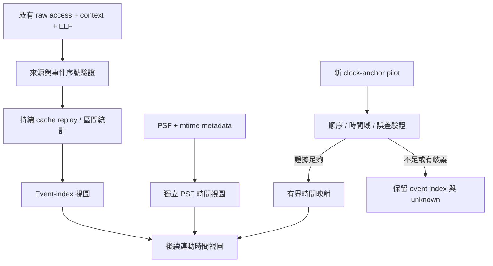

# C2：Cache 與 PSF 時間對齊研究草案

日期：2026-10-13，更新2026-10-23。狀態：**C2a已完成本機驗收，固定C1的40份來源轉成完整chunks／8HTML；C2b clock-anchor尚未開始。**

## 目的與承接範圍

承接 C1 熱點定位，讓使用者選取一段執行區間，觀察 Task／IRQ、函式與 Cache 成本，協助比較軟體最佳化。保持 L1I 8 KiB、L1D 8 KiB、L2 32 KiB 與原模型政策；Web 與單檔離線 HTML 共用分析結果。模型成本仍只適合同條件相對比較。

使用者新增資源限制：Chrome／agent-browser 測試一次只開一個 session；Web 完成後關閉，再開離線測試。所有流程含失敗路徑都必須 close；Playwright 使用單一 worker。不得關閉使用者自行開啟的瀏覽器。這輪盤點未啟動瀏覽器。

## 已核對的來源與時間語意

| 來源 | 已知事實 | 對 C2 的影響 |
|---|---|---|
| [live_cache.c](../../tools/tcp/live_cache.c) 的 charge | CSV 欄位為 pc,address,size,operation,l1i,l1d,l2,ram_read,ram_write；沒有 timestamp | 可重建事件序號與累計成本，無法直接取得每列 guest clock |
| 同檔 execute／memory | I callback 與 R/W callback 分開記錄；capture begin 重置 cache，end 排除於 raw window | 定義明確的半開區間，保留 callback 順序；不可把一列當成一個完整 instruction |
| [live_context.c](../../tools/tcp/live_context.c) | sidecar 保存 seq、event_index、phase、PC、task_id、cause、depth | exact context 指事件序號歸屬，並不代表精確 PSF 時間 |
| [context_capture.py](../../src/psf_lab/context_capture.py) | 核對 sidecar selected_task 與 PSF task-switch 的順序 | 順序對應不能升級成 callback 與 recorder timestamp 的同時性 |
| [recorder_port.h](../../firmware/port/recorder_port.h) | timestamp 為 mtime 低 32 bits，頻率 10,000,000 Hz | 解析粒度 100 ns；同 timestamp 可能含多事件；約 429.497 秒繞回 |
| [PSF semantic parser](../../src/psf_lab/parser/semantic.py) | 保留 origin_ticks；有 sequence gap 與 ambiguous timestamp 處理 | 必須延用有效性旗標；不得把有缺口資料畫成連續、完整時間線 |
| [成本注入 patch](../../tools/qemu/0003-experimental-relative-clock-cost.patch) | plugin 以 async_run_on_cpu 排程，在 callback 執行時取 QEMU virtual clock 再加成本 | 成本申請順序、實際生效時間與 guest 讀鐘需分別驗證 |
| live_cache.c 的 MMIO 分支 | 允許 CLINT mtime read／mtimecmp write，記錄 stderr 後 bypass RAM costing | 現有 MMIO log 沒有 raw event_index 或 timestamp，無法精確插入每列序列 |
| [live_cache_irq.py](../../src/psf_lab/live_cache_irq.py) | 核對整窗注入差異；容許誤差 200 ns | 整窗守恆通過不能證明逐事件對齊誤差也是 200 ns |

mtime 粒度是時鐘量化，不是整體對齊誤差上限。500 MHz 的 2 ns/memory cycle 是成本模型換算；既有 1 ns/instruction 也不能當成已觀測到的 instruction retirement timestamp。

## 三種方案

| 方案 | 可做的事情 | 代價／限制 |
|---|---|---|
| **A，建議分階段**：先事件序號，再做 clock-anchor pilot | 既有資料可先提供區間選取、context／function 篩選與守恆；另外用小型新 capture 驗證時間映射 | 第一階段的橫軸必須標 event index；PSF 不強行疊在同一時間軸 |
| B：先擴充擷取器，取得注入申請／生效與 PSF clock anchors | 優先解決真正的時間對齊，成功後才做新視圖 | 需要新 schema、QEMU/plugin 修改及 observer on/off 驗證；可能改變 capture 行為 |
| C：以累計成本直接套 PSF 起點 | 可以快速畫出外觀完整的時間線 | 目前缺乏非同步生效、MMIO 與邊界誤差證據，不建議採用 |

## 建議 A 的設計邊界

### C2a：事件區間

重播 raw access 時持續維護完整 cache 狀態，產生索引或可重播的區段資料。選取 [start_index, end_index) 只影響加總與展示，不能在區間開頭重置 cache。完整 raw 保留，UI 分桶只影響畫圖，不截斷 CSV 或改分母。

保留事件序號、I/R/W、PC、context、五種成本與 3C 類型；大整數序號與 ns 採字串傳輸，避免 JavaScript 精度損失。已選擇每workload完整gzip chunks嵌入單檔HTML，8份均已驗收；詳細結果見[正式報告](../event-window-dashboard.md)。離線容量若不適合，必須提出可保留完整分析能力的替代設計，不能靜默裁剪。

UI 顯示 event-index 軸與選取範圍；PSF 獨立呈現自己的 clock 軸。未驗證映射時，不連動兩個軸的拖曳或宣稱同時發生。函式比較沿用 C1 的保守配對，PC 仍限制在各自 ELF。

### C2b：時間映射探索

先限定 A02 baseline／pbuf 的小型 pilot，實際次數在計畫階段確定。提出版本化 sidecar，分開記錄 capture identity、raw index、callback phase、clock domain、origin、clock frequency，以及 injection request/applied identity。需要先核對 QEMU callback 可安全讀取哪些 clock；不能預設 plugin 可從任意 callback 取得同一時間域。

若需修改 QEMU，只在既有隔離工具鏈與新 output directory 執行；保存 patch、build flags、binary hashes、失敗輸出及原始資料。對照 observer 關閉／啟用的工作結果、PSF、封包、成本與事件順序，明確區分 host overhead 與 guest 模型行為變化。

## 驗收與拒絕條件

- 單元測試：IRQ 搶占／恢復、同 timestamp 多事件、缺失 anchor、非零 capture 起點、32-bit wrap、sequence gap、空區間、capture 邊界、I 與 R/W 的順序、MMIO bypass。
- 時間映射必須保留誤差來源、上下界及同 timestamp 的原始順序；不得以時間排序打亂 raw sequence。缺少必要證據時標 unavailable，保留原始 index。
- 檢查區間完整加總等於逐列 oracle；unknown／unresolved 不可丟棄；整窗結果必須與 C1 相同資料守恆。
- Python unittest、Ruff、共用 JS 測試、curl integration；agent-browser Web 後 close，再離線且阻擋網路後 close。只做一個 browser session；保留截圖、CSV oracle 比對與關閉紀錄。
- 容量以實際峰值記憶體、HTML bytes、ready／filter 延遲評估；未量測前不承諾全量逐列 HTML 的容量或速度。
- A／B／C1 所有已發佈產物保持原樣；C2 使用新目錄與獨立收據。C2 還沒有完成項目可勾選。

## 本輪完成與待決定事項

完成：來源盤點、clock／event-index 語意區分、三方案比較、低記憶體瀏覽器驗收要求。

已決定：採用 A，C2a 事件序號區間先做，C2b clock-anchor pilot 接續。詳細 schema、分塊策略與容量 gate 見 [C2a 實作計畫](../plans/14-event-window-dashboard.md)。本草案不代表允許使用推測 timestamp，C2a已完成，C2b仍未實作。

## A 的資料盤點與分塊設計

40 份保存報告合計 19,177,626 筆事件，單份 419,022–610,577 筆；A02 raw CSV 單份 15,117,683–15,525,597 bytes。這是實作前輸入盤點；後續HTML／browser量測見正式報告；[原始盤點收據](../../artifacts/verification/event-window/planning/input-inventory.json)。

C2a 每1024列 gzip JSON 分塊，所有塊完整放入每 workload 的單檔HTML；Worker 逐塊驗證和加總，最多同時保留兩個解碼塊，主執行緒只持有圖表桶與函式摘要。整數以字串傳輸、BigInt計算。保留精確區間輸入和完整CSV，圖表分桶不改原始數值。容量 gate 或 browser 支援不符就停止擴大正式資料，保存量測後修訂設計。
