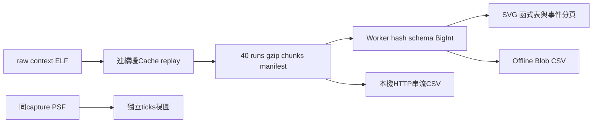
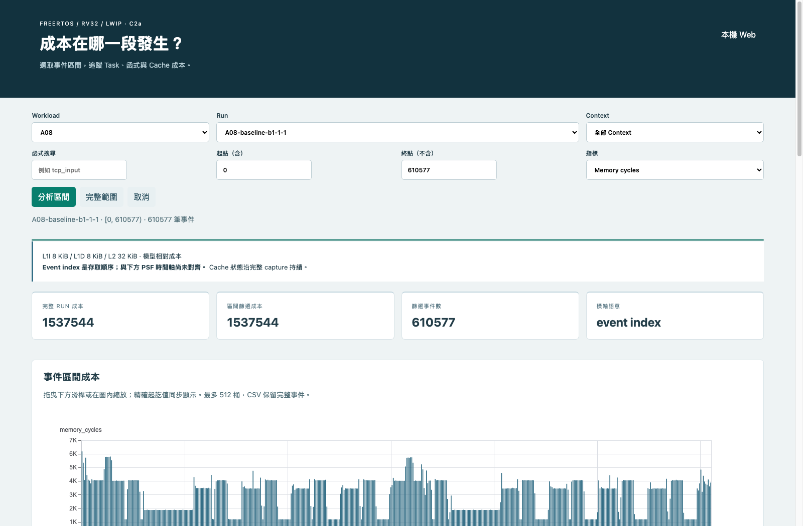
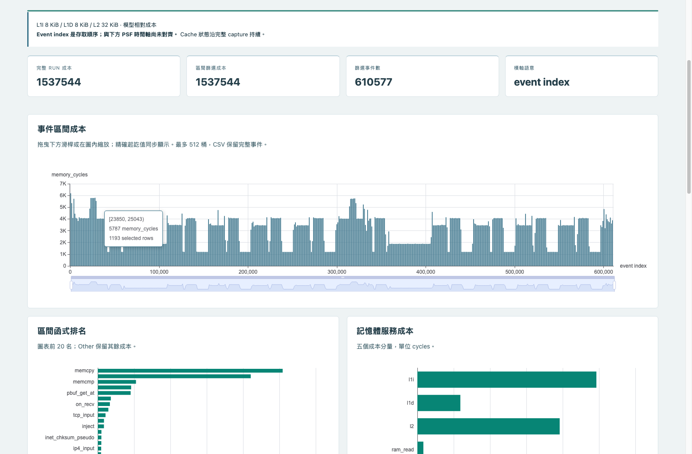
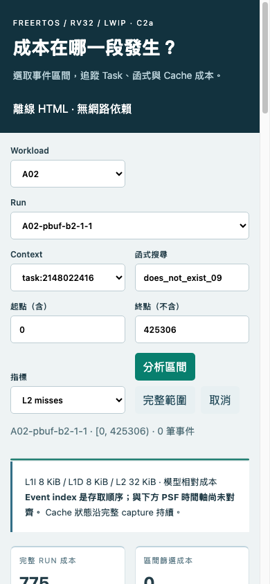
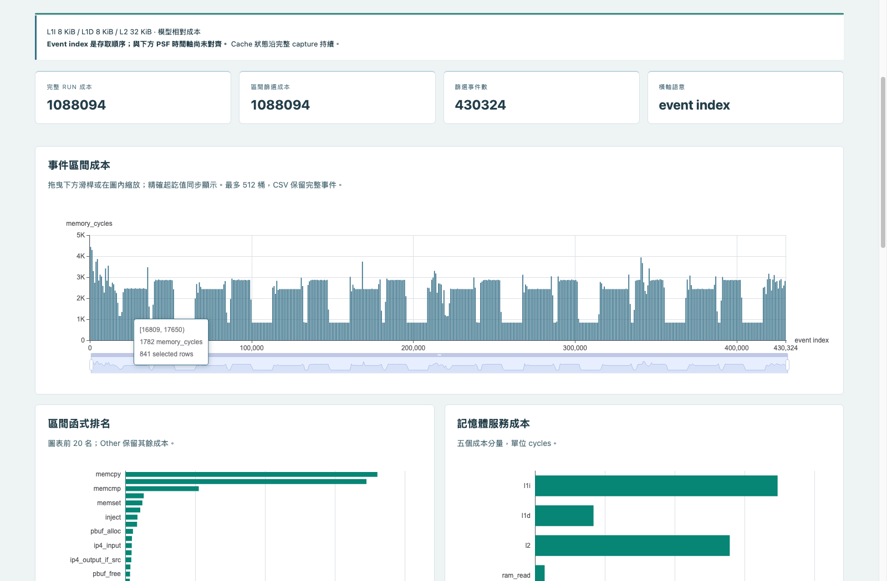
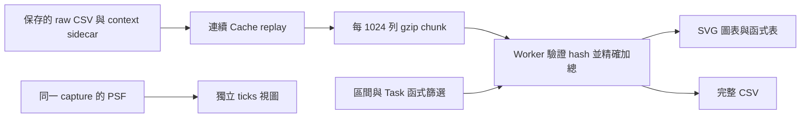

# C2a：用事件區間找出 Cache 成本

**目前狀態：C2a本機正式驗收與兩repo的payload發布完成。40 runs／8HTML已完成；Python328、Node25、Playwright11、Ruff與真TCP故障測試通過。發布SHA另見release收據。C2b已完成來源盤點，實作與新capture尚未開始。**

這份文件是進度與復原入口。已發布的 A、B、C1 成果保持原樣；[C2b clock-anchor計畫](plans/19-c2b-clock-anchor-pilot.md)目前完成來源盤點，pilot尚未實作。

## 正式40-run／8HTML驗收

[完整收據、還原與限制](../artifacts/verification/event-window/release-20261023/README.md)｜[completion](../artifacts/verification/event-window/release-20261023/completion.json)｜[HTTP CSV API](../src/psf_lab/server.py)｜[串流實作](../src/psf_lab/event_window.py)｜[真TCP故障驗證](../tools/tcp/verify_csv_stream_faults.py)

| 模式／workload | 範圍 | ready s | filter s | RSS MiB |
|---|---|---:|---:|---:|
| fast-A08-server | full-interactions | 13.83 | 3.08 | 502.62 |
| fast-A02-server | full-interactions | 10.66 | 2.44 | 489.64 |
| fast-A08-offline | full-interactions | 4.42 | 3.31 | 571.31 |
| fast-A02-offline | full-interactions | 3.60 | 2.73 | 600.52 |
| fast-A01-offline-capacity | capacity-only | 3.67 | 2.27 | 473.73 |
| fast-A03-offline-capacity | capacity-only | 3.88 | 2.60 | 427.66 |
| fast-A04-offline-capacity | capacity-only | 3.66 | 2.29 | 466.36 |
| fast-A05-offline-capacity | capacity-only | 3.51 | 2.29 | 469.92 |
| fast-A06-offline-capacity | capacity-only | 3.75 | 2.41 | 470.27 |
| fast-A07-offline-capacity | capacity-only | 3.42 | 2.30 | 471.89 |

Web經HTTP attachment輸出完整CSV，Offline仍用本機Blob；兩路完整CSV的SHA相同。分析未完成時可在頁面取消；原生下載開始後由瀏覽器下載列取消。圖表最多512桶、逐事件表200列，CSV沒有裁切。新HTML每份約7.2–16.2MiB。





A08完整610577筆access rows；不把一列稱為完整CPU指令，也不把event index當每秒時間。



Hover保留精確半開區間與memory cycles；Web／offline的選區、函式集合與CSV均由獨立oracle核對。



390px版面沒有水平溢出；排序、欄寬、移欄、PC／source與空集合清除另有完整操作證據。

Python328／Node25／Ruff／Playwright11、lifecycle、missing capabilities、forced failure close及真TCP faults皆通過。先前late fault回假成功與preflight意外啟動都已修，原失敗記錄保留。這些RSS是Chrome，不是firmware RAM；host分析速度也不是SDK overhead。

## 2026-10-23：時間修正與 CSV 記憶體阻塞

[完整證據、逐次測量與還原入口](../artifacts/verification/event-window/timing-20261023/README.md)保存成功與失敗、profile、完整查詢結果、CSV、截圖及離線 HTML。[續作計畫](plans/15-c2a-timing-followup.md)記錄實驗與下一步。

- API 每次仍重新讀檔核對 SHA，只快取一份已驗證 manifest 的解析結果；公開回傳 deepcopy。20次chunk profile由1.565s降至0.693s，這不是HTTP延遲量測。
- JS固定欄位加總與 canonical `"0"`／`"1"` 解析快速路徑保留BigInt及全部驗證。完整A02 query輸出逐byte相同。最後三組配對Node查詢約2.90–2.95s降至2.36–2.39s。
- 最終Web三次filter為3.71／3.14／2.92s；完整操作與430,324列CSV oracle通過，但匯出階段RSS650.36MiB，整體false。先前5.29s的失敗也保留。
- 最終離線完整操作：ready4.52s、filter2.85s、RSS536.05MiB，passed；先停止server、阻擋HTTP/HTTPS再測。每個session都close且無殘留PID。
- Python320、Node22、Ruff與build通過；新增bool／非canonical數字、空CSV、缺asset及重複template anchor等負向測試。獨立review未有未解Important。


完整capture為430,324筆；模型成本與事件序號語意直接顯示於畫面，仍保持L1I8／L1D8／L232KiB。



離線hover顯示半開區間、精確memory cycles及selected rows；與Web共用查詢引擎。

## 2026-10-14：RSS 上限改為640 MiB

依使用者明確指示完成調整，[重驗收據與截圖](../artifacts/verification/event-window/rss-640-20261014/)另存。Web完整操作RSS432.08 MiB、離線545.05 MiB，皆符合新上限；兩模式功能通過，瀏覽器皆close且無殘留PID。

離線整體驗收通過。Web首次載入25.83s超過25s；重測載入22.87s通過，但filter5.93s超過5s。因此RSS問題已解除，整體C2a仍未全部驗收。這次只改驗收條件，沒有修改Dashboard的記憶體實作；不把跨次RSS差異宣稱為最佳化成果。

## 可以怎麼用

先選 workload／run，再輸入半開區間 `[start,end)`、Task／IRQ context、函式名稱與指標。主圖最多顯示 512 個桶；hover 顯示精確範圍、成本與選中列數。拖曳下方滑桿會更新精確起終點，並重新計算該區間。

函式表可排序、調欄寬與換欄位位置；逐事件表一次顯示 200 列，點選事件可查看 PC、ELF hash 與來源。函式 CSV 匯出目前完整篩選結果，事件 CSV 匯出全部符合條件的列，不受 200 列分頁限制。

`Memory cycles` 是 cache 模型的記憶體成本，不是實機 CPU 使用率。Event index 是擷取順序，不是時間。Cache 從 capture 起點連續重播，查詢中間區間不會把暖 cache 重置。設定固定 L1I 8 KiB、L1D 8 KiB、L2 32 KiB，64-byte line、4-way、LRU、write-through／write-allocate。

PSF 圖使用獨立 ticks 軸，保留原事件順序、origin 與 quality。它不會隨 cache 區間連動；目前不能把一段 cache 峰值直接宣稱為某個 PSF 時段。



## 低記憶體設計與測試邊界

- Wire 中的整數是十進位字串；加總使用 BigInt，超過 `2^53` 仍保持精確。
- Worker 依序解壓，chunk 上限 1024 列／2 MiB；不把整份 raw trace 解壓到頁面。
- Web 壓縮資料快取上限 8 MiB。離線 HTML 將相同 hash 的 chunk 共用一份，manifest 壓縮後按需載入；完整資料沒有裁切。
- CSV 每塊立即轉成 Blob part；取消時終止 Worker 並清除暫存。
- 測試用 Headless Chrome 153，V8 old-space 64 MiB，停用 GPU 與 software rasterizer。此設定不是一般使用者瀏覽器的保證。
- RSS 是該 agent-browser session 的 Chrome 程序子樹加總，每 0.2 秒採樣，可能漏掉瞬間峰值；共享頁面可能在程序間重複計入。Page heap 是 Chrome 回報值，不等於整個瀏覽器用量。

## 2026-10-13 checkpoint 證據（原512 MiB門檻）

| 項目 | 實測／狀態 |
|---|---|
| A02 pilot | 14 runs，全量 facts／totals／event count 與保存的 C1 相符 |
| 修正後 A02 HTML | 13,043,841 bytes，約 12.44 MiB；包含全部 pilot runs |
| Web 容量重複 3 次 | ready 18.11–18.85s；完整 filter 3.74–3.84s；RSS 473,728／503,712／491,904 KiB，均低於 512 MiB |
| Offline 容量 | 第 1 次 509,472 KiB；第 2 次 549,952 KiB，超限，停止第 3 次 |
| Web 完整操作 | 全部操作通過，RSS 613,888 KiB，整體仍未通過 |
| Offline 完整操作 | hover、drag／oracle、CSV、取消重試、排序、欄寬／順序、context／function／metric、空集合、mobile 均通過；RSS 610,080 KiB，整體仍未通過 |
| 全 run CSV | 430,324 列、74,118,680 bytes、1,088,094 memory cycles，逐列連續 index 與成本核對通過 |
| 跨塊區間 CSV | `[1023,2061)` 共 1,038 列，逐列 index 與成本通過 |
| Python | 修正 commit `0584229` 完整 319 tests 通過 |
| Node／Ruff | 完整 Node 21 tests 與 Ruff 通過 |
| 獨立 review | 4 項 Important 已修正並複查；完整 CSV 記憶體需依實測判定 |

所有瀏覽器測試依序執行、finally close；成功與失敗都檢查該 session 是否留下程序。整體 `passed:false` 不等於資料或所有操作都失敗：收據分別列出 `interactions_passed`、`capacity_passed`、`close_exit`。

前期失敗保留：未去重 HTML 約 55 MiB、初次預設 Chrome RSS 超限、離線容量反覆超限、第一版 slider 測試點到把手外、agent-browser download 子命令切到空白頁。後兩項修正測試方法後完成實際滑鼠拖曳與 CSV 下載，沒有用預期值取代瀏覽器操作。

## 檔案與重跑入口

| 檔案 | 用途 |
|---|---|
| `src/psf_lab/hotspot_events.py` | C1／C2a 共用逐事件 cache replay |
| `src/psf_lab/event_window.py` | chunk 產生、schema／hash 驗證、C1 parity |
| `src/psf_lab/event_window_export.py` | 完整 workload 的單檔離線 HTML |
| `web/src/event-window-data.js` | Web／offline 共用精確計算與 CSV |
| `web/src/event-window-worker.js` | chunk 請求、計算與進度 |
| `web/src/event-window.js` | SVG、表格、篩選與取消生命週期 |
| `tools/tcp/build_event_windows.py` | 從保存 capture 建立新資料集 |
| `tools/tcp/verify_event_window_dashboard.py` | curl／agent-browser、獨立 oracle、下載與 RSS 收據 |
| `docs/plans/14-event-window-dashboard.md` | 原核准範圍、門檻與已核對的 C2a checklist |

API：`GET /api/event-windows`、`GET /api/event-windows/{run_id}`、`GET /api/event-windows/{run_id}/chunks/{chunk_id}`。固定 catalog 內的 ID 才可讀取；不存在回 404，驗證失敗回 503。

開發／驗證命令須在 `poc/` 執行；不要覆寫既有輸入或 passed 產物：

```sh
npm --prefix web run build
PYTHONPATH=src .venv/bin/python tools/tcp/build_event_windows.py \
  --workload A02 --output artifacts/local/new-c2a-pilot
# API 目前讀 artifacts/verification/event-window/formal。
# 實驗時載入 pilot 的副本，只代表 14-run pilot，不可當正式40份。
PYTHONPATH=src .venv/bin/python -m psf_lab serve --port 8017
# 開啟 http://127.0.0.1:8017/event-window.html
```

匯出器讀取同一 API 資料目錄；輸出檔必須不存在：

```sh
PYTHONPATH=src .venv/bin/python tools/tcp/export_event_window_html.py \
  --workload A02 --output artifacts/local/new-c2a-A02.html
```

離線驗收前先停 server，確認 curl 連線失敗，再以 agent-browser 阻擋 HTTP／HTTPS 開啟 `file://`。每次驗收 output 使用新資料夾。內網不需要 Percepio Tracealyzer 授權；仍須依既有 POC 安裝文件準備 Python／Node 與依賴。

## 尚待完成

1. C2b已有clock-anchor pilot提案，尚未實作；cache event index不能推論PSF timestamp。
2. 實機PMU／SDK overhead／UART吞吐與cache-model校準仍待公司平台；本機相對模型結果不能當產品效能數據。
3. 本輪C2a知識庫增補尚未同步；先前知識庫push只涵蓋當時版本。
4. 跨機目標平台依使用者決定暫緩；沒有把未執行項目勾成完成。


## 歷史 checkpoint 操作證據 · 2026-10-13

[Checkpoint 收據與全部中間檔](../artifacts/verification/event-window/checkpoint-20261013/) 保存完整 logs、commands、RSS samples、screenshots，以及可還原的 pilot。


Web 總覽：完整 run 與篩選區間的分母分開顯示。


離線 hover：顯示精確 `[start,end)`、memory cycles 與選中列數。


滑鼠拖曳得到 `[61591,430324)`，共 368,733 列、916,998 memory cycles；獨立 Python oracle 逐列加總相符。


這張是**刻意注入的 UI 測試 fixture**，不是真實 capture 的 gap。原 sequence `7,10,11,12`、相同 ticks、unknown、timestamp wrap 與 origin 都保留；未排序補點。真實檔案沒有被修改。

生命週期測試另確認：B 請求 pending 後切 A，A 完成後才釋放 B，不會覆寫新畫面；舊失敗不會蓋掉「已取消」。匯出在 **2.85%** 進度時取消，重試完成後沒有新增 CSV。第一次 lifecycle 測試因 review 找到驗收漏洞而不採認，修正後第 2 次才列為有效證據。

故意失敗測試保留 `passed:false` 與 `Intentional failure verifies finally-close`，但 `close_exit=0`、剩餘 PID 為空，證明失敗路徑也會關閉專用瀏覽器。

## 還原歷史 partial checkpoint · 2026-10-13

`preview/A02-pilot.html` 可直接開啟，不需要 Python server。`pilot.tar.gz` 是 14-run 資料，不是正式40份。`history/*.html.gz` 保存前期 HTML，解壓後可用相鄰 export receipt 比對原 SHA-256。`inventory.json` 記錄各檔案大小與 hash；`restore-check.json` 是實際解壓到新暫存目錄，再核對全部 manifest／gzip chunks 的結果。

以下只用於新的 checkout；有既有 `formal/` 時先保留原目錄，不覆寫：

```sh
mkdir -p artifacts/local
# 新目錄解壓出 c2a-pilot/
tar -xzf artifacts/verification/event-window/checkpoint-20261013/pilot.tar.gz \
  -C artifacts/local
# 僅在 formal 目錄不存在時建立供 API 使用的 pilot 副本
test ! -e artifacts/verification/event-window/formal && \
  cp -R artifacts/local/c2a-pilot artifacts/verification/event-window/formal
```

還原後 API 顯示的是 **A02 pilot14**。原始 inputs／FreeRTOS／SDK／ELF／PSF 仍在既有 POC 的 `runs/`、`references/`、`firmware/`；不要把 `formal` 這個 API 固定路徑名稱誤認為本階段已完成正式驗收。
