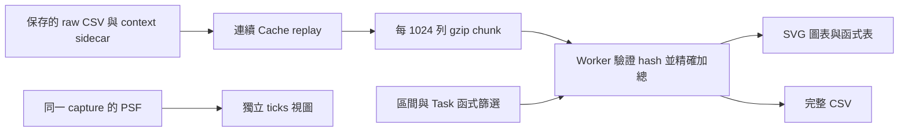
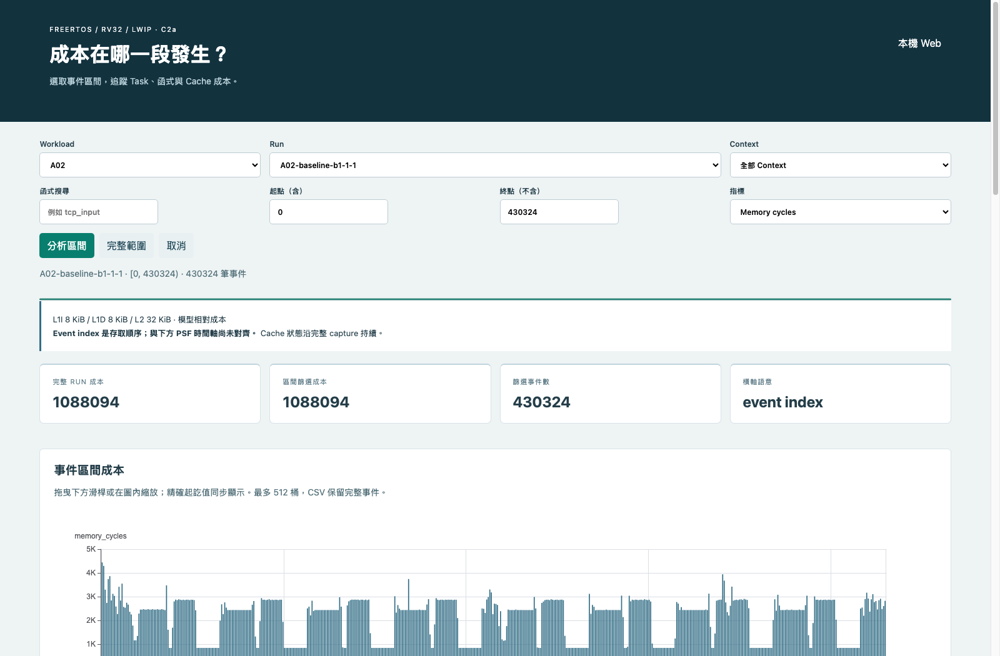
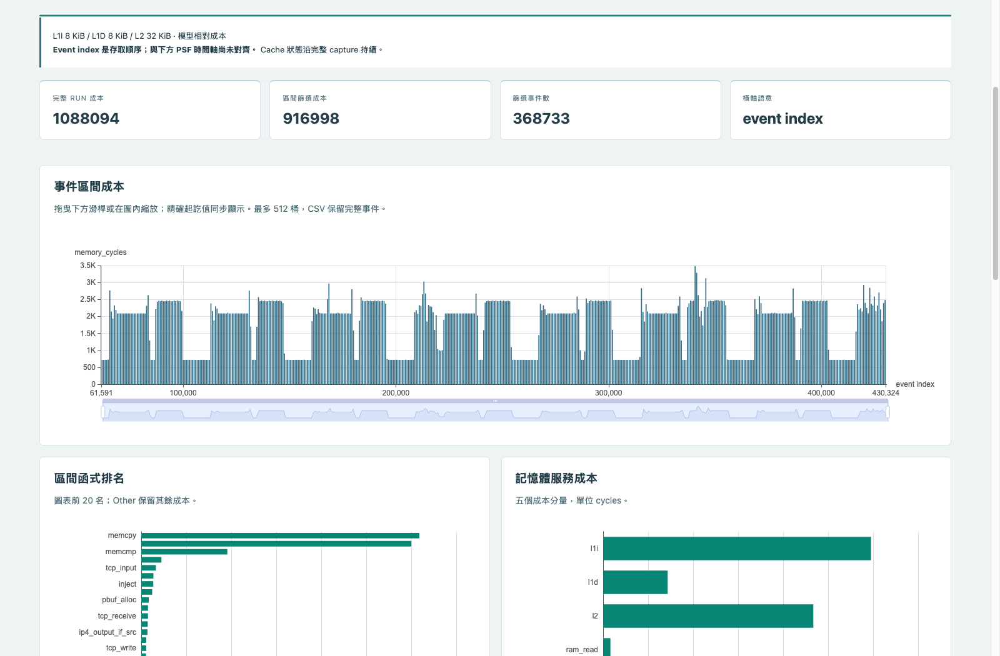
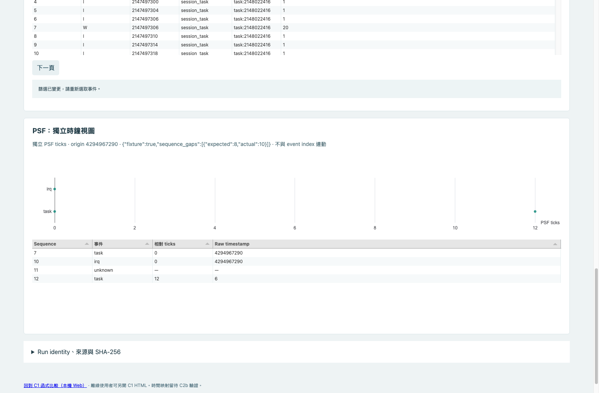

# C2a：用事件區間找出 Cache 成本

**目前狀態：實作與 A02 pilot 已存在，整體驗收未完成。2026-10-14 使用者已將 RSS 門檻調整為 640 MiB，Web／offline RSS重驗均通過；Web時間條件仍有失敗紀錄；尚未擴大正式 40 runs，也未產生正式 8 份 HTML。**

這份文件是進度與復原入口。已發布的 A、B、C1 成果保持原樣；C2b clock-anchor pilot 尚未開始。

## 2026-10-18：Web 效能候選修正，仍未通過整體驗收

已定位重複 manifest 驗證與 Worker 配置／分桶成本，完成局部修正與精確性回歸。Node 全量查詢修改前後結果 hash 相同；資料路徑診斷有改善。此環境無法取得可用 Chrome，且缺少完整 SDK／Python 3.13，因此沒有新的瀏覽器時間／RSS 通過收據。25s／5s／640MiB 條件保持，正式40份／8HTML維持未擴大。見[本次分析、測試限制與重跑命令](c2a-performance-20261018.md)。

## 2026-10-14：RSS 上限改為640 MiB

依使用者明確指示完成調整，[重驗收據與截圖](../artifacts/verification/event-window/rss-640-20261014/)另存。Web完整操作RSS432.08 MiB、離線545.05 MiB，皆符合新上限；兩模式功能通過，瀏覽器皆close且無殘留PID。

離線整體驗收通過。Web首次載入25.83s超過25s；重測載入22.87s通過，但filter5.93s超過5s。因此RSS問題已解除，整體C2a仍未全部驗收。這次只改驗收條件，沒有修改Dashboard的記憶體實作；不把跨次RSS差異宣稱為最佳化成果。

## 可以怎麼用

先選 workload／run，再輸入半開區間 `[start,end)`、Task／IRQ context、函式名稱與指標。主圖最多顯示 512 個桶；hover 顯示精確範圍、成本與選中列數。拖曳下方滑桿會更新精確起終點，並重新計算該區間。

函式表可排序、調欄寬與換欄位位置；逐事件表一次顯示 200 列，點選事件可查看 PC、ELF hash 與來源。函式 CSV 匯出目前完整篩選結果，事件 CSV 匯出全部符合條件的列，不受 200 列分頁限制。

`Memory cycles` 是 cache 模型的記憶體成本，不是實機 CPU 使用率。Event index 是擷取順序，不是時間。Cache 從 capture 起點連續重播，查詢中間區間不會把暖 cache 重置。設定固定 L1I 8 KiB、L1D 8 KiB、L2 32 KiB，64-byte line、4-way、LRU、write-through／write-allocate。

PSF 圖使用獨立 ticks 軸，保留原事件順序、origin 與 quality。它不會隨 cache 區間連動；目前不能把一段 cache 峰值直接宣稱為某個 PSF 時段。



## 低記憶體設計與測試邊界

- Wire 中的整數是十進位字串；加總使用 BigInt，超過 `2^53` 仍保持精確。
- Worker 依序解壓，chunk 上限 1024 列／2 MiB；不把整份 raw trace 解壓到頁面。
- Web 壓縮資料快取上限 8 MiB。離線 HTML 將相同 hash 的 chunk 共用一份，manifest 壓縮後按需載入；完整資料沒有裁切。
- CSV 每塊立即轉成 Blob part；取消時終止 Worker 並清除暫存。
- 測試用 Headless Chrome 153，V8 old-space 64 MiB，停用 GPU 與 software rasterizer。此設定不是一般使用者瀏覽器的保證。
- RSS 是該 agent-browser session 的 Chrome 程序子樹加總，每 0.2 秒採樣，可能漏掉瞬間峰值；共享頁面可能在程序間重複計入。Page heap 是 Chrome 回報值，不等於整個瀏覽器用量。

## 2026-10-13 checkpoint 證據（原512 MiB門檻）

| 項目 | 實測／狀態 |
|---|---|
| A02 pilot | 14 runs，全量 facts／totals／event count 與保存的 C1 相符 |
| 修正後 A02 HTML | 13,043,841 bytes，約 12.44 MiB；包含全部 pilot runs |
| Web 容量重複 3 次 | ready 18.11–18.85s；完整 filter 3.74–3.84s；RSS 473,728／503,712／491,904 KiB，均低於 512 MiB |
| Offline 容量 | 第 1 次 509,472 KiB；第 2 次 549,952 KiB，超限，停止第 3 次 |
| Web 完整操作 | 全部操作通過，RSS 613,888 KiB，整體仍未通過 |
| Offline 完整操作 | hover、drag／oracle、CSV、取消重試、排序、欄寬／順序、context／function／metric、空集合、mobile 均通過；RSS 610,080 KiB，整體仍未通過 |
| 全 run CSV | 430,324 列、74,118,680 bytes、1,088,094 memory cycles，逐列連續 index 與成本核對通過 |
| 跨塊區間 CSV | `[1023,2061)` 共 1,038 列，逐列 index 與成本通過 |
| Python | 修正 commit `0584229` 完整 319 tests 通過 |
| Node／Ruff | 完整 Node 21 tests 與 Ruff 通過 |
| 獨立 review | 4 項 Important 已修正並複查；完整 CSV 記憶體需依實測判定 |

所有瀏覽器測試依序執行、finally close；成功與失敗都檢查該 session 是否留下程序。整體 `passed:false` 不等於資料或所有操作都失敗：收據分別列出 `interactions_passed`、`capacity_passed`、`close_exit`。

前期失敗保留：未去重 HTML 約 55 MiB、初次預設 Chrome RSS 超限、離線容量反覆超限、第一版 slider 測試點到把手外、agent-browser download 子命令切到空白頁。後兩項修正測試方法後完成實際滑鼠拖曳與 CSV 下載，沒有用預期值取代瀏覽器操作。

## 檔案與重跑入口

| 檔案 | 用途 |
|---|---|
| `src/psf_lab/hotspot_events.py` | C1／C2a 共用逐事件 cache replay |
| `src/psf_lab/event_window.py` | chunk 產生、schema／hash 驗證、C1 parity |
| `src/psf_lab/event_window_export.py` | 完整 workload 的單檔離線 HTML |
| `web/src/event-window-data.js` | Web／offline 共用精確計算與 CSV |
| `web/src/event-window-worker.js` | chunk 請求、計算與進度 |
| `web/src/event-window.js` | SVG、表格、篩選與取消生命週期 |
| `tools/tcp/build_event_windows.py` | 從保存 capture 建立新資料集 |
| `tools/tcp/verify_event_window_dashboard.py` | curl／agent-browser、獨立 oracle、下載與 RSS 收據 |
| `docs/plans/14-event-window-dashboard.md` | 原核准範圍、門檻與未完成 checklist |

API：`GET /api/event-windows`、`GET /api/event-windows/{run_id}`、`GET /api/event-windows/{run_id}/chunks/{chunk_id}`。固定 catalog 內的 ID 才可讀取；不存在回 404，驗證失敗回 503。

開發／驗證命令須在 `poc/` 執行；不要覆寫既有輸入或 passed 產物：

```sh
npm --prefix web run build
PYTHONPATH=src .venv/bin/python tools/tcp/build_event_windows.py \
  --workload A02 --output artifacts/local/new-c2a-pilot
# API 目前讀 artifacts/verification/event-window/formal。
# 實驗時載入 pilot 的副本，只代表 14-run pilot，不可當正式40份。
PYTHONPATH=src .venv/bin/python -m psf_lab serve --port 8017
# 開啟 http://127.0.0.1:8017/event-window.html
```

匯出器讀取同一 API 資料目錄；輸出檔必須不存在：

```sh
PYTHONPATH=src .venv/bin/python tools/tcp/export_event_window_html.py \
  --workload A02 --output artifacts/local/new-c2a-A02.html
```

離線驗收前先停 server，確認 curl 連線失敗，再以 agent-browser 阻擋 HTTP／HTTPS 開啟 `file://`。每次驗收 output 使用新資料夾。內網不需要 Percepio Tracealyzer 授權；仍須依既有 POC 安裝文件準備 Python／Node 與依賴。

## 尚待完成

1. RSS已依640 MiB重驗通過；Web首次ready25.83s超25s、重測filter5.93s超5s。後續需處理時間波動，再完成整體容量驗收。
2. Web／offline 完整操作與專項生命週期已驗證；容量通過後仍需重跑最終候選版本，不能把本 checkpoint 當正式 release。
3. 補齊計畫未勾選的負向 fixtures，例如 bool／非 canonical wire 數字、空集合 CSV、缺少 asset／重複 template anchor；已完成的子項不代表整條複合 checklist 都完成。
4. 容量與 pilot 全部通過後才生成正式 40 runs／8 HTML，並補 A08 最大 run 驗收。
5. 完整 Python／Node／Ruff、既有 Playwright workers=1 與 C1 browser 回歸；保存 screenshot／hash／review／remote SHA。
6. C2a 完成後另寫 C2b clock-anchor pilot 計畫，研究 cache event index 與 PSF clock 對齊，不能用猜測 timestamp。


## 這次新增的操作證據

[Checkpoint 收據與全部中間檔](../artifacts/verification/event-window/checkpoint-20261013/) 保存完整 logs、commands、RSS samples、screenshots，以及可還原的 pilot。



Web 總覽：完整 run 與篩選區間的分母分開顯示。


離線 hover：顯示精確 `[start,end)`、memory cycles 與選中列數。



滑鼠拖曳得到 `[61591,430324)`，共 368,733 列、916,998 memory cycles；獨立 Python oracle 逐列加總相符。



這張是**刻意注入的 UI 測試 fixture**，不是真實 capture 的 gap。原 sequence `7,10,11,12`、相同 ticks、unknown、timestamp wrap 與 origin 都保留；未排序補點。真實檔案沒有被修改。

生命週期測試另確認：B 請求 pending 後切 A，A 完成後才釋放 B，不會覆寫新畫面；舊失敗不會蓋掉「已取消」。匯出在 **2.85%** 進度時取消，重試完成後沒有新增 CSV。第一次 lifecycle 測試因 review 找到驗收漏洞而不採認，修正後第 2 次才列為有效證據。

故意失敗測試保留 `passed:false` 與 `Intentional failure verifies finally-close`，但 `close_exit=0`、剩餘 PID 為空，證明失敗路徑也會關閉專用瀏覽器。

## 內網還原這個未完成的 checkpoint

`preview/A02-pilot.html` 可直接開啟，不需要 Python server。`pilot.tar.gz` 是 14-run 資料，不是正式40份。`history/*.html.gz` 保存前期 HTML，解壓後可用相鄰 export receipt 比對原 SHA-256。`inventory.json` 記錄各檔案大小與 hash；`restore-check.json` 是實際解壓到新暫存目錄，再核對全部 manifest／gzip chunks 的結果。

以下只用於新的 checkout；有既有 `formal/` 時先保留原目錄，不覆寫：

```sh
mkdir -p artifacts/local
# 新目錄解壓出 c2a-pilot/
tar -xzf artifacts/verification/event-window/checkpoint-20261013/pilot.tar.gz \
  -C artifacts/local
# 僅在 formal 目錄不存在時建立供 API 使用的 pilot 副本
test ! -e artifacts/verification/event-window/formal && \
  cp -R artifacts/local/c2a-pilot artifacts/verification/event-window/formal
```

還原後 API 顯示的是 **A02 pilot14**。原始 inputs／FreeRTOS／SDK／ELF／PSF 仍在既有 POC 的 `runs/`、`references/`、`firmware/`；不要把 `formal` 這個 API 固定路徑名稱誤認為本階段已完成正式驗收。
