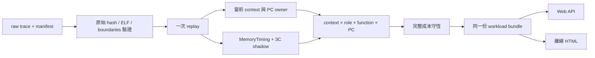
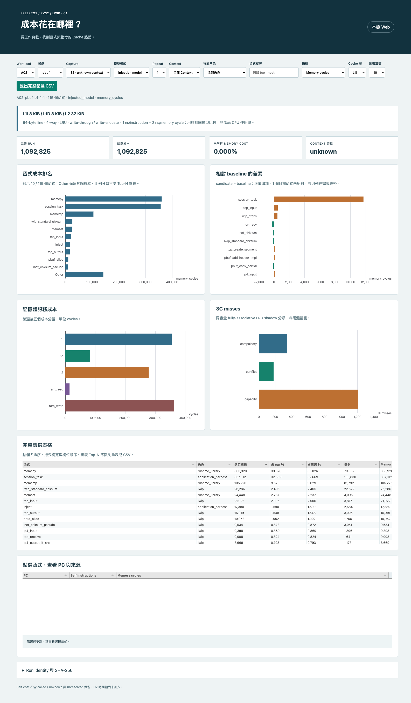
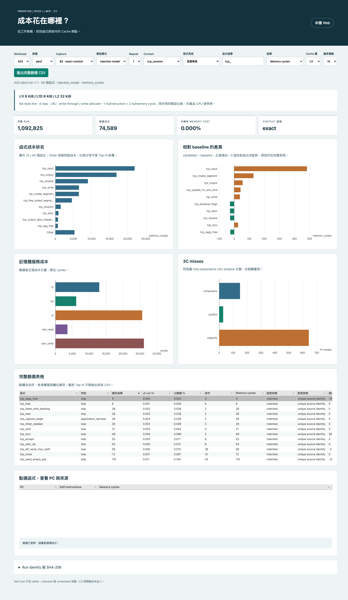
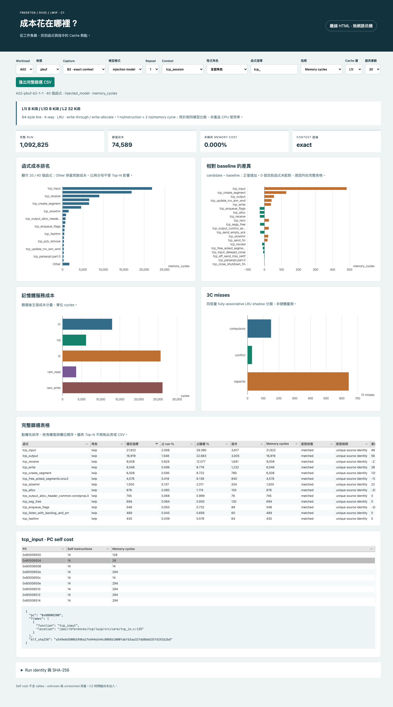
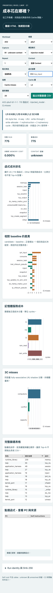

# C1：成本與 Cache 熱點

狀態：C1 實作與 Web／離線驗收完成；GitHub 發佈狀態與 SHA 見 [完成收據](../artifacts/verification/hotspot/completion.json)。

這個頁面用來回答「哪個函式／PC 花最多模型成本？選定 Task／IRQ 後是否相同？pbuf 最佳化把成本移到哪裡？」。沿用 L1I 8 KiB、L1D 8 KiB、L2 32 KiB；用同條件的 baseline／candidate 比較。

## 先從哪裡看

1. 選 workload，先看 B1 的 injection／repeat1 全部資料。
2. 選成本指標：Memory cycles、Self instructions、Accounted model ns 或指定 cache 層 misses。完整 run 與篩選後成本分開顯示。
3. A02／A08 可切 B2，依 tcp_session、tcp_observer、irq:7 或 scheduler 篩選。B1 沒有 exact context，維持 unknown。
4. 點函式表格的一列，再點 PC，查看該 ELF 的 addr2line 證據。未解析內容不猜來源行號。
5. 點欄名排序，拖曳欄寬／欄位順序，匯出完整篩選 CSV。Top-N 僅限制圖表。

## 四張圖怎麼解讀

| 圖 | 意義 | 不能推論的事情 |
|---|---|---|
| 函式成本排名 | 每個函式 self cost；Other 保留未顯示項目 | 不是含 callee 的呼叫樹成本 |
| baseline 差異 | candidate − baseline，正值為成本增加 | unmatched／ambiguous 不當作零；PC 位址不能跨 ELF 相減 |
| 記憶體服務成本 | L1I、L1D、L2 lookup 與 RAM read/write 的模型 cycles | 不表示真實硬體 stall cycles 或產品 CPU loading |
| 3C misses | 首次、衝突、容量 miss；以同容量 fully-associative LRU shadow 分類 | 不是硬體 PMU 量測，也不能單憑這張圖宣稱函式拆分有效 |

`run share` 分母是完整 run，`filtered share` 分母是完整篩選資料。Top-N、表格視窗不改分母。miss rate 的分母必須用對應 cache 層實際 accesses，不能以 CPU load/store 次數代替。

## Web 與離線使用

在 POC 根目錄執行：

```sh
.venv/bin/python -m psf_lab serve --port 8016
```

開啟 `http://127.0.0.1:8016/hotspot.html`。服務只載入固定 catalog 允許的 workload；hash 不符時顯示來源驗證失敗。

離線檔位於 `artifacts/offline/hotspot/`，每個 workload 一個 HTML，可直接開啟。HTML 內嵌該 workload 的 baseline／candidate、可用 family／mode／repeat、JS 與 CSS。沒有 Python 或網路仍能篩選、排序、定位與匯出。

## 如何重建與搬到內網

保留 repo Git history：A/B evidence 會檢查原始提交的內容；只複製工作樹而丟掉歷史不等於完整還原。另須保留既有 `.tools` toolchain；來源與工具 hash 由重播紀錄列出。本輪沒有重新驗證其他 OS/toolchain。

```sh
# 在 POC 根目錄。output 必須不存在，以免覆寫歷史證據。
PYTHONPATH=src .venv/bin/python tools/tcp/analyze_hotspots.py \
  --output artifacts/local/my-c1-replay

# 正式資料產出後：以同一個 bundle builder 包裝，不另寫分析演算法。
.venv/bin/python - <<'PY'
from pathlib import Path
from psf_lab.hotspot_dashboard import publish_bundles
publish_bundles(Path('artifacts/local/my-c1-replay'), Path('artifacts/local/my-c1-bundles'))
PY

npm --prefix web run build
PYTHONPATH=src .venv/bin/python tools/tcp/export_hotspot_html.py \
  --workload A02 --output artifacts/local/my-A02.html
```

匯出工具讀取 `artifacts/verification/hotspot/catalog.json`；重建資料尚未登錄該 catalog 時，不會自動拿來取代驗收過的正式資料。內網要切換時，先核對新 bundle 與其 catalog hashes，再明確替換該資料集並重跑驗收，保留舊版。

## 檔案在哪裡

| 路徑 | 用途 |
|---|---|
| `src/psf_lab/hotspot_report.py` | 聯合統計、Cache 3C、守恆 |
| `src/psf_lab/hotspot_evidence.py` | 來源／ELF／context 驗證與批次重播 |
| `src/psf_lab/hotspot_dashboard.py` | 函式配對、context 身分、catalog、bundle |
| `src/psf_lab/hotspot_export.py` | 安全內嵌 JSON、JS／CSS、禁止網路的 HTML |
| `web/src/hotspot-view.js` | Web／離線共用篩選、分母、排名、CSV |
| `web/src/hotspot.js` | 四張 SVG 圖、互動表格、PC 與來源明細 |
| `tools/tcp/verify_hotspot_dashboard.py` | curl 與 agent-browser 的可重跑操作驗收 |
| `artifacts/verification/hotspot/` | 正式報告、catalog、pilot、測試、截圖與 completion |
| `artifacts/offline/hotspot/` | 8 組 workload 的 HTML 與匯出 hashes |

## 原理與資料邊界



Cache 狀態沿完整 trace 持續，不在 task switch 重置。成本歸屬目前觸發存取的 PC；write-through 的 L1 hit store 仍會查 L2 並寫 RAM。跨 cache line 的一次事件可能查多條 line，但一個 I event 仍只算一次 instruction。

B2 sidecar 由 host 觀測，沒有改 guest／FreeRTOS 或 PSF。Task pointer 只在同 run 識別，跨 run 比較需唯一的 task identity；相同名稱有歧義則差異 unavailable。每個 run 獨立，repeats 不相加成一個工作負載。

## 驗證與限制

- 手算 tests 覆蓋 same-function/different-context、3C、跨 line、write hit、uncacheable region、invalid cost、context缺口、保留未知。
- loader 核對原始 Git pin、檔案／stream hashes、ELF、sidecar boundaries與 exact context。
- 前端測試涵蓋分母不變、空篩選、完整 CSV 與 formula injection；Web/offline 以真實 browser 操作再驗。
- pilot 實測頁面載入與重繪是本機結果，不是跨機效能承諾。
- 還沒有時間軸、PSF/cache timestamp 對齊、PMU、SDK on/off CPU overhead 或 layout 因果驗證；這些工作仍保留在 C2／後續研究。

## A02 的定位線索

B1 injection repeat1 的同源函式配對顯示：`session_task` 指令數沒有改變，但 pbuf 相對 baseline 的 memory cycles 增加 11,724，accounted model ns 增加 23,448。`tcp_input` 增加 483 cycles；`on_recv` 減少 184 instructions 與 266 memory cycles。這些是保存 trace 的重播結果，仍須固定 layout 等因果實驗才知道為何改變。

部分函式只在單側出現或來源有歧義，差異維持 null，不替它們補零。因此「已配對函式 delta 的合計」不一定等於 workload 的完整差異；整體成本仍由完整 facts 守恆。

## 本輪驗收結果

40 份重播報告、8 組 workload、8 份離線 HTML 完成。Python 310／310、Node 13／13、既有 Playwright 11／11、Ruff 通過；curl 六個 routes 與 agent-browser Web／離線互動通過。兩種模式各 6 張截圖，CSV 的 40 列篩選結果另以 Python facts 加總核對。

本機 A02 最終 ready 時間：Web 6.469 秒、離線 0.993 秒；這是各一次驗收值，包含啟動流程，不能當作產品或跨機效能保證。離線 resource list 與 console errors 都為空。PC 明細只保留同一 ELF 的三個欄位，沒有跨 binary 的 PC 差異。

修正前 HTML、失敗瀏覽器紀錄、pilot、產生器原始碼與測試 log 都保存在 `artifacts/verification/hotspot/`，正式 UI 證據位於 `ui/server/` 與 `ui/offline/`；`pilot/` 與 `ui/pre-pc-fix-*` 屬歷史證據。

## 已知小限制

- B2 evidence 的 `raw_stream_sha256` 欄位引用 pinned A stream；formal loader 另外核對實際 formal digest。目前對照相同；兩個來源欄位保留，後續可精簡。
- 快速切換 workload 時，舊請求若延遲失敗，可能清除較新畫面並顯示錯誤。重新選擇 workload 可恢復；成功請求已有 generation guard。這項列為後續 UI 修整，沒有把錯誤畫面當成成功驗收。

## 驗收畫面

### Web：完整 run 與函式排名



### 選定 Task 與函式後的成本



### 離線 HTML：PC 與來源證據



### 手機版面


