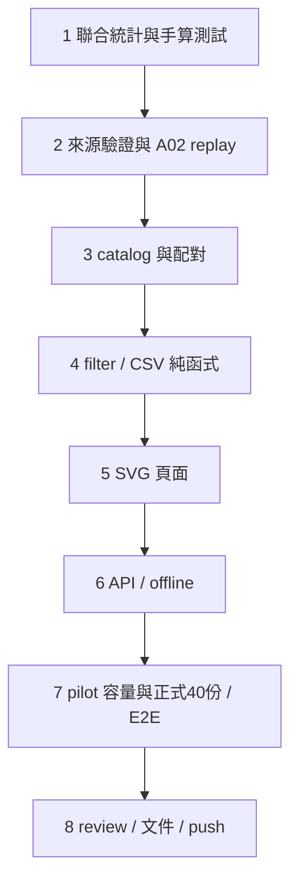

# C1 Hotspot Dashboard Implementation Plan

> **For agentic workers:** REQUIRED SUB-SKILL: Use superpowers:executing-plans to implement this plan task-by-task. Steps use checkbox (`- [x]`) syntax for tracking. 沿用本 session 逐項實作與最後獨立 review 的方式。

**Goal:** 用來源可驗證的 Task／IRQ × role × function × PC 統計，在 Web／離線 SVG Dashboard 定位成本與 Cache miss 熱點。

**Architecture:** Python 重播保存的 raw trace，重用 MemoryTiming／MissClassifier／ELF ownership／context validator，輸出完整稀疏聯合統計。固定 catalog API 與單檔 HTML 消費同一份 workload 配對資料、共用前端篩選與 CSV 邏輯。保留 A／B 原始產物。

**Tech Stack:** 現有 Python、unittest、Ruff、FastAPI、ECharts 6.1.0、Tabulator 6.6.1、esbuild、Node test runner、curl、agent-browser；不新增依賴。

**Spec:** [C1 設計規格](../design/c1-hotspot-dashboard.md)。2026-10-13 使用者以 continue 接續設計審閱，進入實作計畫；使用者隨後以 go 核准實作；目前依驗證證據更新狀態。

## Global Constraints

- L1I 8192、L1D 8192、L2 32768 bytes；64-byte line、4-way、LRU、write-through/write-allocate；模型由保存的 profile 驗證，不使用類別預設 16/16/64 KiB。
- 原始成本為 1 ns/instruction + 2 ns/memory cycle；control 標 shadow、injection 標 injected model。不能標成產品 CPU usage。
- 不重跑 QEMU、不改 guest／FreeRTOS／PSF、不覆寫 A／B manifests、captures、completion 或 offline HTML。
- `unknown`／`unresolved` 參與總和；self cost 不含 callee，不猜 caller。context 與 role 是不同維度。
- 16 份 B1 injection repeat1 + 24 份正式 B2 = 40 份 C1 報告。B1 不擴大至未分析 modes／repeats；B2 為 A02/A08 baseline/pbuf × 2 modes × 3 repeats。capability probe／overhead 不混入正式 catalog。
- 預設 B1、injection、repeat1；選 B2 才提供 exact context。每次選一份 run，不將 repeats 相加；API 返回可用組合，UI 不提供不存在的選項。
- 第一輪 A02 pilot 為 2 份 B1 + 12 份 B2；正式批次全新目錄產生 40 份，不把 pilot 複本加入正式集合。
- CSV 為完整篩選結果，沿用畫面排序；Top-N 僅影響圖表。run share 分母固定完整 run。
- Web／offline 共用 JS；offline 一個 workload 一檔，內嵌該組全部可用 reports。不得靜默截斷、依賴 CDN 或執行任意路徑。
- 先 RED/GREEN，再 commit；全 regression 必須在 clean code commit 上執行。測試會寫 tracked artifacts 時另存 C1 目錄並恢復歷史檔。
- 使用既有 POC feature checkout；所有文件與測試資料放 POC。C2 timeline、硬體 PMU、SDK overhead、layout 因果實驗不在本輪。

## Review Focus

1. context filter 不能用邊際比例估算 function cost；Task 1 手算同函式不同 context。
2. L1 write hit 仍有 L2 lookup，跨 line 一次 raw event 多次查詢；Task 1 對照真實模型呼叫與 3C 守恆。
3. hash、run identity、ELF／boundary 錯配；Task 2 使用檔案突變與明確拒絕測試。
4. baseline 配對有重名、缺方、相同 task name 或不同 runtime pointer；Task 3 保留 ambiguous／unmatched，禁止偽造零成本。
5. 離線 JSON／CSV 注入、空篩選、top-N 偷換分母或漏匯出；Task 4／6 用惡意字串、零值與完整 CSV 對照測試。

## 檔案與介面總覽

| 工作 | 新檔 | 修改既有檔 |
|---|---|---|
| 1 聯合統計 | `src/psf_lab/hotspot_report.py`, `tests/unit/test_hotspot_report.py` | 無 |
| 2 來源與批次 | `src/psf_lab/hotspot_evidence.py`, `tools/tcp/analyze_hotspots.py`, `tests/unit/test_hotspot_evidence.py` | 無；共用舊 validator，若需抽取先證明舊行為不變 |
| 3 身分與比較 | `src/psf_lab/hotspot_dashboard.py`, `tests/unit/test_hotspot_dashboard.py` | 無 |
| 4 前端純函式 | `web/src/hotspot-view.js`, `web/tests/hotspot-view.test.mjs` | 無 |
| 5 SVG 頁面 | `web/hotspot.html`, `web/src/hotspot.js`, `web/src/hotspot.css` | `web/build.mjs` |
| 6 API／offline | `src/psf_lab/hotspot_export.py`, `tools/tcp/export_hotspot_html.py`, `tests/unit/test_hotspot_export.py`, `tests/integration/test_hotspot_api.py` | `src/psf_lab/server.py` |
| 7 驗收 | `tools/tcp/verify_hotspot_dashboard.py`、pilot／formal／UI artifacts | 無 |
| 8 文件與交付 | `docs/hotspot-dashboard.md`、completion | README、本計畫、C backlog；root README／gitlink |



## Task 1：每次存取的聯合統計

**Interfaces:**

```python
def build_hotspot_report(rows, ranges: list[dict], profile: dict, *,
                         identity: dict, contexts: list[dict] | None) -> dict: ...
def validate_hotspot_report(report: dict) -> None: ...
```

identity 必備 `run_id, workload, variant, family, mode, repeat`；family 為 b1/b2，mode 嚴格整數 0/1。context 品質由 Task2 通過來源與 anchors 才可升為 exact，純函式不自行聲稱 exact。

每份 report schema=`hotspot-report-v1`，含 identity、profile、totals、facts、owners、evidence、context_quality。facts 每列為 `context, role, function_id, pc, instructions, memory_cycles, model_service_ns, accounted_model_ns, cost_cycles, cache`；cache 為每層 `accesses, misses, compulsory, conflict, capacity` 整數。PC 與 owner 透過 lookup 正規化，不複製大型證據到每列。

- [x] RED：建立 unittest 手算 `_Cache`/MemoryTiming lookup 順序。用 128-byte、64-byte line、direct-mapped toy L1 與同容量 fully-associative shadow；區塊序列 0,2,0 應得到 compulsory,compulsory,conflict；0,1,2,0 的末項應為 capacity。toy 僅測演算法，正式 profile 仍 8/8/32 KiB。

```python
from psf_lab.tcp_hotspots import MissClassifier
c = MissClassifier(2)
self.assertEqual([c.observe(b, False) for b in (0, 2, 0)],
                 ['compulsory', 'compulsory', 'conflict'])
c = MissClassifier(2)
self.assertEqual([c.observe(b, False) for b in (0, 1, 2, 0)][-1], 'capacity')
```

再建立兩筆 I、同 PC 的 fixture；用 MemoryTiming 各產一次有效 raw cost，context 分別 task:A 與 irq:7。斷言兩列 instructions 各1，而非兩列都2；contexts=None 則只有 unknown。另測跨 line R、L1 hit W 仍查 L2、非cacheable region 零 cache lookup、成本欄被改1、空 stream、bool/負數、context 缺口/超長拒絕。

- [x] 執行 `.venv/bin/python -m unittest tests.unit.test_hotspot_report -v`，保存缺少新介面的 RED。
- [x] 實作：重用 `from_profile` 與 `MissClassifier`；以 `tcp_hotspots.profile_misses` 的 ObservedCache 模式攔截**實際** cache.access，current fact 在 model.access 前固定；一次 event 跨多 line 不增加 instructions。不可用 `replay_split` 代替 MemoryTiming，兩者 store policy 不同。

```python
hit = super().access(address, operation, byte_count)
kind = self.classifier.observe(address // self.geometry.line, hit)
# 只在當前 fact 與 totals 累加本 level 一次 lookup；kind 非 None 才加 miss。
return hit
```

每筆 raw 的五個 cost component 與 model.access 回傳逐欄一致才累加；I 每筆+1。依現有 `resolve_pc` 保留 overlap／missing owner。輸出 deterministic sort；驗證各維度及 3C 守恆。
- [x] GREEN 同一 unittest，Ruff check/format 新檔；commit `Add joint context and PC hotspot replay`。

## Task 2：證據載入、正式集合與 pilot

**Interfaces:**

```python
def catalog_inputs(root: Path, *, workload: str | None = None) -> list[dict]: ...
def load_hotspot_input(root: Path, entry: dict) -> dict: ...
def analyze_hotspots(root: Path, output: Path, *, workload: str | None = None) -> dict: ...
```

load 回傳 `raw_path, ranges, profile, identity, contexts, evidence`。B1 使用 `load_capture_evidence(root, runset, 1, 1)`；B2 完整沿用 `analyze_context_batch.py` 的 batch 集合、run-manifest、boundary ELF、必要 files、task identities、context_intervals 與 validate_context_anchors 鏈，不能只讀已存在的 intervals 檔案。

- [x] RED：tmpdir 建 required file manifest，修改1 byte必須 ValueError；移除 required key、`../`、absolute path、boundary ELF 錯配、sidecar 缺 anchor、formal 23/25 筆都拒絕。直接測 loader，不能只測底層 hash helper。

```python
entries = catalog_inputs(root)
self.assertEqual(len(entries), 40)
self.assertEqual(len({e['run_id'] for e in entries}), 40)
self.assertEqual(len(catalog_inputs(root, workload='A02')), 14)
with self.assertRaises(ValueError):
    analyze_hotspots(root, already_existing_output)
```

- [x] 執行新 tests 確認 RED；實作固定集合、profile hash、小 cache geometry、原始 stream SHA256／compressed file hash 分開記錄。必要資料不全時不 fallback unknown 冒充 exact；B1 原本無 context 才合法 unknown。
- [x] 用該 ELF 跑 `addr2line -a -f -i`，記工具 hash／version、arguments 與完整 stdout。來源為 `??` 時 null；inline frames 可保留 evidence，owner 仍用 B 的實體包含範圍。source display 僅檔案／行號，不自動讀目前 source 內容。
- [x] CLI：`PYTHONPATH=src .venv/bin/python tools/tcp/analyze_hotspots.py --workload A02 --output artifacts/local/c1-pilot-data`；新目錄 exclusive create。逐 run 保存 report.json.gz、summary.json、完整 facts.csv、source-lines.json、evidence.json；completion 含精確集合、檔案 hashes、工具／來源與成功／失敗。
- [x] 每份 totals/role/function/PC 對照原 B 統計；3C 全域對照 `profile_misses` 相同 stream/profile；context角色對照 B2。原始來源不變，新的 ownership 存 run-specific evidence。
- [x] GREEN loader tests／Ruff；pilot 完整與手算通過後 commit；pilot 不能當正式40份驗收。

## Task 3：配對與 Dashboard catalog

**Interfaces:**

```python
def pair_functions(baseline: dict, candidate: dict) -> list[dict]: ...
def build_workload_bundle(reports: list[dict]) -> dict: ...
def load_hotspot_catalog(root: Path) -> dict: ...
def load_hotspot_workload(root: Path, workload: str) -> dict: ...
```

bundle schema=`hotspot-workload-v1`，含 workload、reports、pairs、manifest_sha256。catalog schema=`hotspot-catalog-v1`，固定 A01..A08 的 workload bundle path/hash；只接受此 ID，不能直接接受 path。每份 facts 保留自身 run_id；選 baseline/candidate 時找同 family/mode/repeat/profile。

- [x] RED 配對：地址平移但 repo-relative source／symbol唯一時 matched；相同函式名不同 object 不合併；重名有歧義時 ambiguous；單側 absent 為 unmatched。

```python
# fixture 的 source/symbol 相同，地址不同；變體多一份相同 source/symbol 即歧義。
pairs = pair_functions(baseline_fixture, relocated_fixture)
self.assertEqual(pairs[0]['status'], 'matched')
self.assertIsNone(pair_functions(baseline_fixture, empty_fixture)[0]['delta'])
```

- [x] 實作 normalize source/object prefix：只移除驗證 manifest 指定的 checkout/build root，保留 archive/member；不可只取 basename。保存 pairing key 與理由，delta = candidate−baseline，zero baseline percent=null。
- [x] context UI：run內按原始 context ID 篩選；跨 run task 配對只接受驗證 task-identities 中唯一 task name/role，pointer不能直接配對。相同 IRQ cause／scheduler可配對。名稱重複／task缺失顯示 unavailable，保留 all-context 比較。不把 unknown 與 exact 配對。
- [x] GREEN 需涵蓋不同 workload/mode/family/profile/repeat拒絕、missing hash、CSV輸出metadata來源存在；commit。

## Task 4：共用篩選、聚合、排序、CSV

**Interfaces（新 hotspot-view.js exports）:**

```javascript
selectRun(bundle, {variant, family, mode, repeat}); // report 或明確錯誤
selectFacts(report, {context, role, query});        // 全部符合的 facts
summarizeFunctions(report, facts, metric);         // 含 run/filtered numerator/denominator
rankFunctions(rows, {field, direction, topN});     // {allSorted, visible, other, totalRows}
pcRows(report, facts, functionId);                // 所選函式完整 PCs
hotspotCsv(rows, metadata);                       // UTF-8 CSV 字串，非 Top-N
```

- [x] RED Node fixtures：完整成本100、符合filter40，top1成本30，需 run share30%、filtered share75%、Other10；CSV含全部2列而非1列。空filter回[]、分母0回null；輸入不可被 sort mutate。

```javascript
assert.equal(view.visible[0].run_percent, 30);
assert.equal(view.visible[0].filtered_percent, 75);
assert.equal(view.other.memory_cycles, 10);
assert.equal(view.allSorted.length, 2);
```

- [x] `node --test web/tests/hotspot-view.test.mjs` RED；實作上述純函式，metric whitelist，穩定 tie-break by function_id/PC。比例排序用 numeric/null-last，不比較格式化字串。Cache rate 的 Other 由總misses/總accesses重算，不平均百分比；rate 圖無可相加的 Other 百分比。
- [x] CSV使用完整排序資料，欄位包括 run_id/mode/family/repeat/profile hash/metric units、function/context、所有整數成本、run/filtered denominator。文字以 `= + - @` 或控制字元開頭時加安全引號前綴；數值負 delta 保留數值，不轉成字串注入處理。
- [x] GREEN Node與既有單元測試；commit。Python不再另寫 filter 排名版本，API/offline共用這個 JS。

## Task 5：互動頁面與 pilot 畫面

- [x] 先依 spec ASCII 做頁面 DOM fixture；必備 `#workload, #family, #mode, #repeat, #context, #role, #function-query, #metric, #cache-level, #top-n, #csv, #hotspot-status`，四張 `.hotspot-chart` 與 `#functions-table, #pc-table, #source-evidence`。寫 Node view fixture 驗四圖資料總和／負 delta 保留。
- [x] 實作新頁、CSS、entry；build.mjs 新增 entry/output但不修改 A templates。ECharts `renderer:'svg'`，Tabulator排序/欄寬/欄位移動；source strings用 textContent或安全formatter，不直接 innerHTML。

```javascript
const chart = echarts.init(element, null, {renderer: 'svg'});
status.textContent = `${run.identity.run_id} · ${run.context_quality}`;
window.hotspotReady = true; // 僅在資料核對、圖表與表格初次render完成後
```

- [x] workload/family/mode/repeat 改變時重置不相容 context／function selection，顯示重置結果；資料載入錯誤時清除舊資料並呈現錯誤，不保留舊圖假裝新run。
- [x] tooltip 顯示整數值、units、來源run、分母、model boundary。miss metric/level選擇相依；function click顯示自身PC表，切run後不可保留舊PC。
- [x] pilot提供排名、delta、cost breakdown、3C四圖，桌面1600×1050與手機390×844無整頁水平溢出；表格可局部水平捲動。
- [x] `npm --prefix web run build` 與 Node tests通過後 commit；實際互動 gate 在 Task7，不以 DOM fixture 取代 browser。

## Task 6：本機 API 與單檔匯出

**Interfaces:**

```python
def export_hotspot_html(root: Path, workload: str, output: Path) -> dict: ...
```

API `GET /api/hotspots` 返回 catalog、`GET /api/hotspots/{workload}` 返回 hash驗證後bundle；未知ID404，hash不符/無效資料503，對外錯誤不洩露絕對檔案內容。static頁 `/hotspot.html`。

- [x] RED integration 使用 FastAPI TestClient + tmp fixture catalog，測正常、unknown、URL encoded path traversal、bundle hash mismatch；例：

```python
self.assertEqual(client.get('/api/hotspots/unknown').status_code, 404)
self.assertEqual(client.get('/api/hotspots/A02').status_code, 200)
# 實際修改fixture bundle一個byte後重新request，不依賴mock成功資料。
self.assertEqual(client.get('/api/hotspots/A02').status_code, 503)
```

- [x] 匯出 RED：資料含 `</script><script>alert(1)</script>`、U+2028、`</style>`；JSON可還原但不形成新script元素。assets缺少、output已存在、report hash不符必須拒絕。
- [x] 實作重用 `offline.embed_json` 與 cache_report 的escape/CSP規則，使用hotspot明確template anchors，不用全域任意字串取代；若anchor missing/duplicate拒絕。`connect-src 'none'`；startup先讀inline JSON，無inline才走固定API。
- [x] CLI `PYTHONPATH=src .venv/bin/python tools/tcp/export_hotspot_html.py --workload A02 --output artifacts/local/c1-pilot-A02.html`；receipt保存bundle/JS/CSS/template/output hashes與byte count。
- [x] unittest／Ruff／Node tests通過；commit。

## Task 7：容量、正式重播與兩種 UI 驗收

- [x] 先以 A02 pilot 測 JSON/gzip/HTML bytes、facts列數、頁面ready時間、首次filter時間。browser版本、OS、commit、量測方法與3次原始值保留，不預填結果或通用效能承諾。ready超過既有25s browser wait則pilot fail，不截斷資料；需調整設計再驗。
- [x] pilot通過後新目錄 `artifacts/verification/hotspot/formal` 產生40份完整報告；產生8個workload bundles與8個offline HTML到 `artifacts/offline/hotspot/`。保存catalog、hash manifest、所有中間檔與完成收據。每份守恆及來源檢查都通過才可登錄。
- [x] 新 `tools/tcp/verify_hotspot_dashboard.py` 使用現有 verify_workload_dashboard.py 的curl／agent-browser模式，SESSION/OUT/SHOTS獨立；不得覆寫A/B證據。API正常/unknown與JS/CSS/HTML routes以curl保存status/bytes；asset 與 bundle hashes 另存匯出／manifest 收據。
- [x] agent-browser server流程：A02 baseline/pbuf → B2 injection repeat1 → task filter → function搜尋 → metric排序 → topN切換 → hover →欄寬與欄序變更 →完整CSV比對 → function/PC/source證據 →A08 →B1 unknown →空結果 →手機。排序/CSV以同一資料fixture的預期值比對，不能只看檔案存在。
- [x] 關閉Python Server，curl確認無連線；agent-browser離線模式與HTTP/HTTPS abort routes打開file:// HTML，重跑相同操作。assert resource list無http(s)、console errors為空。每mode至少保存總覽、delta、hover、context篩選、PC來源、手機6張。
- [x] 既有Playwright regression與A agent-browser回歸依序跑，歷史tracked產物先備份，C1保存新結果後復原；全部code先commit，再執行完整Python suite、Ruff、Node。保存成功／失敗log與實際測試數。

## Task 8：審查、文件、publish

- [x] 依 requesting-code-review skill 提供 spec、plan、base與final code SHA，獨立whole-change review聚焦聯合統計、3C、配對、資料完整性及offline；Important問題先修正並重跑受影響驗證。
- [x] `docs/hotspot-dashboard.md` 說明如何重建40份、8份HTML、Web啟動、圖表解讀、A02/A08實際結果、unknown與未驗證因果。README放資料夾表、重要檔案、截圖、重現入口；C1勾選，C2保持未完成。
- [x] completion.json包含tested commit、clean gate、40份精確集合、來源與工具hash、實際測試結果、Web/offline收據、容量數字、review狀態。任何必需gate未通過則passed=false，不能用其他測試替代。

```python
from pathlib import Path
from psf_lab.docs_validation import verify_docs
result = verify_docs(Path.cwd())
assert result['ok'], result['broken_links']
```

- [x] `git diff --check`；核對A/B immutable hashes與source pin未變。POC commit/push `HEAD:poc-history`、root README/gitlink commit/push `main`；capture transport輸出，僅回報分類與SHA，不輸出token。用ls-remote核對，兩個working tree clean。

## 計畫自我審閱

| 設計要求 | 對應工作 |
|---|---|
| 聯合統計／3C／守恆 | 1、2 |
| provenance／source line／unknown | 2、3 |
| baseline與context配對／分母 | 3、4 |
| 四圖／filter／CSV／PC | 4、5 |
| Web／無網路HTML | 6、7 |
| 容量與不截斷／復原證據 | 2、7、8 |
| unittest／Ruff／curl／browser／截圖／review | 各工作、7、8 |

這份計畫不新增時間軸、硬體量測或SDK CPU loading結論。新的API與欄位在本文件定義；正式資料集合固定40份，不把舊測試數當作未來完成數。使用者已核准並執行 Task1–8；驗收證據見 artifacts/verification/hotspot/completion.json，發佈勾選以 remote SHA 核對為準。
