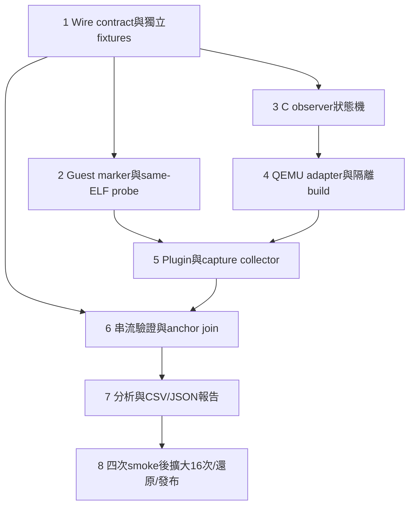

# C2b v1 Clock Anchor Implementation Plan

> **For agentic workers:** REQUIRED SUB-SKILL: Use superpowers:subagent-driven-development (recommended) or superpowers:executing-plans to implement this plan task-by-task. Steps use checkbox (`- [ ]`) syntax for tracking.

**Goal:** 實作已審閱的方案A，以16次A02 captures驗證SDK markers、QEMU成本request／applied與PSF之間的有界時間關係。

**Architecture:** POC app／port提供同ELF的5個markers與cmdline開關；獨立QEMU patch透過串流observer記錄成本生效及ACLINT原生sample。Python先驗證來源、完整性與順序，再做兩次串流掃描，建立anchor bounds與L/C/O/M對照報告；不建立逐事件推測timestamp。

**Tech Stack:** Python 3.13、stdlib、unittest、Ruff；C、GLib、RISC-V GCC15.2；固定QEMU9.2／plugin API4；現有FreeRTOS與TraceRecorder4.12。

**Spec:** [C2b v1設計規格](../design/c2b-clock-anchor-pilot-v1.md)，使用者於2026-10-25以`continue`確認後進入本計畫階段。

**Execution:** 沿用本專案已採用的Native：主agent逐項實作，最後做獨立whole-change review；依據[既有原生執行紀錄](14-event-window-dashboard.md)。不重新詢問A／B或執行方式。本計畫仍需審閱後才開始寫product code／build／capture。

**Current status:** 僅完成書面計畫與自審，以下unchecked項目全部尚未執行。預期輸出、程式片段及測試命令不是已通過的證據。

## Global Constraints

- 工作位置固定為`~/git/percepio/poc`；kernel與SDK原始碼、`references/baseline`及所有舊captures唯讀。
- L1I 8 KiB／L1D 8 KiB／L2 32 KiB、64-byte line、4-way LRU、write-through／write-allocate；使用既有`cases/timing/sysram-10-small.json`，不得改profile湊通過。
- QEMU9.2／RV32／single-vCPU／single-thread TCG／`-icount shift=0,align=off,sleep=off`；原1ns/instruction與2ns/memory cycle保持。
- 原relative binary SHA固定為`69969c3ec8cce8f9340215fc340c5c01f81c3ef978252d3766937d2d176816db`。新binary在新`.tools`目錄，不能覆寫舊檔或使用系統QEMU代替。
- 每個candidate只build一份新ELF，L/C/O/M與兩種injection共用；cmdline在capture之前讀取。
- 5個marker phases、repeat=1、16 captures；先4次smoke，通過才跑其餘12次。正式capture前source已commit且乾淨。
- request clock為`null`；不從instruction callback讀virtual clock／time CSR，不改成同步stall、合併requests或強制TB切分。
- 保留request、applied、app sample、SDK TS、native MMIO與cursor不同phase；不按timestamp排序、不插值、不刪unknown。
- Capture逐一執行，單次120s host timeout；build預設`-j2`、可降`-j1`並記錄。raw上限3,000,000 rows，pending上限65,536，stdio64KiB，JSONL單列含結尾LF最多16KiB。
- Python與C native tests使用`unittest`驅動，執行Ruff；未量測的runtime／產品CPU成本不標passed。C2a Chrome RSS640MiB／ready25s／filter5s等gate未修改。
- 本計畫不接UI；後續Web／offline必須curl integration、單session agent-browser E2E及finally close／截圖，不能拿本輪CLI結果結清UI。
- 本機原始／壓縮資料、patch、build logs、ELF／map、失敗與還原檔保存；Git transport只輸出sanitized狀態與SHA。

## Review Focus

1. **同時間多筆PSF及counter wrap：**以marker seq／phase／payload與原offset配對；Task1／6測equal ticks、EventCount16與TS32 wrap、非零uint64 offset，不任選候選。
2. **end之後才applied：**end只凍結cursor，finish不得偷偷advance；Task3／4／6測draining、未清pending、I/O失敗與缺footer。
3. **observer改變guest行為：**Task5／8維持相同context policy及同ELF；L/C、C/O任何raw／PSF／packet差異都阻止擴大，不normalize掉差異。
4. **timer內部計算混入guest MMIO：**Task4／5／6只記原生MMIO分支，以device／plugin兩種source成對驗證；reset／MTIME write不能冒充mtimecmp。
5. **大量或損壞的sidecar／中途換檔：**Task1／3／6／8測16KiB line、duplicate JSON keys、FIFO上限、兩次掃描hash不一致、timeout partial與gzip還原hash；不能全量載入或靜默截斷。

## 執行順序與檔案邊界



Native仍按Task1→8順序執行。架構圖的箭頭只表示依賴，沒有授權平行跑QEMU或browser。

| 檔案群組 | 單一責任 |
|---|---|
| `src/psf_lab/clock_anchor_wire.py` | canonical數字、JSONL與raw CSV streaming、clock quantum primitive |
| `firmware/port/clock_anchor.c/h`及app opt-in接點 | cmdline、3個register hooks、5筆SDK events |
| `tools/qemu/clock_anchor/poc-clock-state.c/h` | 可在host單獨測試的observer狀態機，為generated patch中core的canonical來源 |
| `tools/qemu/0004-clock-anchor-observer.patch` | QEMU adapter、ACLINT、Meson與export declarations；包含canonical core的generated副本，build時逐byte核對避免雙重維護 |
| `tools/qemu/poc-clock-anchor-api.h` | POC ABI v1結構與宣告，與patched header一致 |
| `tools/tcp/clock_anchor.c/h`及`live_cache.c` opt-in | register callback、cursor／MMIO成功回報；不放Python分析或獨立clock getter |
| `src/psf_lab/clock_anchor_boundaries.py` | ELF／symbols／map身分、context與marker PC，拒絕clone／歧義 |
| `src/psf_lab/clock_anchor_capture.py` | build／source鎖、命令矩陣、subprocess、120s timeout、capture收據 |
| `src/psf_lab/clock_anchor_evidence.py` | 順序／FIFO／MMIO／PSF驗證，兩次streaming join與品質狀態 |
| `src/psf_lab/clock_anchor_analysis.py` | 因果對照、比例分母、JSON／CSV與Markdown報告 |
| `tools/tcp/run_clock_anchor_pilot.py` | CLI參數與exit code；業務邏輯在上述modules |
| `tools/tcp/package_clock_anchor.py` | 可還原資料封裝、清單與逐檔SHA核對 |

## 固定資料契約：所有Tasks共同遵守

### A. Sidecar v1

common keys為`schema,run_id,record_seq,kind,cpu,raw_cursor,phase`；schema固定`clock-anchor-record-v1`，cpu固定字串`"0"`。整數保留canonical decimal字串、各欄位再驗其bit範圍；flags為真正JSON bool，不接受整數代替。record_seq從0開始，header為0，footer為最後一筆，`record_count=footer.record_seq+1`。

| kind | 額外必備欄位／語意 |
|---|---|
| header | abi_version=`"1"`；qemu／ELF／profile／plugin SHA；configuration、injection_enabled、observer_enabled、marker_mode、expected_frequency_hz=`"10000000"`、clock domains |
| capture_begin／capture_end | cursor0／最終N；phase=`before_guest_instruction` |
| cost_request | request_id、request_event_index、delta_ns；request_clock_ns必須null；phase依I/R/W為`instruction_before`／`memory_after_success` |
| cost_applied | request_id、before_ns、requested_target_ns、advance_return_ns、after_ns；phase=`cpu_async_outside_exec` |
| marker_enter／marker_sampled／marker_leave | marker_seq、marker_phase；sampled多sample64，其他兩種sample64為null；phase=`hook_before_guest_instruction` |
| mtime_read | source=`device`或`plugin`、native_io_seq、address、size=`"4"`；device另有virtual_ns、timebase_hz、time_delta、mtime64、value32，plugin的這些sample欄位均null |
| mtimecmp_write | source與native_io_seq、address、size；device有value32，plugin value32為null，不另讀clock |
| epoch_change | reason=`mtime_write`／`reset`／`device_changed`／`frequency_changed`及可取得的原值；本v1拒絕建立映射 |
| footer | complete bool、raw_rows、requests、applied、pending、device_io、plugin_io、record_count；成功時pending0、complete true |

device與plugin兩列是同一guest MMIO的兩個phase，使用同一native_io_seq，不是兩次guest read。這是spec既有kind的具體化，沒有加入新的raw row或新的clock取樣。cursor note只更新hub狀態，不產生逐row log。

對非成功run，可留下不完整檔、`complete:false` footer及stderr失敗原因；validator一律不將它升級為verified evidence。拒絕unknown kind／keys、duplicate JSON keys、NaN、非UTF-8、非LF結尾、空行與超長行。

### B. Python介面

以下signature是契約；實作步驟在各Task，不以空函式或ellipsis代替工作：

```text
clock_anchor_wire.ClockEvidenceError(code: str)  # ValueError subclass，保留code
clock_anchor_wire.ClockUnavailable(code: str)    # 有效來源但不支援的clock
clock_anchor_wire.decimal(value: str, *, bits: int | None = None) -> int
clock_anchor_wire.iter_clock_records(path: Path, *, max_line_bytes: int = 16384) -> Iterator[dict]
clock_anchor_wire.iter_access_rows(path: Path) -> Iterator[dict]
clock_anchor_wire.mtime_quantum(t: int, offset: int, hz: int) -> tuple[int, int]

clock_anchor_capture.RunSpec(candidate: str, configuration: str, injection: int, repeat: int = 1)
clock_anchor_capture.pilot_matrix() -> list[RunSpec]
clock_anchor_capture.prepare_tools(root: Path, qemu_build: Path, legacy_qemu: Path,
                                   output: Path) -> dict
clock_anchor_capture.capture_one(root: Path, spec: RunSpec, tools: dict, elf: dict, output: Path) -> dict
clock_anchor_capture.run_pilot(root: Path, output: Path, tools: dict, *, stage: str) -> dict

clock_anchor_boundaries.collect_boundaries(root: Path, elf: Path, map_path: Path,
                                         toolchain: Path, output: Path) -> dict
clock_anchor_evidence.scan_evidence(records: Iterable[dict], accesses: Iterable[dict],
                                   expected: dict, *, pending_limit: int = 65536) -> dict
clock_anchor_evidence.extract_psf_markers(trace: dict) -> list[dict]
clock_anchor_evidence.join_anchor_bounds(records: Iterable[dict], scan: dict, psf: dict) -> dict
clock_anchor_evidence.verify_clock_capture(run: Path, expected: dict) -> dict
clock_anchor_analysis.compare_transparent(reference: dict, observed: dict) -> dict
clock_anchor_analysis.compare_marker_effect(on: dict, off: dict) -> dict
clock_anchor_analysis.write_pilot_report(runset: Path, output: Path) -> dict
```

`expected`固定包含run_id、candidate、configuration、injection_enabled、observer_enabled、marker_mode、四個SHA、expected_frequency_hz、raw_rows；filesystem wrapper另需profile_path，不從sidecar自己產生expected。raw_rows由獨立Python replay求得；run manifest另保存source／tool／dependency hashes、command list、actual marker mode oracle、application receipts與每檔digest。scanner不修改原record；summary整數傳輸仍使用字串。

### C. Public POC ABI與export

canonical header定義下列完整layout。mode與injection使用uint32 0／1，struct_size等於當前host的sizeof，abi_version為1；configure會複製字串、驗SHA／run_id長度，不保留caller的短期指標。clock_note的未使用欄位必須為0。

canonical header只include標準stdint／stdbool，不依賴QEMU內部include路徑；plugin先include API4的`qemu-plugin.h`，QEMU adapter用`qemu/qemu-plugin.h`，之後再include同一份POC ABI header。這樣Task3的native core可獨立編譯。

```c
#include <stdint.h>
#include <stdbool.h>
typedef struct PocClockConfig {
    uint32_t struct_size, abi_version, observer_enabled, injection_enabled;
    uint32_t marker_mode, expected_frequency_hz;
    const char *path, *run_id, *configuration;
    const char *qemu_sha256, *elf_sha256, *profile_sha256, *plugin_sha256;
} PocClockConfig;
typedef struct PocClockNote {
    uint32_t struct_size, kind;
    uint64_t raw_cursor, pc;
    uint32_t marker_seq, marker_phase;
    uint64_t sample64, address;
    uint32_t access_size, is_store;
} PocClockNote;
enum PocClockNoteKind {
    POC_CLOCK_BEGIN=1, POC_CLOCK_RAW_I=2, POC_CLOCK_RAW_R=3, POC_CLOCK_RAW_W=4,
    POC_CLOCK_ENTER=5, POC_CLOCK_SAMPLED=6, POC_CLOCK_LEAVE=7,
    POC_CLOCK_END=8, POC_CLOCK_MMIO_SUCCESS=9
};
bool qemu_plugin_poc_clock_configure(const void *, const PocClockConfig *);
void qemu_plugin_poc_clock_note(const void *, const PocClockNote *);
void qemu_plugin_poc_add_ns_tagged(const void *, uint64_t delta_ns,
                                   uint64_t request_id, uint64_t event_index);
bool qemu_plugin_poc_clock_finish(const void *, uint64_t expected_rows);
```

四個function prototypes也必須以`QEMU_PLUGIN_API`直接出現在patched `include/qemu/qemu-plugin.h`，struct使用forward declarations；不能只藏在另個include中。[固定版export generator](https://github.com/qemu/qemu/blob/ae35f033b874c627d81d51070187fbf55f0bf1a7/scripts/qemu-plugin-symbols.py)只掃傳入的header文字，macOS清單由此產生。host ABI v1與upstream API4是兩個不同version，不改upstream version整數。

---

## Task 1：Wire reader、clock數學與獨立fixtures

**Files:** Create `src/psf_lab/clock_anchor_wire.py`、`tests/fixtures/clock_anchor.py`、`tests/unit/test_clock_anchor_wire.py`。

**Interfaces:** Produces契約B的四個wire函式／兩個exception；fixture提供`record(kind, seq, cursor, phase, **fields)`、`minimal_wire()`、`write_wire(path, records)`與`psf_markers()`，全部手工指定數值，不呼叫production decoder／writer生成expected。

- [ ] **1. 寫RED數字／clock primitive測試。**

```python
def test_offset_wrap_and_signed_clock_edge(self):
    self.assertEqual(mtime_quantum(3, 1, 10_000_000), (200, 300))
    self.assertEqual(mtime_quantum(1, (1 << 64) - 1, 10_000_000), (200, 300))
    q = ((1 << 63) - 1) // 100
    self.assertEqual(mtime_quantum(q, 0, 10_000_000), (q * 100, 1 << 63))
    for value in (True, -1, "01", "+1", " 1", "1\n", "9" * 41):
        with self.subTest(value=value), self.assertRaises(ClockEvidenceError):
            decimal(value)
    with self.assertRaises(ClockUnavailable):
        mtime_quantum(3, 1, 0)
```

- [ ] **2. 手工fixture與reader反例。** common record按契約A組dict，minimal_wire為header seq0、begin seq1、end seq2、footer seq3，共4列／raw_rows0，僅測語法，不冒充有效capture。`write_wire`用stdlib json.dumps＋LF；`psf_markers(*, base=100, sequence_start=1)`用既有`tests.fixtures.binary.event/stream`，先兩筆object_name定義handle4=`C2B`、5=`C2Bv1|%u|%u|%u|%u`，再用event id0x9c寫五筆6-word payload `(4,5,i,i,lo,hi)`。第i筆app sample為`base+10*i`，SDK timestamp為`base+10*i+1`的low32；metadata timestamps用`base-1`的low32，EventCount從sequence_start遞增取low16。frequency10MHz。name payload以`struct.pack('<I',handle)+utf8+NUL`補齊4-byte，再pack words。

```python
def test_duplicate_keys_truncation_and_line_limit(self):
    for data in (b'{"kind":"header","kind":"footer"}\n',
                 b'{"schema":"clock-anchor-record-v1"}', b'\xff\n',
                 b'{}\n\n', b'x' * 16385 + b'\n'):
        with self.subTest(data=data[:40]):
            path = self.temp / "bad.jsonl"
            path.write_bytes(data)
            with self.assertRaises(ClockEvidenceError):
                list(iter_clock_records(path))
```

- [ ] **3. 執行RED：**`PYTHONPATH=src .venv/bin/python -m unittest tests.unit.test_clock_anchor_wire -v`；確認因缺module／行為失敗，不把語法錯誤當RED。
- [ ] **4. 實作reader與數學核心。** `readline(16385)`限制讀入，object_pairs_hook拒重複key，parse_constant拒NaN；逐kind白名單驗keys／型別。raw reader使用csv.DictReader，固定既有9欄，支援plain／gzip，逐列附0-based index，不全量read_bytes。

```python
q = (t - offset) % (1 << 64)
lower = q * 100
if lower >= 1 << 63:
    raise ClockEvidenceError("clock_range")
upper = min(lower + 100, 1 << 63)
```

頻率不等於10MHz時丟ClockUnavailable；t／offset超uint64範圍則ClockEvidenceError。`decimal`只接受str且`0|[1-9][0-9]{0,39}` fullmatch，bits上限用`n < 1<<bits`。不得strip後接受壞數字。
- [ ] **5. GREEN／Ruff並commit。** 同一unittest通過，`.venv/bin/ruff check src/psf_lab/clock_anchor_wire.py tests/fixtures/clock_anchor.py tests/unit/test_clock_anchor_wire.py`及format check；保存RED/GREEN logs，再commit task paths。

## Task 2：同ELF guest mode、SDK markers與capability probe

**Files:** Create `firmware/port/clock_anchor.c/h`、`firmware/app/cases/clock_anchor_probe.c`、`tests/unit/test_clock_anchor_guest.py`、`tests/integration/test_clock_anchor_guest.py`、`tests/integration/clock_anchor_support.py`；Modify `firmware/port/semihost.c/h`、`firmware/app/main.c`、`oracle.c`、`cases/tcp_request_response.c`、`firmware/Makefile`。

**Interfaces:** `poc_sh_get_cmdline(char*,uint32_t,uint32_t*) -> int`；`poc_clock_anchor_init(void)`、`poc_clock_anchor(uint32_t phase)`、`poc_clock_anchor_mode/count(void) -> uint32_t`；header的portable inline `poc_clock_parse_mode(const char*,uint32_t,uint32_t*) -> int`供host C test使用。Task5用同ELF、5 phases與oracle的`clock_marker_mode/clock_marker_count`。

- [ ] **1. RED portable parser／native C harness。** unittest用cc `-std=c11 -Wall -Wextra -Werror`編譯包含新header的小程式，接受精確`c2b-markers=0/1`，拒空字串、值2、前後空白、embedded NUL、額外參數、length不符。assert實際C程式exit／輸出，不用Python重寫parser再自證。
- [ ] **2. 執行RED後實作bounded SYS_GET_CMDLINE與parser。**

```c
int poc_sh_get_cmdline(char *buf, uint32_t cap, uint32_t *length) {
    uintptr_t p[] = {(uintptr_t)buf, cap};
    if (!buf || !length || cap == 0 || call(0x15, p) != 0 || p[1] >= cap)
        return -1;
    *length = (uint32_t)p[1];
    return buf[*length] == '\0' ? 0 : -1;
}
```

portable parser要求length13、前12 bytes=`c2b-markers=`、第12 byte為0／1、第13為NUL；mode取digit減`'0'`。初始化64-byte buffer，失敗以console診斷＋`poc_finish(0)`停止，不能預設mode0。
- [ ] **3. 實作SDK helper與3個hooks。** `CLOCK_ANCHORS ?= 0`只在1時定義`POC_CLOCK_ANCHORS`。main在SDK enable與POC channel註冊後、case執行前init；兩種mode都預先註冊C2B channel／format，mode0僅略過body。hooks使用`noinline,noclone,used`及asm inputs／memory clobber，沿用`clock_nano`的ABI做法。

```c
void poc_clock_anchor(uint32_t phase) {
    if (!marker_mode) return;
    configASSERT(phase == marker_count + 1 && phase <= 5);
    uint32_t seq = marker_count + 1;
    poc_clock_anchor_enter(seq, phase);
    uint64_t sample = poc_mtime();
    poc_clock_anchor_sampled(seq, phase, (uint32_t)sample, (uint32_t)(sample >> 32));
    configASSERT(xTracePrintF4(channel, format, seq, phase,
                 (uint32_t)sample, (uint32_t)(sample >> 32)) == TRC_SUCCESS);
    marker_count = seq;
    poc_clock_anchor_leave(seq, phase);
}
```

5個插入點逐項照spec §4.1，不移動原IRQ save／restore或capture boundaries。oracle寫實際mode／count；default build不新增C2B runtime行為。probe case只呼叫五個phase再`poc_oracle_finish()`，不手工生成PSF。
- [ ] **4. GREEN host tests／Ruff，commit來源後才跑guest probe。** build使用新ignored OUT，不能覆寫build/clock_probe或舊A02。probe Makefile參數為`CASE=clock_anchor_probe CLOCK_ANCHORS=1`。保存ELF／map／反組譯與build命令。
- [ ] **5. 真QEMU integration。** 原relative binary、相同probe ELF執行兩種cmdline，assert ELF SHA相同、oracle mode/count為0/0及1/5、PSF真實解析的C2B events為0／5。再執行缺參數、過長64 bytes以上、mode2及額外arg，必須非成功且無complete oracle；partial PSF保留。integration tests用`C2B_REQUIRE_QEMU=1`啟用，config位於`C2B_RUNTIME_CONFIG`；啟用後缺config／工具是FAIL，不是skip。

`clock_anchor_support.py`提供test helper `guest_probe_config(root, qemu, output) -> Path`：用新OUT編譯probe一次，寫`c2b-runtime-config-v1`，欄位為source_commit、root、legacy_qemu(path/sha256)、probe_elf(path/sha256)、output_parent；clock_qemu／plugins／candidates先為null。每個test在output_parent下exclusive-create自己的新子目錄。Task5的prepare_tools產生同schema完整版，Task6才要求這三個欄位非null。
- [ ] **6. 保存probe收據並commit。** 本次probe是development capability evidence，不算Task8的16個正式captures；後續source改動不可使它冒充最終candidate驗收。

## Task 3：可測試的C observer狀態機與sink

**Files:** Create `tools/qemu/clock_anchor/poc-clock-state.c/h`、`tools/qemu/poc-clock-anchor-api.h`、`tests/native/clock_anchor_state.c`、`tests/unit/test_clock_anchor_native.py`。

**Interfaces:** canonical public ABI遵守契約C。private header的實際契約如下，不綁QEMU headers；poc_state_fail保留第一個reason後回false，new失敗回NULL，其他mutator均回bool。adapter負責外部mutex，core不得跨clock provider持鎖。

```c
#include <stddef.h>
typedef struct PocState PocState;
typedef bool (*PocSink)(void *, const char *, size_t);
typedef struct PocNativeIO {
    uint32_t kind, size, is_store; /* kind: 1=mtime read, 2=mtimecmp write, 3=epoch */
    uint32_t epoch_reason; /* 0=none, 1=mtime_write, 2=reset, 3=device, 4=frequency */
    uint64_t address, time_delta, mtime64, value32;
    int64_t virtual_ns;
    uint32_t timebase_hz;
} PocNativeIO;
PocState *poc_state_new(const PocClockConfig *, PocSink, void *opaque);
void poc_state_free(PocState *);
uint64_t poc_state_cursor(const PocState *);
const char *poc_state_error(const PocState *);
bool poc_state_fail(PocState *, const char *reason);
bool poc_state_note(PocState *, const PocClockNote *);
bool poc_state_request(PocState *, uint64_t id, uint64_t index, uint64_t delta);
bool poc_state_apply_begin(PocState *, uint64_t id, int64_t before,
                           uint64_t cursor, int64_t *target_out);
bool poc_state_apply_end(PocState *, uint64_t id, int64_t returned,
                         int64_t after, uint64_t cursor);
bool poc_state_native_io(PocState *, const PocNativeIO *);
bool poc_state_finish(PocState *, uint64_t expected_rows);
```

PocNativeIO的kind3必須提供非0 epoch_reason；其他kind該欄為0。epoch record不假稱有新的clock sample。native_io_seq由core分配，plugin成功phase由`POC_CLOCK_MMIO_SUCCESS` note匹配，不由plugin自造native值。

- [ ] **1. RED host harness測真core。** unittest呼叫cc編譯canonical core與tests/native harness，harness以stdout輸出實際JSONL。最小有效程序為configure→begin→cursor1→request1(index0,delta2)→end(cursor1)→apply(before100,returned102,after102,cursor1)→finish；assert request_clock_ns null、applied cursor1、footer pending0、record_count正確。
- [ ] **2. 反例分別寫測試並RED。** duplicate request、跳號、apply非head、target overflow、cursor倒退、3,000,001 rows、65,537 pending、end後新request、finish pending、sink第N次short-write、footer寫失敗。observer-off的sink完全不能被呼叫，但pending與lifecycle檢查仍執行。另測marker_mode=0且injection_enabled=1仍接受有效request並核對applied；只有injection_enabled=0的request會被拒絕。
- [ ] **3. 實作lifecycle與bounded FIFO。** state enum CONFIGURED／ACTIVE／DRAINING／FINISHED／FAILED；ring最多65,536項。request要求index=cursor-1、id連續、0<delta<=INT64_MAX；apply驗target不overflow。begin/apply/end不持有外部mutex跨clock provider。僅injection_enabled=0時不得出request；marker_mode=0且injection_enabled=1仍照常計成本與排request。

```c
/* apply_begin的關鍵檢查；成功後只準備target，不自行讀鐘或advance。 */
if (!head || head->id != id || before < 0 || head->delta > INT64_MAX ||
    (uint64_t)before > (uint64_t)INT64_MAX - head->delta)
    return poc_state_fail(s, "apply-order-or-range");
*target_out = before + head->delta;
```

- [ ] **4. 實作確定性的JSON writer與IO成對狀態。** 使用契約A白名單enum及已驗證ASCII run_id／hex SHA，不拼接任意JSON。每行先完整格式化到16KiB內，再sink；超長／short-write立即failed，後續finish不得complete true。native IO給連續id；plugin success必須依序對上同address／direction／size，保留device／plugin兩個phase。
- [ ] **5. 互通GREEN。** Python用Task1 reader讀C harness輸出，另以手工expected斷言欄位；bad case需非0並保留partial stdout。native harness每次subprocess timeout5s，避免死鎖等成假成功。清除temp目錄前將每case的command、source hash、stdout／stderr bytes與exit保存到新ignored測試log目錄，保留RED／GREEN；不只保存最後成功摘要。commit source與可複查receipt。

## Task 4：QEMU adapter、ACLINT同次sample與隔離build

**Files:** Create `tools/qemu/0004-clock-anchor-observer.patch`、`tools/qemu/make_clock_anchor_patch.py`、`tools/qemu/build-clock-anchor-probe.sh`、`tools/qemu/clock_anchor/abi_probe.c`、`tests/unit/test_clock_anchor_build.py`；Modify `tools/tcp/run_clock_nano.py`、`run_clock_edges.py`僅增加`--jobs` 1／2、預設2，取代hard-coded -j4，保留所有guest budgets與既有參數。Patch touches QEMU `plugins/api.c`、`plugins/poc-clock-observer.c`、`plugins/poc-clock-state.c/h`、`plugins/meson.build`、`include/qemu/qemu-plugin.h`、`include/qemu/poc-clock-anchor-api.h`、`include/sysemu/poc-clock-observer.h`、`hw/intc/riscv_aclint.c`。

**Interfaces:** Produces新QEMU binary、patched API4 header、export清單、`build-manifest.json`。manifest含source archive／patch／overlay／binary／header／compiler／meson／ninja hashes與versions、configure／build commands。Task5只接受這份實際檔案hash，不用PATH的QEMU。

- [ ] **1. RED build contract tests。** 新script必須拒既有destination、錯archive digest、缺patch、overlay不相符；source-tree fixture用實際`qemu-plugin-symbols.py`掃header，四個新function必須直接匯出。先跑`tests.unit.test_clock_anchor_build`見RED。
- [ ] **2. 寫POC adapter。** configure驗handle／ABI／struct_size／fixed icount與machine預定smp=1；此時plugin先於CPU建立，不能用CPU_FOREACH數到0便拒絕，也不能要求current_cpu存在。plugin install依info先檢riscv32／smp，vcpu_init與每次applied再檢實際CPUState／index／running／BQL。note只copy cursor與hook資料，不讀clock。tagged request保留原一筆一個async work、delta與id；observer-off同路徑、不開檔。原API保持原語意。

來源是固定QEMU9.2 `system/vl.c:2626–2632`：`qemu_plugin_load_list`先於`machine_run_board_init`；fixed icount已由較早的configure_accelerators處理。加native fixture與真QEMU smoke，避免把尚未建立CPU誤當不支援環境。

```c
static PocState *clock_state;
static QemuMutex clock_lock; /* configure在任何vcpu callback前初始化 */
typedef struct PocClockWork { uint64_t id, event_index, delta_ns; } PocClockWork;
static G_NORETURN void poc_clock_fatal(const char *reason) {
    error_report("C2b clock: %s", reason);
    exit(2);
}
static void poc_require_safe_cpu(CPUState *cpu) {
    if (!current_cpu || current_cpu != cpu || cpu->cpu_index != 0 ||
        cpu->running || !bql_locked() || icount_enabled() != ICOUNT_PRECISE)
        poc_clock_fatal("unsafe-applied-context");
    CPUState *other;
    unsigned count = 0;
    CPU_FOREACH(other) { count++; }
    if (count != 1) poc_clock_fatal("wrong-applied-cpu-count");
}
static void poc_clock_apply(CPUState *cpu, run_on_cpu_data data) {
    PocClockWork *work = data.host_ptr;
    int64_t target;
    poc_require_safe_cpu(cpu);
    int64_t before = qemu_clock_get_ns(QEMU_CLOCK_VIRTUAL);
    qemu_mutex_lock(&clock_lock);
    bool ok = poc_state_apply_begin(clock_state, work->id, before,
                                   poc_state_cursor(clock_state), &target);
    const char *reason = poc_state_error(clock_state);
    qemu_mutex_unlock(&clock_lock);
    if (!ok) poc_clock_fatal(reason);
    int64_t returned = qemu_clock_advance_virtual_time(target);
    poc_require_safe_cpu(cpu);
    int64_t after = qemu_clock_get_ns(QEMU_CLOCK_VIRTUAL);
    qemu_mutex_lock(&clock_lock);
    ok = poc_state_apply_end(clock_state, work->id, returned, after,
                             poc_state_cursor(clock_state));
    reason = poc_state_error(clock_state);
    qemu_mutex_unlock(&clock_lock);
    g_free(work);
    if (!ok) poc_clock_fatal(reason);
}
```

callback work item在結束釋放metadata。mutex不跨advance，FILE以64KiB setvbuf；fflush／fclose也檢查錯誤。其他emulation／SMP／非fixed icount configure拒絕。private header在非plugin build提供不觀測stub，避免ACLINT多出未定義symbol。
- [ ] **3. ACLINT patch只改原生MMIO分支。** 不在`cpu_riscv_read_rtc`通用函式直接log，避免記到timer內部運算。MTIME low／high read重用一次原virtual getter，保存同組input與return；mtimecmp部分store記原word，plugin phase之後只驗成功、不再讀clock。MTIME write／reset記epoch_change，active／draining時fail closed。

```c
int64_t ns = qemu_clock_get_ns(QEMU_CLOCK_VIRTUAL);
uint64_t tick = muldiv64(ns, mtimer->timebase_freq, NANOSECONDS_PER_SECOND)
              + mtimer->time_delta;
uint32_t word = is_high ? (uint32_t)(tick >> 32) : (uint32_t)tick;
/* observer接收ns、frequency、time_delta、tick與word；不得再取一次clock。 */
```

- [ ] **4. 產生完整0004與建置script。** canonical core是Task3檔案，patch內副本由工具產生／逐byte核對，不能人工分叉。新目錄從hash為`f859f0bc65e1f533d040bbe8c92bcfecee5af2c921a6687c652fb44d089bd894`的QEMU9.2 tarball開始，套0001～0004；meson1.12.1、ninja1.13.2；沿原configure flags，只把build平行度定為2。archive可指定本機檔案，無檔時才以正常TLS下載；保留configure／每個build失敗log與patched source。

`make_clock_anchor_patch.py`提供`generate_clock_patch(base:Path, edited:Path, output:Path)->dict`及CLI `--base PATH --edited PATH --output NEW_PATCH`：base是只套0001～0003的來源，edited是加本Taskadapter及canonical core的來源。用stdlib difflib逐檔產生unified diff，舊／新路徑為`a/`／`b/`，新檔的fromfile為`/dev/null`；只允許本Task Files列出的QEMU paths。先複製canonical core到edited再產生，輸出exclusive-create，回傳paths／新檔SHA；測試把patch實際套到base副本，所有bytes需等於edited。build套完0004後再比core／public ABI header hash，不以生成器成功代替內容核對。
- [ ] **5. GREEN unit後commit來源，才執行build／ABI probe。** script介面為`tools/qemu/build-clock-anchor-probe.sh NEW_DEST [SOURCE_ARCHIVE] [JOBS]`；archive預設先找既有`.tools/qemu-time-control/qemu-9.2.0.tar.xz`，沒有才下載，jobs只接受1／2且預設2。用`nm`及generated export清單確認四個symbols；abi_probe用observer-off配置，執行Task2 probe guest，舊binary應載入失敗／新binary應正常。故意ABI2／struct_size錯、SMP2或無fixed icount必須拒絕；不提供instruction callback的clock getter來測試。
- [ ] **6. 原clock nano／edges回歸。** 下列driver程式片段對舊relative與新binary逐一執行，保持原delay／case，不能只跑--help。將`new`路徑取自實際build manifest；不要假造路徑已存在。保存command list、stdout／stderr與結果；observer未configure時不應建立clock sidecar。

```python
checks = (("run_clock_nano.py", ["--relative"], "nano"),
          ("run_clock_nano.py", ["--relative", "--burst"], "nano-burst"),
          ("run_clock_edges.py", ["--relative"], "edges"))
for label, binary in (("legacy", legacy), ("new", new)):
    for script, extra, name in checks:
        cmd = [str(root / ".venv/bin/python"), str(root / "tools/tcp" / script),
               "--qemu", str(binary), "--output", str(output / f"{label}-{name}"),
               "--repeats", "1", "--jobs", "2", *extra]
        subprocess.run(cmd, cwd=root, check=True, timeout=300)
```

`legacy`、`new`與`output`分別由原binary pin、新build manifest、新ignored evidence根目錄取得；子目錄均須尚未存在。這些是clock API回歸，不算Task8的16次TCP captures。

## Task 5：ELF boundaries、plugin與capture driver

**Files:** Create `src/psf_lab/clock_anchor_boundaries.py`、`clock_anchor_capture.py`、`tools/tcp/clock_anchor.c/h`、`tools/tcp/prepare_clock_anchor_tools.py`、`tools/tcp/run_clock_anchor_pilot.py`、`tests/unit/test_clock_anchor_boundaries.py`、`test_clock_anchor_capture.py`、`test_clock_anchor_plugin.py`、`tests/native/clock_anchor_plugin.c`；Modify `tools/tcp/live_cache.c`僅opt-in接點。

**Interfaces:** Produces契約B的RunSpec／matrix／capture functions與boundaries。native helper對外為`clock_anchor_init(config_path)`、`clock_anchor_needs_registers(pc)`、`clock_anchor_vcpu_init(id,cpu)`、`clock_anchor_before(cursor,pc)`、`clock_anchor_after_row(cursor,pc,op)`、`clock_anchor_mmio_success(cursor,pc,address,size,store)`、`clock_anchor_finish(rows)`；回傳失敗時停止capture。既有context observer各組都開啟。

- [ ] **1. RED RunSpec／matrix／source/output測試。**

```python
def test_matrix_is_complete_smoke_first_and_mode_is_derived(self):
    rows = pilot_matrix()
    self.assertEqual(len(rows), 16)
    self.assertEqual(len(set(rows)), 16)
    self.assertEqual([(r.candidate, r.configuration, r.injection) for r in rows[:4]],
                     [("baseline", c, 1) for c in ("L", "C", "O", "M")])
    self.assertEqual([r.marker_mode for r in rows[:4]], [1, 1, 1, 0])
    self.assertEqual([r.observer_enabled for r in rows[:4]], [False, False, True, True])
```

RunSpec為frozen dataclass，拒candidate非baseline/pbuf、config非L/C/O/M、injection型別不是int0／1、repeat不為1。拒dirty source、既有或落在source／舊captures內的output、symlink逃逸、QEMU plugin argv無法表示的comma path；空白path用subprocess list正常支援。
- [ ] **2. 寫ELF／boundary unit tests並RED。** 從實際ELF header檢RV32 little endian／RISC-V；nm／readelf／objdump輸出與binary hash一起存。拒重複或缺少三個marker symbols、clone、非instruction-aligned PC及其他candidate map。利用既有`parse_link_map`與`context_boundaries.build_boundaries`：供應elf_path、firmware.elf digest、tool_outputs.nm、可執行sections及map_records，得到舊context config；新module另加marker PCs，不改舊函式的驗證語意。
- [ ] **3. 寫plugin native stub tests並RED。** 仿`tests.unit.test_live_context`，cc真編譯clock_anchor.c，stub四個POC APIs與register API。測a0～a3缺失／重複／short-read、phase不連續、sample高低位、observer-off不新增R_REGS、raw cursor只在row成功後增加、MMIO不加row。hooks的sample由`((uint64_t)a3<<32)|a2`取得，不讀guest clock。
- [ ] **4. 加live_cache opt-in與CLI。** 新plugin argc為原6個context args加`clock-config=PATH`共7個；L維持原6個args。clock config採與context config相同的strict `key=value`平面文字，不新增JSON-C依賴；keys固定version、observer、injection、marker_mode、run_id、configuration、四個SHA、sidecar、enter_pc、sampled_pc、leave_pc。unknown／duplicate keys拒絕，observer-off的sidecar值為`-`並傳NULL。PC為canonical十進位RV32，path拒newline／comma，不trim合法path的空白。

charge寫row後先note cursor，再tagged request；end先note freeze cursor，再停raw；atexit檢finish。MMIO原allowlist／stderr log保留，同時note成功phase。observer-off仍回報cursor供tagged accounting，但不註冊三個新register hooks。

```c
clock_anchor_after_row(events, pc, op);
if (enabled) {
    if (total > (uint64_t)INT64_MAX / 2) fail("clock cost overflow");
    qemu_plugin_poc_add_ns_tagged(handle, total * 2, events, events - 1);
    api_calls++;
}
```
- [ ] **5. 實作build與legacy來源鎖。** 每candidate用新OUT build一次，參數`CASE=tcp_request_response CASE_SRC=tcp_request_response_irq CLOCK_ANCHORS=1 TCP_VARIANT=<candidate> CHECKSUM_OPT=Os TCP_WORKLOAD=linear`，force-include header為A02的64 bytes／13,0,51。L plugin從固定commit `9b0152c708a1b635d56ed147f4768e124cb5c670`唯讀匯出live_cache.c、live_context.c/h、live_timing.c/h、poc-clock-api.h與API4 header編譯，保留目錄結構；不能拿已改的新collector當舊reference。

`prepare_tools(root,qemu_build,legacy_qemu,output)`在exclusive-create的output中做上述build、probe ELF與兩個plugin；寫tools.json及runtime-tests.json。tools.json固定schema、source_commit、legacy/new QEMU與headers的path/sha256、兩plugin path/sha256、baseline/pbuf各自ELF/map/symbols/boundaries/build命令及dependency hashes、profile／registry hash。runtime-tests.json沿用Task2 schema、加入clock_qemu／plugins／candidates；供Task6 integration，不由test自行選PATH工具。CLI命令為：

此處source_commit是build時的來源版本；每次capture另記當時clean HEAD為capture_source_commit，validator／analysis另記自己的tested commit。build可早於Python分析模組，但compiled dependency hashes必須仍與當前來源相符；若不符，重新build到新目錄。不能用commit不同的理由隱藏dependency變更，也不要求metadata-only commit使相同binary無效。

```sh
PYTHONPATH=src .venv/bin/python tools/tcp/prepare_clock_anchor_tools.py \
  --qemu-build-manifest .tools/c2b-clock/build-manifest.json \
  --legacy-qemu .tools/qemu-time-control/qemu-system-riscv32-relative \
  --output runs/local/c2b-tools
```

`.tools/c2b-clock`是本計畫建議的新build位置；只在Task4確實於該處成功建置後使用。若改成其他新目錄，CLI傳其實際manifest，不建立指向舊binary的替代檔。
- [ ] **6. 新collector subprocess與失敗保留。** 每run複製同一ELF、symbols／map；命令使用絕對binary與list argv，semihosting arg只取derived mode。新增qemu.log、console.log、raw CSV、context JSONL、clock JSONL、PSF、packet及oracle receipts。120s timeout後terminate／wait此run的process group，必要時kill group並確認不殘留；不kill別人的QEMU。缺檔／非0／partial都保存capture.json為failed；成功exit也僅標captured-unvalidated，Task6驗證後才可能採認。
- [ ] **7. GREEN unit／Ruff／commit。** CLI固定`--tools PATH --output NEW_PATH --stage smoke|full`，smoke只4次，full先驗同目錄smoke的commit／commands／source／binary／ELF hashes，符合才接續12次；不相符就拒絕resume並要求新output。source本身必須已commit、logs在ignored新路徑，不能因寫自己的receipt使來源變dirty。

## Task 6：串流因果驗證與PSF join

**Files:** Create `src/psf_lab/clock_anchor_evidence.py`、`tests/unit/test_clock_anchor_evidence.py`、`test_clock_anchor_join.py`、`tests/fixtures/clock_anchor_semantic.py`、`tests/integration/test_clock_anchor_runtime.py`。

**Interfaces:** Produces契約B的scan／PSF extract／join／verify。純函式允許手工fixtures；filesystem wrapper另驗manifest／實際檔案hash、工具與ELF身分，不能以fixture模式放過真capture的來源。scan只保存bounded FIFO、5個marker brackets與累計值；第二次scan才用已知PSF／payload過濾native read候選。

- [ ] **1. RED FIFO／formula tests。** 手工semantic fixture明列raw rows、成本、request／applied與footer；expected target100+2=102、phase與row對照獨立指定。對一份valid fixture逐項破壞id／delta／cursor／sample／IO source，必須得到特定code，而不是任意exception。

```python
def test_quantum_and_duplicate_request_fail_closed(self):
    fixture = semantic_fixture()  # 此fixture在本Task手寫，不用production writer
    result = scan_evidence(iter(fixture.records), iter(fixture.accesses), fixture.expected)
    self.assertEqual(result["pending"], "0")
    bad = copy.deepcopy(fixture.records)
    request = next(r for r in bad if r["kind"] == "cost_request")
    request["request_id"] = "0"
    with self.assertRaises(ClockEvidenceError) as caught:
        scan_evidence(iter(bad), iter(fixture.accesses), fixture.expected)
    self.assertEqual(caught.exception.code, "request_order")
```

`semantic_fixture()`回傳test dataclass `ClockFixture(records,accesses,expected,psf,anchors)`：預設marker_mode0、injection1、3筆I/R/W raw rows，成本分別只在l1i/l1d/ram_write為1/2/3，其餘0；request ids1/2/3、indices0/1/2、delta2/4/6，end(cursor3)後才apply，before依序1000/1002/1006、after1002/1006/1012，footer為第10列、pending0。這是synthetic protocol fixture，不宣稱硬體profile或ELF真實執行。

另提供`marker_fixture()`：injection0、markers-on、5個phases；每phase五筆I rows依序enter／app low-read／sampled／SDK low-read／leave，共25 rows；各有兩筆device→plugin read成對記錄，native IO共10組。phase i的app tick為100+10*i，SDK tick為101+10*i，virtual ns分別tick*100+5與tick*100+7，offset0。expected SDK cursors手寫`[4,9,14,19,24]`，第一組quantum`[11100,11200)`，可覆蓋20 rows、prefix4與suffix1為unknown。PSF使用Task1的手packed fixture；型別／來源防線由filesystem wrapper與真integration另驗，不能拿synthetic fixture建立runtime收據。
- [ ] **2. RED wrap／IRQ／bounds／品質矩陣。** 用Task1手packed PSF測same tick、TS32 wrap、EventCount16 wrap、unknown event、gap、payload高低交換、重複／缺phase；用native fixture測offset0與UINT64 wrap、epoch變化、wrong frequency、SDK候選不唯一、enter→sampled與sampled→leave間IRQ、cost end後applied。明確預期prefix／suffix unknown、重疊不插值、空區間合法輸出。
- [ ] **3. 實作pass1。** filesystem wrapper先以既有`audit_accesses(raw, profile=locked_small_profile)`獨立連續重播並驗每row五種C成本；profile先與tools manifest／repo來源hash核對，再把audit.events填expected.raw_rows。不可省略profile參數：該函式預設是舊16+16/64KiB，與本案8+8/32不同。request與raw iterator lockstep，delta=sum(5 costs)*2，FIFO要求apply依序且applied cursor≥request cursor；僅injection_enabled=false時requests0，marker_mode=0不豁免injection-on的request驗證。device→plugin IO依序配對，device公式／word／size正確，plugin sample欄位不得冒稱新clock。record_seq／footer／counts／lifecycle逐筆核對；logger／context原phase不是retirement。
- [ ] **4. 實作pass2與candidate aggregation。** 先解析PSF取得5組seq／phase／sample及原TS／offset，再串流第二遍：app sample候選限enter→sampled，SDK TS候選限sampled→leave，僅mtime low address；保留相符數、unique full tick、cursor min/max，不把全部native reads放list。多筆相同full tick允許；不同full tick則ambiguous，不能任挑。兩次掃描的未壓縮內容SHA與預期必須相同；中途換檔／修改直接invalid。

```python
start = previous["cursor_max"]
end = following["cursor_min"]
if start < end and previous["epoch_id"] == following["epoch_id"]:
    intervals.append({"start": str(start), "end": str(end),
                      "lower_ns": previous["lower_ns"],
                      "upper_ns": following["upper_ns"],
                      "quality": "between_observations"})
```

時間界先轉int驗非倒退／合法，再保留decimal strings；不填interval外的row times。status分evidence／application／alignment／resolution，資料合法但缺clock證據是unavailable，並非verified。
- [ ] **5. 真QEMU runtime integration。** `C2B_REQUIRE_QEMU=1 C2B_RUNTIME_CONFIG=PATH PYTHONPATH=src .venv/bin/python -m unittest tests.integration.test_clock_anchor_runtime -v`；config指定Task4 build manifest、Task5候選／plugin build manifest與新ignored output。實跑一個O probe及SMP／錯ABI／錯cmdline拒絕路徑，再對其sidecar副本做缺footer／duplicate request／hash mismatch反例，原檔不改。要求無skip；預設未設require時integration測試明示skip，不能當runtime完成。
- [ ] **6. GREEN unit、Ruff、format與commit。** 驗證同一內容plain／gzip結果一致；大檔測試用generator加tracemalloc證明pending上限內記憶體不隨已消費rows增長，閾值只限reader本身、與Chrome640MiB無關。保留所有RED/GREEN與runtime失敗logs。

## Task 7：透明性比較、marker效應與輸出

**Files:** Create `src/psf_lab/clock_anchor_analysis.py`、`tests/unit/test_clock_anchor_analysis.py`、`tools/tcp/analyze_clock_anchor_pilot.py`；Modify Task5 CLI在capture後呼叫validator。

**Interfaces:** `compare_transparent`只接受同candidate／ELF／injection；檢packet bytes／順序、oracle、資源、raw stream／cost totals、PSF bytes／語意及guest measurement。`compare_marker_effect`只接受O/M且其他identity一致，輸出差值／分母。`write_pilot_report`exclusive-create新report目錄，產生summary.json、anchors.csv、comparisons.csv、report.md與hash清單。

- [ ] **1. RED差異與分母測試。**

```python
def test_transparency_and_marker_denominator_are_separate(self):
    control = analysis_identity("C", cycles=100, elapsed_ns=1000)
    observed = analysis_identity("O", cycles=100, elapsed_ns=1000)
    self.assertTrue(compare_transparent(control, observed)["passed"])
    observed["raw_stream_sha256"] = "f" * 64
    self.assertFalse(compare_transparent(control, observed)["passed"])
    on = analysis_identity("O", cycles=110, elapsed_ns=1200)
    off = analysis_identity("M", cycles=100, elapsed_ns=1000)
    effect = compare_marker_effect(on, off)
    self.assertEqual(effect["model_cycles_delta"], "10")
    self.assertEqual(effect["model_cycles_denominator"], "100")
    self.assertEqual(effect["model_cycles_percent"], "10.000000")
```

`analysis_identity`在test內手寫完整必要identity（同ELF、mode、packets／PSF等），不呼叫production collector生成expected；加zero denominator、missing artifact、比較不同candidate、PSF一byte不同、unknown alignment與marker mode互換反例。
- [ ] **2. 實作透明性及marker delta。** L/C與C/O不得去掉不相同的timestamps或payload後宣稱一致；O/M不要求raw／PSF相同。百分比以Decimal、6位小數顯示，raw numerator／denominator保留字串；分母0輸出null＋reason。single-pair host overhead百分比不宣稱穩定，只列raw host wall／可取得的child CPU metrics；拿不到CPU time是null，不是0。

分析差值可以是負數，與raw wire的unsigned counters分開；補測on90／off100應得到delta`-10`、percent`-10.000000`，不能clamp成0或因「overhead」名稱拒絕。
- [ ] **3. 加入context、trace bytes與code size來源。** raw I/R/W、memory cycles、guest elapsed與IRQ／task差異分開；marker bracket先依既有context intervals列known／unknown，不能把preemption elapsed全算SDK exclusive CPU。保存`size -A`／map／ELF sections；新舊ELF差值包括整個新helper／init／layout影響，不稱SDK本身固定code size。上下文不足時exclusive成本為unavailable。
- [ ] **4. JSON／CSV／Markdown。** CSV為UTF-8、QUOTE_ALL、CRLF，欄位完整precision字串；不可信文字若起始為`=+-@`或tab／CR，前置apostrophe並附spreadsheet_escaped。表格列bounds寬度／候選數／unknown比率／queue cursor距離，不輸出request→applied ns latency；resolution固定unrated。Markdown至少含架構／取樣時序Mermaid與每組原始檔連結，不放假Dashboard截圖。

generated signed numeric欄位按明訂型別輸出負數字串，不當成不可信label加apostrophe；CSV roundtrip要同時測負差值與`=SUM(A1:A2)`文字guard，避免公式防護破壞數字精度或原值。

analysis CLI固定`--runset PATH --output NEW_PATH`，呼叫write_pilot_report；成功解析partial仍須exit非0並保留partial報告，不能只因檔案寫成功回0。
- [ ] **5. GREEN／Ruff／commit。** CSV roundtrip與JSON rows對照，確認report引用全部16個identities；不足16時明示partial，不能寫pilot completed。renderer／HTML／Web service均未變，不把本Task標作UI驗收。

## Task 8：正式16次、完整回歸、還原封裝與發布

**Files:** Create `tools/tcp/package_clock_anchor.py`、`tests/unit/test_clock_anchor_package.py`；Modify README、requirements、plan19及新增`docs/clock-anchor-pilot.md`。新產物只在`runs/local/c2b-pilot-v1-<commit>/`及新的`artifacts/verification/clock-anchor/acceptance-<date>/`，不覆寫本計畫或舊來源收據。

**Interfaces:** `package_clock_anchor(runset:Path, output:Path, *, max_part_bytes:int=64*1024*1024)->dict`在tool模組提供可import函式；所有成員相對path，拒絕symlink／traversal。產出restore manifest、inventory、各gzip／分卷與原內容SHA；`verify_restore(package:Path, temporary_output:Path)->dict`實際還原到新目錄逐檔比對。

- [ ] **1. RED封裝還原測試。** 任意binary bytes與partial failed run必須逐byte還原；錯part hash、缺part、zip/tar traversal或覆寫既有output皆失敗。不能把>100MiB原始CSV直接stage到Git；每part最大64MiB且完整原hash在manifest。
- [ ] **2. GREEN、來源commit與完整回歸。** 先確認tools dependency仍匹配；package tests／Ruff通過後commit來源，從clean tree保存tools manifest、兩份candidate ELF、legacy plugin來源commit與hash，再執行下列完整檢查。備份可能被回歸改寫的舊tracked artifacts並於測後還原；新資料只寫新ignored目錄，不預寫通過數。

```sh
PYTHONPATH=src .venv/bin/python -m unittest discover -s tests -v
.venv/bin/ruff check .
.venv/bin/ruff format --check .
C2B_REQUIRE_QEMU=1 C2B_RUNTIME_CONFIG=runs/local/c2b-tools/runtime-tests.json \
  PYTHONPATH=src .venv/bin/python -m unittest \
  tests.integration.test_clock_anchor_guest tests.integration.test_clock_anchor_runtime -v
```

完整suite中的C2b runtime若skip，收據必須列skip／not-performed；最後一條明確啟用後須0skip。既有Node／Playwright與agent-browser在此pilot沒有UI改動時不重複執行，也不列成新UI驗收。

- [ ] **3. 正式四次smoke。** 上一步檢查通過且來源仍乾淨才執行；`--tools`必須是Task4／5合併核對的manifest，而非預先假設已存在的檔。

```sh
PYTHONPATH=src .venv/bin/python tools/tcp/run_clock_anchor_pilot.py \
  --tools runs/local/c2b-tools/tools.json \
  --output runs/local/c2b-pilot-v1-final --stage smoke
```

smoke必須實際完成baseline injection1的L/C/O/M；L/C、C/O與所有application gate通過，O有5組verified bounds，才允許full。失敗保留partial並停止；source修正另建新output，不能改預期或加tolerance。
- [ ] **4. 同一source的resume跑其餘12次。**

```sh
PYTHONPATH=src .venv/bin/python tools/tcp/run_clock_anchor_pilot.py \
  --tools runs/local/c2b-tools/tools.json \
  --output runs/local/c2b-pilot-v1-final --stage full
```

full只補缺的12份，不重寫前4份；先核對commit、命令、ELF／binary／plugin／profile hashes，任一漂移就拒絕resume。每run後即保存成功／失敗receipt，不能只在最後寫總結。16份完成仍依evidence／alignment／resolution分層判定；markers-off／observer-off不能冒稱有anchors。
- [ ] **5. 獨立whole-change review。** Native方式最後由fresh reviewer檢全branch／spec，Important先修，再只重跑受影響測試與正式captures。步2已通過的完整檢查，沒有新source變更／失敗／未解疑慮時不重複執行；metadata與新captures不能使未跑的runtime變成passed。
- [ ] **6. 分析、封裝及實際還原。** report須列16次／先4後12、所有失敗、host環境、單次配對限制、marker bytes與完整code-size來源、bounds／unknown、source與tested commits。封裝包含新patch／canonical overlays、完整patched source與license、build logs／dependency locks、ELF／map／symbols、raw／PSF／sidecar／context／packets、JSON／CSV、原與壓縮hash。實際還原到新ignored目錄再核對所有檔案；現有macOS結果不外推跨機或實機。

package CLI固定`--runset PATH --output NEW_PATH --restore-check NEW_PATH`，最後一個選項會實際呼叫verify_restore，並保存結果。每檔gzip後依序切成最多64MiB parts；manifest列相對path、原bytes／SHA、完整gzip SHA及各part的bytes／SHA。restore先驗parts，串流串接解壓，核對原SHA與regular-file mode，不依賴原始run目錄。缺少離線建置依賴時列清楚unavailable，不能把只有source／locks的包宣稱為任何host都可離線build。

```sh
PYTHONPATH=src .venv/bin/python tools/tcp/analyze_clock_anchor_pilot.py \
  --runset runs/local/c2b-pilot-v1-final --output artifacts/local/c2b-pilot-report-final
PYTHONPATH=src .venv/bin/python tools/tcp/package_clock_anchor.py \
  --runset runs/local/c2b-pilot-v1-final --output artifacts/local/c2b-restore-final \
  --restore-check artifacts/local/c2b-restored-check-final
```

analysis成功後，把report、package與restore-check收據複製到新acceptance目錄並重驗hash，才stage發布；例示final路徑已存在時改用新的run名稱，不清空舊目錄。
- [ ] **7. 更新文件／push／核對。** 執行`verify_docs(Path.cwd())`與`git diff --check`，README給資料夾／重要檔／重跑與restore命令；task完成／inconclusive／未完成分開。只stage本輪paths，先push POC至poc-history、核對remote SHA，再更新root gitlink／README push main，最後兩repo HEAD等於remote、status乾淨。Git stdout／stderr capture後僅輸出sanitized原因及SHA，不顯示remote URL或憑證。

## 計畫覆蓋自審與下一階段

| Spec範圍 | 本計畫責任 |
|---|---|
| §1–3 scope／來源／模組 | Global Constraints、Task1／4／5 |
| §4五個markers／同ELF／cmdline | Task2、Task5、Task8 |
| §5request/applied／native sample／epoch／lifecycle | 契約A/C、Task3／4／5／6 |
| §6join／bounds／unknown | Task1數學、Task6兩次串流與品質狀態 |
| §7 16-run／三因果對照 | Task5矩陣、Task7比較、Task8執行 |
| §8反例／resource／resolution | Review Focus、各Task具體tests、Task8收據 |
| §9還原／來源／發布 | Task4build manifest、Task8package／restore／remote核對 |
| §10階段邊界 | 本計畫待審閱；仍無product code／新captures |

書面設計已由本次`continue`確認；本計畫完成後由使用者審閱，再沿用Native執行。實機PMU／產品SDK／UART、cache unused-byte與layout因果分析、最新知識庫增補及跨機暫緩狀態不因本計畫建立而結清。Web／offline接合另立下一份計畫，必須帶著pilot真實bounds與資料量，再決定互動及容量，不先承諾精度或截圖。
