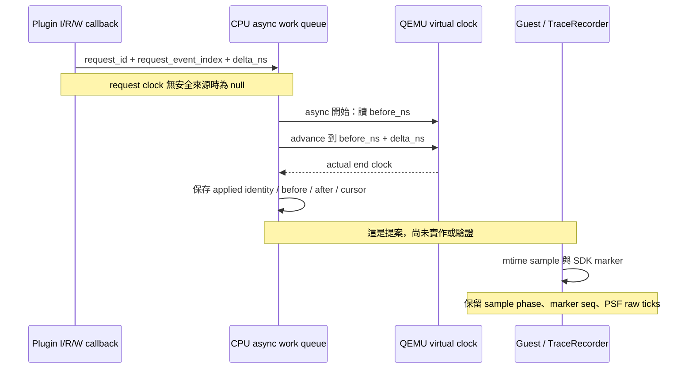

# C2b：QEMU clock 能力盤點

日期：2026-10-23。範圍：**來源研究與唯讀檔案核對**。這次沒有重新編譯、執行 guest 模擬、擷取 trace 或開啟瀏覽器。主流程的 `--version`／hash 與保存PSF重解析見[SDK盤點](c2b-sdk-anchor-capabilities.md)。C2b 的新 API、anchor schema 與時間映射都尚未實作。

2026-10-25決策更新：使用者已選A，修改POC app／port加SDK markers；[具體書面規格](../design/c2b-clock-anchor-pilot-v1.md)完成待審閱。以下能力表保留來源盤點邊界，不代表新callback已經runtime通過。

**主要結論：現有 QEMU 9.2／API 4 沒有 public virtual-clock getter。不能在任意 instruction callback 加上 `qemu_clock_get_ns()` 就當成安全、精確的逐事件時間。** 固定 icount 有讀鐘上下文限制，TB 的計數又是預先扣整塊。第一輪較可控的方案，是在既有 async cost 生效點記錄 clock before／after，搭配原始 event index 與 guest／SDK marker 的有界觀測；沒有證據的 request clock 保留 `null`。

## 1. 這次核對哪一套 QEMU

| 來源 | 這次確認 | 適用邊界 |
|---|---|---|
| [來源快照 manifest](../../references/qemu-time-control/SOURCE.json) | QEMU `v9.2.0`，revision `ae35f033b874c627d81d51070187fbf55f0bf1a7` | 固定版本的 upstream 來源；不是已建置的 binary |
| [隔離建置腳本](../../tools/qemu/build-clock-probe.sh) | tarball SHA `f859f0bc65e1f533d040bbe8c92bcfecee5af2c921a6687c652fb44d089bd894`；依序套用 0001／0002／0003 | 可重建研究版；本輪未執行腳本 |
| `.tools/qemu-time-control/qemu-9.2.0/` | 本機完整來源存在，`VERSION` 為 `9.2.0`，含三份研究 patch | ignored 的本機檔案；不能假定新 checkout 已有 |
| `.tools/qemu-time-control/qemu-system-riscv32-relative` | 本輪唯讀 SHA-256：`69969c3ec8cce8f9340215fc340c5c01f81c3ef978252d3766937d2d176816db`；15,051,168 bytes | 檔案存在與 hash，不等於新 C2b runtime 驗收 |
| [一般 toolchain lock](../../tools/toolchain-lock.json) | Homebrew QEMU 項目記錄 `11.1.2` | 不能以這項 lock 取代相對成本研究版的身份核對 |
| [context runner](../../src/psf_lab/context_capture.py) | 第140–143行固定選研究 binary，並比對來源 runset 的 `qemu_sha256` | 本輪應沿用版本拒絕機制；不可默默換系統 QEMU |

本輪用系統 `curl` 從上述固定 revision 重取三份官方檔案，逐 byte 與保存快照比較；三份皆相同，也符合 manifest：

| 檔案 | SHA-256 |
|---|---|
| `plugins/api.c` | `f63fa30a077e47263e47c28bb609f843e8dd61420a7c31113d3cb3b58bd6a2da` |
| `include/qemu/qemu-plugin.h` | `e4c5bf7e92075d7c1e6b1dcb6164bca6c549b2912a62b56ce1a777be4c7b8788` |
| `accel/tcg/icount-common.c` | `d72c1515b7e098c2651caada5106d091b55ba8ee5ec4e23ae1f02167a2bcf2a5` |

以下行號指保存的未刪空行原始檔，與網頁文字轉換器的行號可能不同。線上來源以固定 revision 為準。

## 2. API 能力與不能推論的事情

| 能力 | Upstream／POC | 來源與語意 | C2b 判定 |
|---|---|---|---|
| plugin API 4 | upstream | [header](../../references/qemu-time-control/include/qemu/qemu-plugin.h) 第62–70行定義版本；編譯／載入須匹配 | 可沿用固定 header；新版官方文件出現的 API 不自動適用本機9.2 |
| request time control | upstream | 同 header 第705–714行；[api.c](../../references/qemu-time-control/plugins/api.c) 第651–662行：第一個取得 handle，後續要求失敗；system mode 加 migration blocker | handle 是修改時間的授權，不是 clock 值或讀鐘介面 |
| `qemu_plugin_update_ns` | upstream | 同 header 第717–729行；api.c 第665–682行：指定絕對 ns 目標，透過 `async_run_on_cpu` 生效 | 回傳不代表已套用；不能用函式呼叫時間當 applied time |
| public virtual-clock getter | 此固定 header 無此 API | 逐項檢查 header；public API 不包含 `qemu_clock_get_ns` | 標 `unavailable`；不能直接依賴未公開內部 symbol |
| `qemu_plugin_poc_add_ns` | **POC patch** | [0003](../../tools/qemu/0003-experimental-relative-clock-cost.patch) 第23–48行：async work 執行時讀 virtual clock，再加 delta | 可延伸 applied 證據；目前沒有 request id、event index、clock receipt 或 completion callback |
| register list／read | upstream | header 第885–931行：init callback 列出當前 vCPU 可用暫存器；讀 register 須 `QEMU_PLUGIN_CB_R_REGS` | 可讀取哪些 CSR 仍取決於實際描述與 context；有名稱不等於讀 time CSR 安全 |
| debug virtual memory read | upstream | header 第897–916行警告不保證 pending writes 已 flush；api.c 第563–580行走 `cpu_memory_rw_debug` | 可考慮讀明確已完成的 RAM marker；不當成任意 MMIO clock getter |
| 記錄成功 memory access 的值 | 既有 API4 callback 只給 meminfo／地址 | [live_cache.c](../../tools/tcp/live_cache.c) 第60–79行只記錄位址／操作／成本，沒有載入值 | 不可從目前 CSV 還原 mtime load value；若借用目的暫存器，須處理完成 phase 與例外 |

官方固定版本：[plugin header](https://github.com/qemu/qemu/blob/ae35f033b874c627d81d51070187fbf55f0bf1a7/include/qemu/qemu-plugin.h)、[plugin implementation](https://github.com/qemu/qemu/blob/ae35f033b874c627d81d51070187fbf55f0bf1a7/plugins/api.c)。本段是來源能力表，沒有宣稱新 C2b 呼叫路徑已通過 runtime。

## 3. 兩個不能繞過的 icount 限制

### 3.1 普通 instruction callback 不保證可以讀 virtual clock

保存的 [icount-common.c](../../references/qemu-time-control/accel/tcg/icount-common.c) 第105–115行檢查：當 `current_cpu` 正在 running，且 `cpu->neg.can_do_io` 為 false，讀 icount 會報 `Bad icount read` 並 `exit(1)`。`qemu_clock_get_ns(QEMU_CLOCK_VIRTUAL)` 經 [qemu-timer.c](../../references/qemu-time-control/util/qemu-timer.c) 第623–634行呼叫 accelerator 的 virtual clock；固定 icount 使用 icount getter。這是必須保留的執行上下文限制。[官方 icount 實作](https://github.com/qemu/qemu/blob/ae35f033b874c627d81d51070187fbf55f0bf1a7/accel/tcg/icount-common.c)

**不能採取的捷徑：**新增 exported wrapper 後，在每個 I／R／W callback 直接讀同一 getter；或將 `QEMU_PLUGIN_CB_R_REGS` 當成允許任意 I/O／clock 的旗標。該旗標處理 register state，可在本機 `plugins/core.c` 第370–391行看到 helper flags，沒有給出 `can_do_io` 保證。本輪沒有實際觸發該錯誤；這是來源可見的 failure path。

### 3.2 icount counter 也不是任意點的逐指令完成時間

本機完整來源 `accel/tcg/translator.c` 第42–96行在 TB 開頭產生 counter 減法，待翻譯結束才把整個 TB 的 `num_insns` 填入。因而不能只移除 guard、讀內部 counter，就將數字當成 instruction retirement clock。若需要逐指令精度，還要處理 TB 前扣、fault／rollback、I/O boundary 與 callback phase；那是另一項 TCG instrumentation 設計。[官方 translator 實作](https://github.com/qemu/qemu/blob/ae35f033b874c627d81d51070187fbf55f0bf1a7/accel/tcg/translator.c)

此外，官方9.2文件定義 instruction callback 在指令執行**之前**；成功 memory callback 在 load／store 完成**之後**。目前 `live_cache.c` 第50–57行的 `context_after_instruction()` 仍是在 instruction callback 裡、`charge(I)` 之後呼叫，不能拿這個函式名稱或既有 `phase="after"` 當 retirement 證據。C2b 應保留既有資料，另用明確 phase 描述「after-I-row／before-guest-insn」。[固定版本 callback 語意](https://github.com/qemu/qemu/blob/ae35f033b874c627d81d51070187fbf55f0bf1a7/docs/devel/tcg-plugins.rst)

## 4. Clock domains、timer 與 MMIO

| domain／事件 | 已確認來源 | 對齊時必須保留 |
|---|---|---|
| QEMU virtual ns | `qemu_clock_get_ns(QEMU_CLOCK_VIRTUAL)`；既有成本 patch 在 async work 中讀取 | 不能混用 host monotonic／wall clock；request 與 applied 分開 |
| ACLINT mtime | 本機 `hw/intc/riscv_aclint.c` 第42–51行：virtual ns 以 timebase 換算後，加 `time_delta` | 須確認 frequency 與 offset；不能預設 mtime 永遠等於 virtual ns／100 |
| mtime write | 同檔第209–224行會改 `time_delta` | 需排除或記錄 counter reset／offset 改變；capture 之外的寫入也影響起點 |
| time／timeh CSR | 本機 `target/riscv/csr.c` 第1252–1274行經 `env->rdtime_fn`，virtual mode 可能另加 `htimedelta` | 不直接等於 CPU cycles；透過 GDB register API 讀取也可能走 virtual-clock 路徑，沒有繞過 icount guard 的保證 |
| PSF hardware counter | [recorder_port.h](../../firmware/port/recorder_port.h) 第10–14行取 `poc_mtime()` 低32bits，10,000,000 Hz | 100 ns 量化、32bit wrap、origin、sequence gaps；100 ns 不是整體對齊誤差上限 |
| guest 64bit mtime read | [clock.c](../../firmware/port/clock.c) 第2–6行使用 high／low／high 重讀 | 三次 MMIO 有不同 instruction／memory phase；成功取得值的時間不能假裝是 marker 入口時間 |
| mtime／mtimecmp bypass | [live_cache.c](../../tools/tcp/live_cache.c) 第67–74行只允許四個32bit timer位址，輸出stderr後略過 cache charge | 不在 raw index 序列新增列；新 sidecar 應明列 MMIO seq／phase／對應 index，不可悄悄改舊 I/R/W schema |

ACLINT／CSR 來源：[固定 ACLINT](https://github.com/qemu/qemu/blob/ae35f033b874c627d81d51070187fbf55f0bf1a7/hw/intc/riscv_aclint.c)、[固定 CSR](https://github.com/qemu/qemu/blob/ae35f033b874c627d81d51070187fbf55f0bf1a7/target/riscv/csr.c)。本段的 clock 關係來自 source；這次未量測新 anchors 的 offset 或 error。

### 4.1 已證明的換算與尚未證明的 epoch

固定 `virt` 的 TCG 路徑在本機 `hw/riscv/virt.c` 第1533–1542行建立 SiFive CLINT，傳入 `RISCV_ACLINT_DEFAULT_TIMEBASE_FREQ`；`include/hw/intc/riscv_aclint.h` 第78行定義為10,000,000 Hz；同一常數也在 `virt.c` 第739–743行放入 DTB。這是 source 可確認的 timebase，不是任意板子的共通值。[官方 board](https://github.com/qemu/qemu/blob/ae35f033b874c627d81d51070187fbf55f0bf1a7/hw/riscv/virt.c)、[官方 timer constants](https://github.com/qemu/qemu/blob/ae35f033b874c627d81d51070187fbf55f0bf1a7/include/hw/intc/riscv_aclint.h)

在這個 frequency 下，MMIO mtime 的關係是：

```text
mtime64 = (floor(virtual_ns / 100) + time_delta) mod 2^64
PSF_raw = low32(mtime64)
```

`time_delta` 是 device 的 `uint64_t` offset，不能未經 schema 定義就當 signed ns。`riscv_aclint_mtimer_reset_enter()` 在本機來源第304–317行透過寫 MTIME=0 重設 clock；寫入邏輯按「新 mtime − 當前 raw clock」調整 offset。因此 reset 時的 virtual clock、之後的 MTIME writes 都影響 epoch；**本輪未證明實際 capture 的 `time_delta==0`**。clock frequency 的 source 證據無法取代 epoch／reset 的 runtime 證據。

只有在 offset 與 unwrap 已證明時，某個 mtime sample 才能反推對應的100 ns量化區間；marker入口／SDK寫事件與該sample之間的指令、IRQ與async work仍需另列 bracket。若 offset 未知，保留其未知或可證明的範圍；不能只把 `PSF_raw × 100` 疊到 QEMU ns 原點。

## 5. Request 與 applied 需要不同證據

現有 relative API 是非同步佇列，會在 work 真正執行時才取 `now`。固定版本 `cpu-common.c` 第169–178行建立 work item；第349–385行逐筆處理。原始 `delta` 不是 callback 當下的 stall 長度；現有 API 也沒有回報 `qemu_clock_advance_virtual_time()` 的返回 clock。[官方 CPU work queue](https://github.com/qemu/qemu/blob/ae35f033b874c627d81d51070187fbf55f0bf1a7/cpu-common.c)

### 5.1 Applied clock 的 source 安全前提

目前 single-thread TCG 的正常路徑可逐步追到以下位置。行號使用本機完整9.2來源：

1. `accel/tcg/tcg-accel-ops.c:73–80`：`tcg_cpu_exec()` 包住 `cpu_exec_start()`／`cpu_exec()`／`cpu_exec_end()`。
2. `cpu-common.c:250–252,290–292`：start 設 `cpu->running=true`；end 改回 false。
3. `accel/tcg/tcg-accel-ops-rr.c:257–265,301`：執行 guest 時釋放 BQL，回來處理 icount 後重新取得 BQL，再進 `rr_wait_io_event()`。
4. 同檔第108–120行呼叫 `qemu_wait_io_event_common()`；`system/cpus.c:444–450` 再進 `process_queued_cpu_work()`。
5. `cpu-common.c:349–376` 在非 exclusive work 路徑直接呼叫 queued function；0003 使用這種 work item。

因此 source 支持把讀鐘放在既有 **async applied callback、guest cpu_exec 已返回且 BQL 已持有**的位置；此時 `running=false` 可避開前述 running／can_do_io 分支。這個依據只涵蓋已固定的 single-vCPU、single-thread TCG、precise icount 路徑。[官方 single-thread TCG loop](https://github.com/qemu/qemu/blob/ae35f033b874c627d81d51070187fbf55f0bf1a7/accel/tcg/tcg-accel-ops-rr.c)

新 patch 應在讀鐘前檢查 CPU identity、`running=false`、BQL 與 precise icount，記錄實際 before／after／返回 clock；舊 setter 的 guard 是防線，不能拿來替代新API的runtime收據。本輪沒有跑新 callback；舊 nano accumulation 成功也只證明舊路徑，不證明新 logging 的 ordering、檔案失敗處理或 observer overhead。



建議新 schema 至少能分辨 request index 與 applied 時點的 raw cursor；只把 request index 複製到 applied 記錄，不代表成本在該事件立即生效。每筆需有 run identity、request id、phase、CPU／hart、clock domain、raw counter／width／frequency、delta、actual before／after、quality。格式與欄位仍須經主設計決定。

未完成／重複／重排／缺口、未知頻率、非單調 clock、溢位與 clock-domain 不符應拒絕建立映射；不能補 timestamp、插值，或按 timestamp 重排原始事件。若使用 sparse anchors，兩 anchor 之間只能提供有證據的區間／未知狀態，不自動得到每一列的精確 ns。

## 6. 三個方案與建議順序

| 方案 | 可回答的問題 | 修改與代價 | 目前判定 |
|---|---|---|---|
| 方案1：guest／SDK marker brackets；plugin 只觀測已完成的 RAM marker 或明確 next-instruction phase | event sequence 與 PSF counter 在 marker 附近的有界關係 | guest 有量測指令與 recorder 成本；RAM read ordering／marker ABI須驗證；看不到全部 async applied 證據 | 可作保守前導；不能宣稱已完成 request/applied 全鏈 |
| **方案2：延伸既有 async relative-cost patch，加 applied before／after receipt，搭配 guest／SDK marker** | 成本何時被套用、排隊順序、哪些 interval 能與 PSF bracket 對照 | 需新隔離 binary 與 patch、request／cursor 身份、observer off/on、log I/O overhead／失敗處理；request clock 可為null | **建議第一輪完整 C2b pilot 的候選**，仍須設計與runtime證據 |
| 方案3：每 instruction 的 TCG clock instrumentation | 更密集事件 clock／retirement 語意 | 必須處理TB預扣、例外、I/O、timers、async ordering；SMP更複雜，資料量最大 | 本輪不先採；不以小 getter wrapper 取代這項研究 |

推薦方案2是 Codex 根據來源限制提出的設計建議，不是 QEMU 官方功能承諾，也不是已完成實作。不能在這個階段自行指定 marker 每幾筆、capture 重複次數或誤差通過門檻。

## 7. 可沿用的舊證據與新的驗收缺口

| 證據 | 已涵蓋 | 沒有涵蓋 |
|---|---|---|
| [clock-nano completion](../../artifacts/verification/clock-nano/completion.json) | 歷史18個 nano runs、6個 edges runs；relative accumulation 通過 | 明載 `per_memory_instruction_stall_verified=false`；沒有本輪 request/applied sidecar |
| [context completion](../../artifacts/verification/cost-attribution/context/completion.json) | 保存資料的 context reports 與 task／IRQ 歸屬 | 不是 PSF timestamp 與每列 raw event 的 simultaneity 證據 |
| [C2a release](../../artifacts/verification/event-window/release-20261023/README.md) | 40-run、8HTML、精確 event-index 統計與原資料守恆 | 沒有 clock anchors；不能 retroactively 生成缺少的時間 |
| 本輪來源／hash核對 | API、patch、guard、phase與counter關係 | 未執行 guest 模擬；沒有新的 overhead、clock error 或binary correctness測量 |

目前 runner 的已定範圍為 [runner.py](../../src/psf_lab/runner.py) 第25–48行：`virt`／`rv32`／`-smp 1`／single-thread TCG／`-icount shift=0,align=off,sleep=off`。0001 setter 額外拒絕非 precise icount、多CPU、running CPU／負 clock；0003還限制delta在signed-ns範圍。本輪不外推到 SMP、adaptive icount、migration、record/replay 或實機 PMU。

主計畫還須決定：首輪技術方案、允許 guest marker 與 QEMU patch 的修改範圍、observer off/on 的測量方式、pilot 重複次數、acceptable bracket／error、容量與 overhead 門檻。頻率已知不等於誤差預算已定；先保留失敗與 unknown，再依量測做決策。
