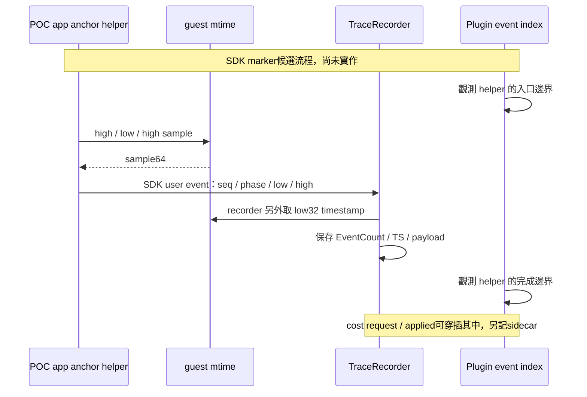

# C2b：SDK anchors、PSF clock 與首輪實驗邊界

更新：2026-10-23。**能力盤點完成；修改範圍 A／B 等待使用者選擇。這是研究紀錄，尚不是已核准的實作規格。** 本輪只讀來源、核對 binary 身分及重新解析兩份保存的 PSF；沒有重新 build、執行 guest、產生新 capture 或開瀏覽器。

## 先看結論

1. 現有研究版 QEMU 9.2 仍在，SHA 與 A02 baseline／pbuf 的原 manifest 相符，可在明確版本上接續研究。
2. 本 POC 的 recorder 使用 application-defined `mtime` 低 32 bits，10 MHz。重新解析兩份 A02 保存 PSF，也得到相同頻率、4-byte word、單核心 FreeRTOS 平台。
3. SDK 已提供 `xTracePrintF4`，候選 anchor 可使用現有 user-event 格式，不必先修改 FreeRTOS kernel 或 SDK 原始碼。
4. 原始 clock sample 與 PSF event 自己的 timestamp 是兩次取樣，不能視為同時發生。QEMU 成本 request／applied 又是不同 phase。
5. 任意 instruction callback 沒有已證明安全的 virtual-clock getter；第一輪應保留 request clock 的 `null`，驗證 applied-clock 與 guest／SDK marker brackets。完整 QEMU 來源、限制與方案見[獨立盤點](c2b-qemu-clock-capabilities.md)。

## 這輪實際做了什麼

| 項目 | 已確認結果 | 證據／限制 |
|---|---|---|
| 研究 binary | QEMU 9.2.0，SHA `69969c3ec8cce8f9340215fc340c5c01f81c3ef978252d3766937d2d176816db` | 只執行 `--version` 與讀檔 hash；不等於新 patch 已通過 runtime |
| 既有 A02 身分 | baseline／pbuf 原 manifest 的 QEMU SHA 都與現檔一致 | [source-audit.json](../../artifacts/verification/clock-anchor/planning-20261023/source-audit.json) |
| 保存 PSF 重解析 | 兩份各 24 events、10 MHz、origin 2295、4-byte word、1 core；quality valid、issues 為空 | [existing-psf-clocks.json](../../artifacts/verification/clock-anchor/planning-20261023/existing-psf-clocks.json)；`capture_complete` 仍是 `null`，不能補成完整性保證 |
| 執行環境 | `virt`／`rv32`／`-smp 1`／single-thread TCG／fixed icount shift 0 | [runner.py](../../src/psf_lab/runner.py)；保留在 source-audit，沒有外推 SMP／實機 |
| 第一次 parser probe | system Python 無法 import `psf_lab`；改用專案 `.venv` 與 `PYTHONPATH=src` 成功 | [失敗紀錄](../../artifacts/verification/clock-anchor/planning-20261023/system-python-probe-failed.txt)；沒有更動套件或來源 |

[source-audit.json](../../artifacts/verification/clock-anchor/planning-20261023/source-audit.json) 保存本輪 parent commit、14 份來源 hash、實際 QEMU flags、binary versions／hash、舊 runset 身分；這些是 provenance，不是新 C2b 驗收。

[固定revision的官方來源重取收據](../../artifacts/verification/clock-anchor/planning-20261023/upstream-source-check.json)確認3份QEMU檔案與保存快照逐byte相符。Python urllib曾因本機issuer certificate缺失失敗，改用system curl的正常TLS驗證取得相同來源；[失敗紀錄](../../artifacts/verification/clock-anchor/planning-20261023/urllib-source-probe-failed.txt)亦保留，沒有停用憑證驗證或改信任庫。

## SDK 如何嵌入既有 FreeRTOS

目前 [FreeRTOSConfig.h](../../firmware/config/FreeRTOSConfig.h) 第15行啟用 trace facility，第41行 include `trcRecorder.h`；[Makefile](../../firmware/Makefile) 連結 SDK、FreeRTOS kernel port 與本地 app／port。本 POC 的 [trcConfig.h](../../firmware/config/trcConfig.h) 第45行選 application-defined hardware port，第91行啟用 user events。

本輪候選設計是新增 POC app／port helper，呼叫 SDK 現有 API；SDK 與 kernel 的原始碼可以保持原樣。**是否採用這個修改範圍，仍等待 A／B 選擇。** 這不表示任意公司版本都能直接相容，內網仍須比對當地 FreeRTOS／SDK／port。

### 可使用的 API

| API／設定 | 來源與用途 | C2b 注意事項 |
|---|---|---|
| `xTraceStringRegister` | [現有初始化](../../firmware/app/main.c) 第12–17行已使用 | 候選 channel／format 可在 capture 之前註冊；註冊資料也佔 PSF 空間 |
| `xTracePrintF4` | [trcPrint.h](../../references/baseline/percepio/TraceRecorder/include/trcPrint.h) 第268–290行；4個參數，使用已註冊 channel／format | 可提出 sequence、phase、clock low／high；尚未編譯或跑過新 helper |
| `xTraceEventCreate6` | 同一 macro 展開；[trcEvent.c](../../references/baseline/percepio/TraceRecorder/trcEvent.c) 第262–275行 | 2個 handle 加4個參數；timestamp 由 recorder 自己取得 |
| `xTraceTimestampGet` | [trcTimestamp.h](../../references/baseline/percepio/TraceRecorder/include/trcTimestamp.h) 第147–156行 | 本配置關閉 trace assertions，使用 macro；不可只 hook 同名 C 函式便假定攔到每筆 event |
| `TRC_HWTC_COUNT` | [recorder_port.h](../../firmware/port/recorder_port.h) 第10–14行 | `poc_mtime()` 低32bits，10 MHz；頻率不能拿 CPU 500 MHz 代入 |

官方 API 導覽：[Percepio trcPrint.h](https://github.com/percepio/TraceRecorderSource/blob/main/include/trcPrint.h)；timer macro 說明：[官方 Integration Guide，2.1.1](https://percepio.com/TracealyzerSDK/TraceRecorder_Integration_Guide.pdf)。線上 `main` 會變動，這輪實作依據以已保存的 SDK 4.12.0 檔案與 hash 為準，不把網站索引版本當本地版本。

### 一筆候選 marker 佔多少 bytes

本地 [trcTypes.h](../../references/baseline/percepio/TraceRecorder/include/trcTypes.h) 預設 base word 為32bits；實際兩份 PSF 也驗得4-byte word。[TraceEvent6_t](../../references/baseline/percepio/TraceRecorder/include/trcEvent.h) 第94–99行包含 `EventID` 2 bytes、`EventCount` 2 bytes、`TS` 4 bytes、6個 base words。

因此 **`xTracePrintF4` 的單筆 event 格式推導為 `8 + 6 × 4 = 32 bytes`**。這是來源推導，尚未用新 ELF 實測 trace 增量；不包含 channel／format 註冊、其他 scheduler events、buffer 或傳輸封裝。若共 N 筆 marker，這部分是 `32 × N`，CPU instructions、cache 汙染、IRQ 關閉時間與整體 trace 增量必須另外量測。

## 取樣順序：不能把三個位置合併

[clock.c](../../firmware/port/clock.c) 第2–6行用 high／low／high 重讀取得64-bit `mtime`；[trcEvent.c](../../references/baseline/percepio/TraceRecorder/trcEvent.c) 第64–100行在 critical section 配置 event、設定序號並另外取得 timestamp。若 app 先讀 clock，再送 user event，payload sample 與 event timestamp 之間仍有指令與可能的搶占。

上圖只表達SDK的兩次取樣；cost request／applied可與這些步驟穿插，甚至在helper返回後才生效，須讀QEMU sidecar的實際cursor。完成邊界須依實際 ABI、ELF 與 callback phase 驗證；不能把現有 `context_after_instruction()` 當成 instruction retirement。現有 `poc_mark` 還會呼叫 oracle、格式化字串，不能未量測就宣稱它是低成本、精準同步點。

## 時間映射應保留什麼

| 資料 | 原樣保存 | 不應代替成什麼 |
|---|---|---|
| Raw access | I／R／W順序、event index、PC、context | 不自創每列 ns timestamp |
| Cost request | request id、request event index、delta、phase；clock 無安全來源時 `null` | 不將 request index 複製成「同時生效」證據 |
| Applied | 同一 request id、實際 raw cursor、clock before／after、domain | 不把 virtual clock advance 當實機 instruction stall |
| Guest marker | marker sequence、sample64、sample method、入口／完成 index bracket | 不拿 marker 函式入口當 clock sample 時刻 |
| PSF | 原 timestamp32、EventCount16、payload、origin、gap／wrap／quality | 不依 timestamp 排序，不丟棄相同 ticks |

10 MHz 對應100 ns量化；32-bit counter約429.497秒繞回。現有 parser 還會對大於半個counter範圍的相鄰 delta 標記 ambiguous；不能只照 modulo 解成連續時間。[semantic.py](../../src/psf_lab/parser/semantic.py) 第91–120行。

QEMU 的 `mtime` 還有 device `time_delta`／epoch，不能先假定為零。缺 offset、anchor、序號連續性或可靠 phase 時，對齊狀態須是 `unavailable`／有界區間，而不是產生一個看似精確的點。兩個 sparse anchors 中間不做線性插值；有證據時只給包含範圍，沒有證據就維持 unknown。

## 後續分段與正在等的選擇

| 階段 | 可審閱產物 | 目前狀態 |
|---|---|---|
| 能力盤點 | 來源表、clock domains、binary／PSF provenance | 本文件與QEMU盤點已完成；尚無新 capture |
| Pilot 規格 | anchor schema、phase、版本與可修改範圍、對照矩陣、拒絕條件 | 等使用者選 A／B，之後寫成具體規格供審閱 |
| 最小新 capture | 獨立 output、新 patch／binary、request／applied／marker／PSF 全鏈原始資料 | 未實作 |
| 誤差與 observer 驗證 | 排隊延遲／bracket寬度／未知比例、封包與應用結果、host overhead／guest變化分開 | 次數與通過門檻尚未決定；既有200 ns整窗條件不可直接搬用 |
| Web 與單檔 HTML | 共用已驗證資料，顯示 bounds／unknown，再做篩選與CSV、E2E截圖 | 等 pilot 證據；沿用一次一個 Chrome、結束 close |

**待選 A：**POC app／port 用現有 SDK 加少量 markers，配合獨立 QEMU request／applied patch；FreeRTOS kernel、SDK原始碼保持原樣。較容易把 PSF 和明確 marker 身分配對，但要量測 observer 與 marker 的擾動。

**待選 B：**guest ELF完全不變，先做QEMU側錄。可降低 guest 變動；既有 trace 缺少 marker 配對時保留 unknown，無法保證完成相同程度的 PSF 對齊。

這兩個選項都先做 pilot 與誤差報告；沒有將全量40-run重跑或Dashboard聯動視為已完成。原實機PMU／SDK CPU loading／UART量測、知識庫增補與跨機暫緩決策，仍依既有待辦處理。
